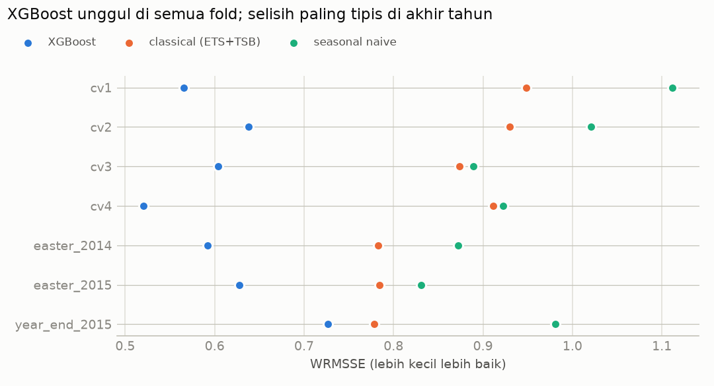
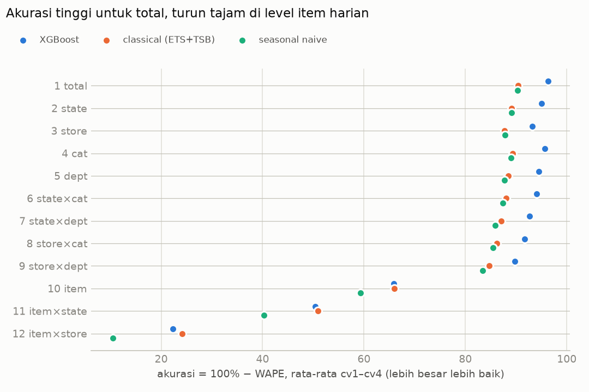
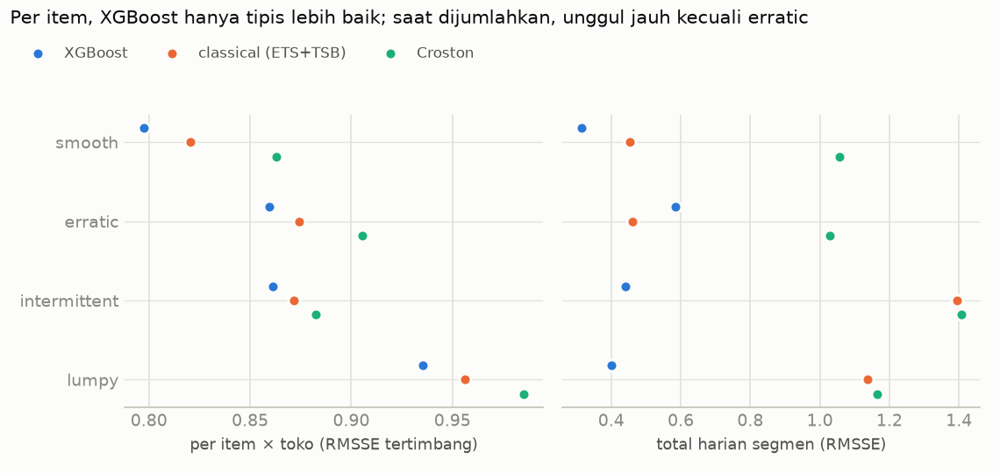
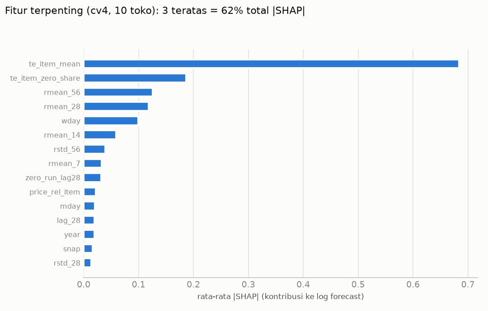
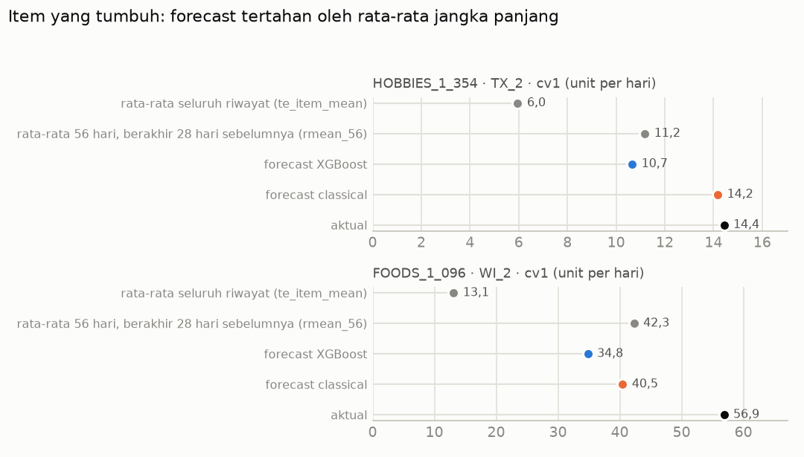
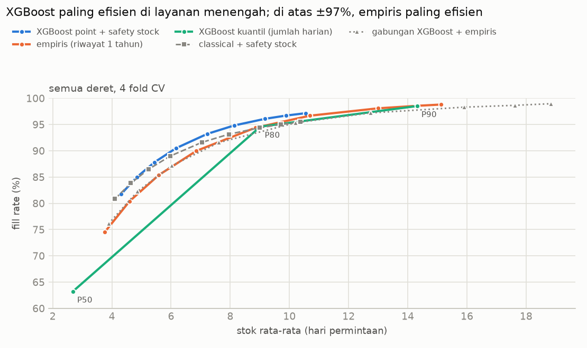
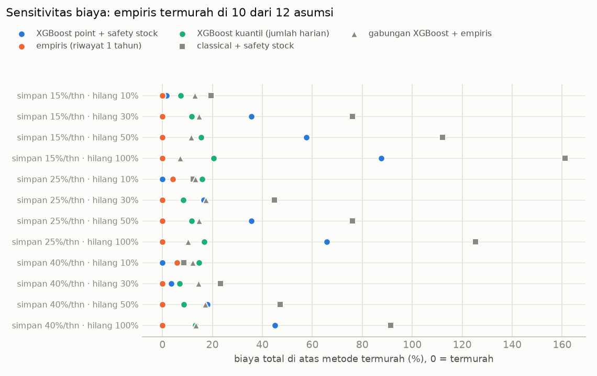
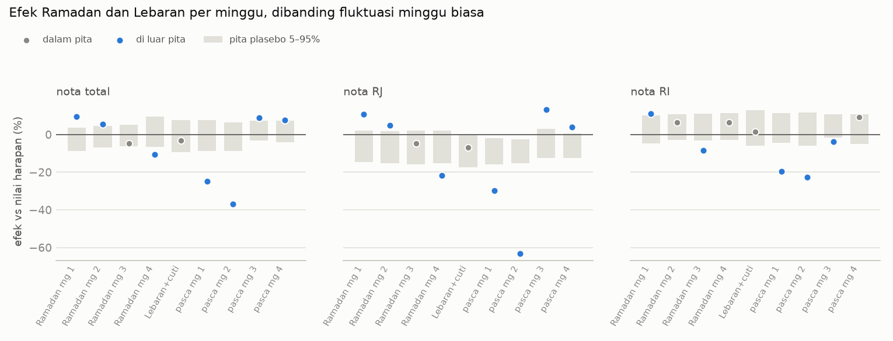
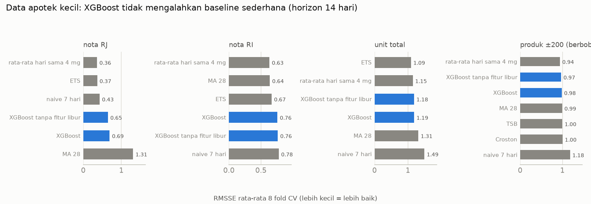

# Demand Forecasting Retail: M5 Walmart >> Indonesia

Proyek ini berawal dari satu pertanyaan sederhana: kalau penjualan harian setiap produk di setiap
toko diramal dengan XGBoost, seberapa akurat hasilnya, di bagian mana modelnya gagal, dan apakah
ramalan yang lebih akurat benar-benar membuat keputusan stok lebih murah?

Saya memakai data kompetisi M5 dari Walmart (30.490 kombinasi produk-toko, 1.941 hari). Setelah
itu, metode yang sama saya coba di data penjualan sebuah apotek di Indonesia, untuk melihat
efek Ramadan dan Lebaran.

Saya sengaja tidak berhenti di skor WRMSSE. Notebook M5 di Kaggle sudah ribuan, jadi yang ingin
saya tunjukkan di sini adalah prosesnya: backtest yang jujur, analisis error per segmen, dan
simulasi stok yang menghubungkan forecast dengan biaya.

**Status:** Fase 0–8 selesai. Holdout M5 (25 Apr–22 Mei 2016) sengaja **belum dipakai sama
sekali**. Tuning parameter pohon dan eksperimen fitur terakhir sudah selesai, dan keduanya tidak
mengubah model, jadi model M5 sekarang sudah final.
Holdout baru dibuka sekali di akhir proyek, supaya ada satu angka akhir yang benar-benar tidak
ikut memengaruhi keputusan saya selama eksperimen.

---

## Ringkasan hasil

- **XGBoost jauh lebih akurat daripada semua baseline.** WRMSSE rata-rata 4 fold **0,582**,
  sedangkan baseline terbaik (ETS + TSB) **0,916**. Error-nya sekitar 36% lebih kecil, dan
  XGBoost menang di ketujuh periode uji.
- **Tetapi keunggulannya ada di level gabungan.** Untuk total penjualan harian 10 toko, akurasinya
  96,4% (baseline 90,4%). Untuk satu produk di satu toko per hari, akurasinya hanya 22,3%, sedikit
  di bawah baseline (24,2%). Penjualan per produk per hari memang sangat acak.
- **Model terlalu bergantung pada rata-rata lama produk.** Dari SHAP, fitur terpentingnya adalah
  rata-rata penjualan item sepanjang riwayat (42%). Akibatnya, produk yang sedang naik daun
  diramal terlalu rendah (−7% sampai −32%), dan produk yang sedang turun terlalu tinggi.
- **Forecast yang lebih akurat tidak otomatis membuat stok lebih murah.** Dalam simulasi stok,
  XGBoost paling efisien untuk target layanan menengah. Tetapi kalau kehabisan stok mahal dan
  targetnya fill rate di atas 98%, metode empiris sederhana dari riwayat 1 tahun justru paling
  murah.
- **Data apotek Indonesia ternyata terlalu pendek untuk menguji fitur Ramadan.** Isinya hanya
  tahun 2015, dan yang lengkap hanya April–Desember, jadi Lebarannya cuma satu. Dari data itu, pekan
  Lebaran sendiri tidak berbeda dari minggu biasa. Penurunan besar baru muncul 1–2 minggu
  sesudahnya: jumlah nota turun 25% lalu 37%.
- **Di data sekecil itu, XGBoost kalah dari cara sederhana.** Untuk ramalan 14 hari, rata-rata
  hari yang sama dari 4 minggu terakhir dan ETS lebih akurat daripada XGBoost.

---

## Data

**M5 (Walmart)**

| | |
|---|---|
| Sumber | [M5 Forecasting – Accuracy](https://www.kaggle.com/competitions/m5-forecasting-accuracy/data), Kaggle |
| Isi | 3.049 produk, 10 toko (CA, TX, WI), 3 kategori, 7 departemen |
| Periode | 29 Jan 2011 – 22 Mei 2016 (d_1 – d_1941) |
| Ukuran | 59,2 juta baris setelah diubah ke format panjang; 46,8 juta setelah membuang hari sebelum produk pertama kali dijual |

Data tidak disertakan di repo ini. Untuk mengunduhnya, perlu akun Kaggle dan persetujuan aturan
kompetisi. Checksum file dan hasil pengecekan skemanya ada di [`data/SOURCES.md`](data/SOURCES.md).

Beberapa hal yang saya temukan saat EDA dan ikut menentukan desain model:

- 59,6% hari produk-toko bernilai nol.
- 25 Desember praktis tutup, walaupun penjualannya tidak persis nol.
- Efek SNAP (bantuan pangan) jelas terlihat di kategori FOODS.
- 62% produk laris pernah tidak terjual ≥ 28 hari berturut-turut. Kemungkinan besar ini stok habis,
  bukan karena tidak ada pembeli.

**Apotek Indonesia**

| | |
|---|---|
| Sumber | Gustriansyah, R. (2022). [Retail sales dataset of a pharmacy in Indonesia](https://data.mendeley.com/datasets/2ym7v78wtd/1). Mendeley Data, DOI `10.17632/2ym7v78wtd.1`, lisensi CC BY 4.0 |
| Isi | Dump database MariaDB: header nota, detail nota, master produk (6.878 produk) |
| Periode | 1 Jan – 31 Des 2015. Yang lengkap hanya 1 Apr – 31 Des (275 hari) |
| Ukuran | 514.620 baris detail nota, 127.064 nota |

Datanya saya unduh lewat API publik Mendeley, dan checksum-nya cocok dengan yang tercatat di
sana. Hal-hal yang saya temukan saat audit:

- Header nota Januari–Maret sebagian besar hilang (42–68% nota tidak punya tanggal), jadi tiga
  bulan pertama tidak saya pakai.
- Datanya berisi nomor resep, kode dokter, dan penjamin Askes, dan hampir tidak ada pembeli umum.
  Kemungkinan besar ini apotek rumah sakit atau klinik, bukan apotek ritel.
- Nomor nota diawali kode RJ, RI, dan beberapa kode lain. Artinya tidak dijelaskan di dataset.
  Dugaan saya, RJ adalah rawat jalan dan RI rawat inap, tetapi itu belum pasti.
- Nota RJ hampir nol setiap Minggu **dan** Senin, sedangkan RI stabil sepanjang minggu.
  Penyebabnya tidak saya ketahui.
- Kolom kode pasien dan dokter hanya saya pakai untuk menghitung agregat, dan tidak pernah
  ditampilkan.

Tanggal libur 2015 saya ambil dari sumber resmi, bukan dari ingatan: SKB 3 Menteri (lewat
Setkab), SKB perubahan 310/2014, Keppres 25/2015 untuk Pilkada, dan pengumuman sidang isbat untuk
awal Ramadan (18 Juni) dan Idulfitri (17 Juli). Hasilnya ada di
[`data/external/id_calendar.csv`](data/external/id_calendar.csv), dengan sumber di setiap baris.

---

## Cara saya menguji

Satu holdout saja menurut saya tidak cukup, karena hasilnya bisa kebetulan bagus di satu periode.
Jadi saya memakai **4 fold rolling origin**. Setiap fold meramal 28 hari ke depan:

| Fold | Periode yang diramal |
|---|---|
| cv1 | 4–31 Jan 2016 |
| cv2 | 1–28 Feb 2016 |
| cv3 | 29 Feb–27 Mar 2016 |
| cv4 | 28 Mar–24 Apr 2016 |

Ditambah tiga fold khusus (Easter 2014, Easter 2015, dan akhir tahun 2015) yang dilaporkan terpisah.

Aturan yang saya pegang selama proyek:

- Semua fitur hanya memakai data sampai cutoff. Ini dicek dengan tes anti-leakage di beberapa
  cutoff, bukan diasumsikan.
- Early stopping memakai 28 hari terakhir sebelum cutoff, bukan periode yang diramal.
- Setiap eksperimen punya aturan keputusan yang saya tulis **sebelum** melihat hasilnya.
- WRMSSE saya cocokkan dengan bobot resmi M5 untuk ke-42.840 deret (selisih maksimum 2,3e-9)
  sebelum angkanya saya percaya.

---

## Hasil 1: akurasi forecast



| Model | WRMSSE (rata-rata 4 fold ± sd) |
|---|---:|
| **XGBoost** (satu model per toko, objective tweedie) | **0,582 ± 0,051** |
| Classical (ETS untuk deret stabil, TSB untuk deret intermiten) | 0,916 ± 0,032 |
| Seasonal naive (nilai 7 hari lalu) | 0,986 ± 0,101 |
| TSB | 1,100 |
| Moving average 28 hari | 1,103 |
| Croston | 1,128 |

WRMSSE lebih kecil lebih baik. Nilai 1 kira-kira setara dengan menebak "besok sama dengan hari ini".



Grafik ini yang paling menjelaskan karakter model. Di level total, toko, kategori, dan
departemen, XGBoost unggul 5–6 poin. Di level produk, semua model hampir sama, dan sama-sama rendah.

Salah satu keputusan yang paling membantu adalah **mengeluarkan deretan nol panjang dari data
training** (yang kemungkinan besar stok habis), supaya model belajar permintaan, bukan kekosongan
rak. WRMSSE turun dari 0,756 ke 0,690 di eksperimen 2 toko.

Untuk keperluan stok, saya juga melatih model kuantil (P10/P50/P80/P90). P80 dan P90-nya tepat
sasaran: aktual berada di bawah P80 pada 81,0% hari dan di bawah P90 pada 89,4% hari.

---

## Hasil 2: di mana model lemah



Saya mengelompokkan setiap deret dengan skema Syntetos–Boylan (smooth, erratic, intermittent,
lumpy).

- Per produk, XGBoost hanya 1–3% lebih baik daripada baseline terbaik di semua segmen.
- Saat dijumlahkan, error-nya saling menetralkan, sehingga total segmen intermittent dan lumpy
  sekitar 54% lebih akurat.
- **XGBoost tidak lebih baik** untuk total segmen erratic (cenderung terlalu tinggi, bias +9%),
  untuk hari Sabtu–Minggu di level produk, dan di fold Easter 2015 di level produk.



Dari SHAP, model pada dasarnya bekerja sebagai "rata-rata item jangka panjang + penjualan terbaru +
pola hari dalam minggu". Harga hanya menyumbang 3%, dan fitur event (termasuk Easter) hampir tidak
dipakai (0,3%).



Contoh paling jelas: FOODS_1_096 di toko WI_2 sedang laku ±42 per hari, tetapi rata-rata
riwayatnya hanya 13 per hari. XGBoost meramal 35 per hari, sedangkan aktualnya 57. Pola ini
sistematis di seluruh produk yang sedang tumbuh atau turun.

Belakangan saya mencoba memperbaikinya dengan rata-rata item dari 182 atau 365 hari terakhir.
Kalau rata-rata lama diganti versi 365 hari, bias per kelompok memang berkurang (item yang tumbuh
sangat cepat dari −31% ke −26%, item yang turun tajam dari +12% ke +5%). Tetapi akurasi totalnya
malah turun. Ternyata kebiasaan model menarik ramalan ke rata-rata lama sebagian memang benar,
karena produk yang sedang naik atau turun sering kembali ke levelnya. Jadi fiturnya tidak saya
ganti ([`06b`](reports/06b_te_recent_window.md)).

---

## Hasil 3: dampak ke keputusan stok

Ini bagian yang paling ingin saya jawab. Saya mensimulasikan kebijakan stok sederhana:

- stok dicek seminggu sekali, dan pesanan tiba 2 hari kemudian;
- target stok = kuantil permintaan selama 9 hari;
- penjualan yang tidak terlayani dianggap hilang.

M5 tidak punya data biaya, jadi biayanya saya **asumsikan** (simpan 25% per tahun, kehabisan
30% dari harga per unit), lalu saya uji dengan 12 kombinasi lain.



Grafik ini membandingkan fill rate pada jumlah stok yang sama:

- Sampai sekitar 10 hari stok, **forecast XGBoost + safety stock paling efisien**, yaitu 1–3 poin
  fill rate lebih tinggi untuk stok yang sama.
- Di atas fill rate ±97%, **metode empiris** (kuantil penjualan 9 hari dari riwayat 1 tahun)
  paling efisien. Asumsi distribusi normal tidak sanggup menangkap lonjakan penjualan produk yang
  jarang laku.



Karena kehabisan stok jauh lebih mahal daripada menyimpan, kebijakan termurah hampir selalu
mengejar fill rate tinggi. Di wilayah itu, metode empiris termurah di 10 dari 12 asumsi biaya.
XGBoost hanya menang ketika biaya kehabisan stok rendah.

Dua hal lain yang saya pelajari:

- Menjumlahkan kuantil harian bukan cara yang tepat untuk mendapat kuantil total 9 hari. P50-nya
  hanya mencakup 28% periode, sedangkan P90-nya 97%.
- Metode gabungan (level dari XGBoost, bentuk distribusi dari riwayat) yang saya harapkan bisa
  mengambil kelebihan keduanya ternyata lebih mahal di semua asumsi biaya.

---

## Hasil 4: data apotek Indonesia

Rencana awalnya, pipeline M5 dipakai lagi di sini dengan tambahan fitur Ramadan dan Idulfitri.
Syarat yang saya tetapkan sejak awal adalah minimal 2 tahun data dan 2 kali Lebaran. Data ini
hanya punya satu Lebaran, sehingga fitur Ramadan tidak bisa diuji secara jujur: kalau Lebarannya
ada di data latih, tidak ada Lebaran lain untuk menguji; kalau ada di data uji, model belum pernah
melihat Lebaran. Karena itu saya mengerjakan dua hal yang masih bisa dijawab: seberapa besar efek
Lebaran, dan seberapa baik XGBoost di data sekecil ini.


### Efek Ramadan dan Lebaran

Jumlah nota tiap minggu saya bandingkan dengan nilai harapannya, yaitu pola mingguan biasa
dikali level penjualan sebelum dan sesudah periode Ramadan–Lebaran. Masalahnya, dengan satu
Lebaran tidak ada uji statistik biasa yang bisa dipakai. Penggantinya, saya membuat "Ramadan
palsu" di periode biasa (Agustus–Desember) dan menghitung efeknya dengan cara yang sama. Efek
asli baru saya anggap nyata kalau besarnya di luar rentang efek palsu tersebut. Cara menghitung
baseline dan panjang jendelanya juga saya pilih hanya dari periode biasa itu, sebelum efek
Lebaran dihitung.



- Pekan Lebaran (16–21 Juli, termasuk cuti bersama) hanya −3%, masih dalam rentang minggu biasa.
- Dua minggu sesudahnya (22 Juli–4 Agustus), nota turun **25% lalu 37%**. Nota RJ bahkan
  turun 63% di minggu kedua. Hasilnya tetap sama walaupun baseline-nya saya hitung dengan lima
  cara berbeda.
- Setelah itu jumlah nota naik lagi, sekitar 8–9% di atas biasa, selama dua minggu.
- Minggu terakhir Ramadan turun 11%. Kenaikan di awal Ramadan tidak saya simpulkan, karena
  besarnya berubah-ubah tergantung baseline yang dipakai.

Saya tidak bisa memastikan penyebab penurunan sesudah Lebaran itu. Bisa jadi layanan RJ
memang libur setelah Lebaran, bisa juga tanggal di sistem adalah tanggal input, bukan tanggal
pelayanan. Data ini tidak cukup untuk membedakan keduanya.

### Forecast 14 hari

Horizonnya saya pendekkan menjadi 14 hari karena riwayatnya hanya 9 bulan. Pengujiannya memakai
8 fold rolling origin (September–Desember), ditambah dua fold khusus di sekitar Lebaran.
Parameter XGBoost saya tetapkan di awal dan tidak saya tuning, karena datanya terlalu sedikit
untuk tuning sekaligus evaluasi yang jujur.



| Metode | Nota RJ | Nota RI | Unit total | ±200 produk (berbobot) |
|---|---:|---:|---:|---:|
| Rata-rata hari yang sama, 4 minggu terakhir | **0,36** | **0,63** | 1,15 | **0,94** |
| ETS | 0,37 | 0,67 | **1,09** | – |
| XGBoost | 0,69 | 0,76 | 1,19 | 0,98 |
| XGBoost tanpa fitur libur | 0,65 | 0,76 | 1,18 | 0,97 |

Angka di tabel adalah RMSSE rata-rata 8 fold (lebih kecil lebih baik). Dari 24 perbandingan
di level agregat, XGBoost tidak pernah menjadi yang terbaik. Menurut saya ada dua alasannya.
Pertama, data latih per fold hanya ±60–220 hari per deret, padahal di M5 satu toko punya jutaan
baris. Kedua, pola mingguannya sangat kuat dan stabil, sehingga rata-rata hari yang sama sudah
hampir cukup.

Fitur hari libur juga tidak membantu, termasuk di fold yang memuat Lebaran. Ini wajar, karena
hari Lebarannya sendiri memang tidak berbeda. Penurunan sesudah Lebaran tidak tertebak oleh
metode mana pun (semuanya meleset 19–51% terlalu tinggi).

### Dibandingkan dengan Easter di M5

Di M5, efek Easter terkumpul di sekitar hari-H (±3 hari). Di apotek ini, efek Lebaran justru
muncul 5–18 hari sesudahnya. Kalau fitur Easter (jarak ke hari libur, dipotong ±7 hari) dipakai
begitu saja untuk Lebaran, sebagian besar efeknya akan terlewat. Yang bisa dipindahkan dari M5
ke sini adalah metodenya (kalender dari sumber resmi, backtest, baseline yang sama), bukan pola
hari liburnya.

---

## Yang tidak berhasil

Saya catat juga eksperimen yang gagal, karena ini bagian dari hasilnya:

| Percobaan | Hasil |
|---|---|
| `item_id` sebagai fitur kategorikal | Lebih buruk (0,808 vs 0,756), dan model 18× lebih besar |
| Melatih ulang setelah early stopping | Tidak membantu secara konsisten |
| Tweedie power 1,2–1,5, Poisson, squared error | Semua kalah dari tweedie 1,1 |
| Fitur hari libur bergerak (Easter) | Tidak terbukti membantu di level produk, hanya di total FOODS |
| Menaikkan batas iterasi model kuantil dari 1.000 ke 3.000 | Skor validasi membaik, tetapi ramalan sedikit memburuk (+0,07%) |
| Metode stok gabungan XGBoost + empiris | Lebih mahal di 12 dari 12 asumsi biaya |
| Tuning parameter pohon (depth, min_child_weight, sampling, reg_lambda, max_bin, eta) | Hanya `min_child_weight` 200 yang lolos di 2 toko (−0,010). Di 10 toko perbaikannya menyusut jadi −0,003, di bawah batas noise, jadi tidak saya pakai |
| Rata-rata item dari 182 atau 365 hari terakhir | Bias item yang sedang berubah berkurang, tetapi WRMSSE memburuk (terbaik 0,692 vs 0,690) |
| Apotek: satu model XGBoost untuk nota dan unit sekaligus, tanpa menyamakan skala | Deret unit (±14.000/hari) mendominasi model, sehingga di satu fold nota (±100–300/hari) diramal 4–4,6× terlalu tinggi. Saya perbaiki dengan membagi setiap deret dengan rata-ratanya |
| Apotek: fitur hari libur umum untuk meramal Lebaran | Tidak membantu |
| Apotek: menguji fitur Ramadan | Tidak bisa, karena hanya ada satu Lebaran |

Satu catatan teknis yang mungkin berguna bagi orang lain: di xgboost 3.4.1, SHAP versi GPU
(`pred_contribs`) memberi hasil yang tidak aditif untuk model dengan fitur kategorikal (selisih
sampai 0,57 pada 98% baris). Versi CPU tepat. Semua angka SHAP di sini dihitung di CPU.

---

## Keterbatasan

- Semua angka berasal dari backtest. Holdout belum dipakai.
- Penjualan tidak sama dengan permintaan. Saat stok habis, penjualan tercatat lebih rendah dari
  permintaan sebenarnya, dan M5 tidak punya data persediaan untuk memastikannya.
- Biaya di simulasi stok adalah asumsi. Kedaluwarsa, kapasitas rak, dan minimum order tidak
  dimodelkan.
- Tuning parameter pohon saya lakukan satu kelompok parameter per tahap, bukan pencarian
  menyeluruh atas semua kombinasi. Kombinasi yang tidak diuji bisa saja sedikit lebih baik.
- Fitur harga di SHAP menunjukkan bagaimana model memakai harga, bukan efek harga terhadap
  permintaan.
- Hasil apotek berasal dari satu Lebaran di satu apotek. Itu gambaran satu kejadian, bukan efek
  yang berlaku umum. Rentang "minggu biasa" untuk pembanding juga kasar, karena periode pembandingnya
  (Agustus–Desember) hanya sekitar 4,5 bulan.

---

## Isi repo

```
├── README.md, PROJECT_PLAN.md, config.yaml
├── data/
│   ├── SOURCES.md          # sumber, lisensi, dan checksum data
│   └── external/           # kalender libur Indonesia 2015
├── reports/
│   ├── README.md           # daftar laporan sesuai urutan fase
│   ├── 01_…08c_*.md        # laporan per fase, bernomor sesuai urutan pengerjaan
│   ├── figures/            # semua grafik
│   ├── data/               # angka hasil (JSON/CSV) yang dikutip laporan
│   ├── runs/               # catatan teknis run model final
│   └── archive/            # rekap lama yang tidak diperbarui
├── src/retailfc/           # kode pipeline
└── tests/
```

Data mentah dan model tidak ikut di-commit, karena ukurannya besar dan sebagian datanya terikat
aturan kompetisi.

---

## Laporan lengkap

Laporan diberi nomor sesuai urutan pengerjaan. Ringkasan satu baris tiap laporan ada di
[`reports/README.md`](reports/README.md).

| Fase | Laporan | Isi |
|---|---|---|
| 0 | [`data/SOURCES.md`](data/SOURCES.md) | Sumber data, lisensi, checksum, dan cek skema |
| 1 | [`01_hardware_profile.md`](reports/01_hardware_profile.md) | Pemakaian RAM/VRAM dan cara menghematnya |
| 2 | [`02_eda.md`](reports/02_eda.md) | EDA: hari nol, pola mingguan, SNAP, hari tutup, Easter, kualitas data |
| 3 | [`03_validation_design.md`](reports/03_validation_design.md) | Desain fold dan aturan anti-leakage |
| 4 | [`04_easter_ablation.md`](reports/04_easter_ablation.md) | Uji fitur hari libur bergerak |
| 5 | [`05a_models.md`](reports/05a_models.md) | Baseline, XGBoost, model kuantil, dan cara membaca WRMSSE |
| 5 | [`05b_quantile_cap1000.md`](reports/05b_quantile_cap1000.md), [`05c_quantile_cap3000.md`](reports/05c_quantile_cap3000.md) | Uji batas iterasi model kuantil |
| 5 | [`05d_tree_tuning.md`](reports/05d_tree_tuning.md) | Tuning parameter pohon dan konfirmasi di 10 toko |
| 6 | [`06_error_analysis.md`](reports/06_error_analysis.md) | Error per segmen, SHAP, dan studi kasus |
| 6 | [`06b_te_recent_window.md`](reports/06b_te_recent_window.md) | Eksperimen rata-rata item jendela terbaru |
| 7 | [`07_inventory_sim.md`](reports/07_inventory_sim.md) | Simulasi stok dan analisis sensitivitas biaya |
| 8 | [`08a_id_data_audit.md`](reports/08a_id_data_audit.md) | Audit kelayakan data apotek |
| 8 | [`08b_id_design.md`](reports/08b_id_design.md) | Desain studi efek dan forecast apotek, ditulis sebelum hasilnya dihitung |
| 8 | [`08c_id_transfer.md`](reports/08c_id_transfer.md) | Efek Ramadan/Lebaran, forecast 14 hari, dan perbandingan dengan Easter |

---

## Menjalankan ulang

Semua dikerjakan di laptop biasa (RAM 16 GB, GPU RTX 3050 4 GB), jadi pipeline-nya sengaja
diproses per toko. Python 3.12, xgboost 3.4.1.

```powershell
# venv saya taruh di luar folder proyek, karena karakter "→" di path membuat numpy gagal
# memuat DLL di Windows
python -m venv $HOME\.venvs\retailfc
& $HOME\.venvs\retailfc\Scripts\Activate.ps1
pip install -e ".[dev]"

kaggle competitions download -c m5-forecasting-accuracy   # ekstrak ke data/raw/m5/

python -m retailfc.verify_m5        --config config.yaml
python -m retailfc.io               --config config.yaml
python -m retailfc.features         --config config.yaml
python -m retailfc.baselines        --config config.yaml
python -m retailfc.xgb_final        --config config.yaml
python -m retailfc.quantile_final   --config config.yaml
python -m retailfc.error_analysis   --config config.yaml
python -m retailfc.shap_analysis    --config config.yaml
python -m retailfc.inventory_sim    --config config.yaml

# data apotek: taruh sales.zip dari Mendeley di data/raw/id_pharmacy/, lalu ekstrak sales.sql
# di folder yang sama
python -m retailfc.id_pharmacy      --config config.yaml
python -m retailfc.id_audit         --config config.yaml
python -m retailfc.id_calendar      --config config.yaml
python -m retailfc.id_event_study   --config config.yaml --calibrate
python -m retailfc.id_event_study   --config config.yaml
python -m retailfc.id_forecast      --config config.yaml
python -m retailfc.id_report        --config config.yaml
pytest -q
```

Semua parameter dan asumsi ada di [`config.yaml`](config.yaml). Rencana kerja dan aturan
proyeknya ada di [`PROJECT_PLAN.md`](PROJECT_PLAN.md).

---

## Selanjutnya

1. **Holdout M5:** evaluasi forecast dan simulasi stok di 25 Apr–22 Mei 2016, sekali saja.
   Model M5 sudah final, jadi ini bisa dijalankan sekarang.
2. **Fase 9:** rangkuman akhir.

Untuk menguji fitur Ramadan dengan benar, saya butuh data Indonesia yang mencakup minimal 2–3
kali Lebaran. Kalau nanti menemukan data seperti itu, eksperimennya akan saya lanjutkan.
