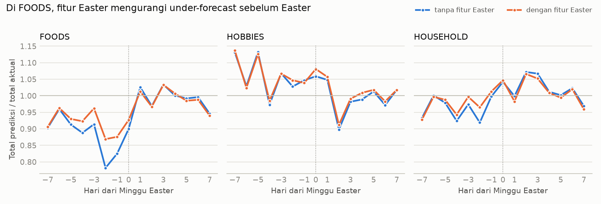

# Fase 4: Ablation Fitur Hari Libur Bergerak, Easter (P4)

*[← 03 Desain validasi](03_validation_design.md) · [Daftar laporan](README.md) · [05a Model dan baseline →](05a_models.md)*

Sumber: `python -m retailfc.ablation_easter --config config.yaml`
(angka lengkap: `reports/data/easter_ablation.json`).

## Pertanyaan

Apakah `days_to_easter` / `days_since_easter` (dipotong di 7 hari) menambah akurasi
dibanding model yang hanya tahu hari-H Easter lewat `event_name_1`? Jawabannya menentukan
apakah desain yang sama layak dipakai untuk Idulfitri (Fase 8).

## Setup (ditetapkan sebelum melihat hasil)

| Item | Nilai |
|---|---|
| Toko | CA_1, TX_1 (aturan: eksperimen di 1–2 toko) |
| Fold | `easter_2014`, `easter_2015` (fold khusus), cv3 (hari −7..0 Easter 2016), cv4 (hari +1..+7) |
| Varian | 36 fitur (dengan) vs 34 fitur (tanpa `days_to/since_easter`) |
| Seed | 42 dan 43, untuk mengukur noise antar run |
| Model | `reg:tweedie` p=1,2, GPU, `eta` 0,05, `max_depth` 8, early stopping 100 iterasi, `item_id` label encoding |
| Jendela evaluasi | ±7 hari dari Minggu Easter, di dalam horizon fold |
| **Kriteria** | Fitur dianggap berguna jika error di jendela Easter turun **konsisten** di semua fold dan toko, **dan** penurunannya lebih besar dari selisih antar seed |

Total 32 model. Puncak RAM 5,1 GB.

Catatan: ablation ini dijalankan **sebelum** fitur `zero_run_lag28` (indikasi stok habis)
ditambahkan, jadi memakai 36 fitur, bukan 37. Perbandingan dengan vs tanpa Easter tetap
sah karena kedua varian memakai set fitur dasar yang sama.

## Hasil

### Level item: kriteria TIDAK terpenuhi

Selisih (dengan − tanpa); negatif = fitur Easter membantu.

| Metrik | Rata-rata selisih | Perbandingan yang membaik |
|---|---:|---:|
| RMSE jendela Easter | +0,0002 | 7 dari 16 |
| MAE jendela Easter | +0,0020 | 9 dari 16 |
| WAPE total harian per kategori, jendela Easter | −0,0035 | 10 dari 16 |
| RMSE seluruh horizon | +0,0024 | 8 dari 16 |

Noise antar seed (selisih RMSE jendela, seed 42 vs 43, varian sama): **0,031**, jauh
lebih besar daripada efek fiturnya. Arah perubahan juga tidak konsisten antar fold
(mis. CA_1 `easter_2015` membaik −0,05, CA_1 `easter_2014` memburuk +0,09).

### Level total harian: fitur menangkap sebagian lonjakan FOODS sebelum Easter

Rasio total prediksi / total aktual per hari (2 toko × 4 fold × 2 seed digabung;
1,00 = tepat):

| FOODS, hari dari Easter | −4 | −3 | −2 | −1 | 0 | +1 |
|---|---:|---:|---:|---:|---:|---:|
| tanpa fitur Easter | 0,89 | 0,91 | **0,78** | **0,82** | 0,90 | 1,03 |
| dengan fitur Easter | 0,92 | 0,96 | **0,87** | **0,88** | 0,93 | 1,01 |

- Kedua varian **under-forecast** pada hari-hari sebelum Easter (EDA Fase 2: FOODS +15–16%
  di hari −2 dan −1). Fitur Easter mengurangi kekurangan itu sekitar 6–9 poin.
- HOUSEHOLD menunjukkan pola serupa yang lebih lemah (hari −4 dan −2).
- HOBBIES hampir tidak berubah.

Di level item sinyal ini tenggelam: kebanyakan item terjual 0–2 unit per hari, jadi
kenaikan 15% di total toko hanya mengubah sebagian kecil prediksi item, sedangkan noise
item jauh lebih besar.

## Kesimpulan

1. **Sesuai kriteria yang ditetapkan sejak awal, fitur Easter tidak terbukti memperbaiki
   error di level item.** Ini dilaporkan apa adanya.
2. Fitur ini **menangkap sebagian pola agregat** sebelum Easter (FOODS), dan **tidak
   merusak** horizon secara keseluruhan (selisih RMSE horizon di dalam noise antar seed).
3. Data latih hanya punya 3–5 Easter sebelum tiap cutoff. Jumlah kejadian yang sedikit
   membatasi apa yang bisa dipelajari pohon dari fitur ini.

## Keputusan

| Topik | Keputusan |
|---|---|
| Fase 5 | **Fitur Easter tetap dipakai** di model utama: tidak merugikan, dan berguna di level agregat (relevan untuk stok per toko, Fase 7). Dicatat sebagai "tidak terbukti di level item". |
| Fase 6 | Laporkan error di sekitar Easter dan event lain secara terpisah (event vs non-event). |
| Fase 8 (Idulfitri) | Desain `days_to/since_event` bisa dipakai ulang (fungsinya sudah generik). Efek Lebaran diperkirakan lebih panjang dan lebih besar, tetapi data apotek kemungkinan hanya memuat sedikit Lebaran. Hasil di sini menunjukkan: dengan sedikit kejadian, manfaat paling mungkin terlihat di level **agregat**, bukan per SKU. Ini sejalan dengan rencana cadangan Fase 8 (studi efek + forecast agregat). |

## Keterbatasan

- Hanya 2 toko dan 2 seed. Perbedaan kecil antar varian tidak bisa dibedakan dari noise.
- Rasio per hari menggabungkan fold yang mencakup hari berbeda (cv3 hanya hari ≤ 0,
  cv4 hanya hari ≥ 1), jadi jumlah data per titik tidak sama.
- Easter 2014 jatuh bersamaan dengan Orthodox Easter; efek keduanya bercampur.
