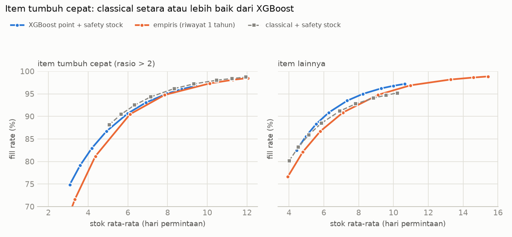

# Fase 7: Simulasi Stok (P3)

*[← 06b Rata-rata item jendela terbaru](06b_te_recent_window.md) · [Daftar laporan](README.md) · [08a Audit data apotek →](08a_id_data_audit.md)*

> **Status (24 Okt 2026):** simulasi selesai di **4 fold CV** (cv1–cv4, 10 toko, 30.490 deret,
> 112 hari horizon). Holdout (d_1914–d_1941) **belum disentuh**; simulasinya dijalankan sekali
> di akhir proyek bersama evaluasi holdout. Kode: `src/retailfc/inventory_sim.py`, grafik:
> `src/retailfc/inventory_report.py`, angka lengkap: `reports/data/inventory_sim.json`,
> tes: `tests/test_inventory_sim.py`.

---

## Ringkasan

- **Pertanyaan:** apakah forecast XGBoost yang lebih akurat membuat keputusan stok lebih murah?
- **Jawaban: tergantung tingkat layanan yang dikejar.**
  - Pada **tingkat layanan menengah** (stok 6–10 hari, fill rate ±90–97%), **forecast point
    XGBoost + safety stock paling efisien**: fill rate 1–3 poin lebih tinggi untuk stok yang
    sama dibanding classical dan empiris.
  - Pada **tingkat layanan sangat tinggi** (fill rate ≥ 98%), yang menjadi pilihan termurah
    ketika biaya kehabisan jauh lebih mahal dari biaya simpan, **metode empiris sederhana
    (kuantil penjualan 1 tahun terakhir) paling murah**, karena ekor distribusinya lebih
    realistis.
- **Pada asumsi biaya dasar**, empiris termurah. Di 12 kombinasi asumsi biaya, empiris
  termurah di **10**, dan XGBoost point + safety stock di **2** (saat biaya kehabisan rendah,
  10% harga).
- **Menjumlahkan kuantil harian XGBoost bukan cara yang tepat** untuk target stok: P50 hanya
  mencakup 28% periode, dan P90 mencakup 97%.
- **Metode gabungan** (level dari XGBoost, ekor dari empiris) diuji dan **tidak lebih baik**
  dari empiris (lebih mahal di 12 dari 12 asumsi).
- **Item tumbuh cepat** (Fase 6 §8.5): di kelompok ini, classical + safety stock paling
  murah, sesuai temuan bahwa XGBoost lambat menyesuaikan diri.
- **Kesimpulan:** akurasi forecast rata-rata yang lebih baik **tidak otomatis** menurunkan biaya
  stok. Untuk stok, yang menentukan adalah ketepatan **ekor distribusi**.

---

## 1. Kebijakan stok dan asumsi

**Kebijakan** (sama untuk semua metode): *periodic review order-up-to*, penjualan yang tidak
terlayani hilang (*lost sales*).

| Parameter | Nilai | Sumber |
|---|---|---|
| Siklus pesan | setiap 7 hari | **asumsi** |
| Lead time | 2 hari | **asumsi** |
| Periode proteksi | 9 hari (dipotong di akhir horizon: 9, 9, 9, 7 hari) | dari dua asumsi di atas |
| Target stok S | kuantil permintaan selama periode proteksi | |
| Pesanan | max(0, S − stok di tangan − pesanan di jalan) | |
| Stok awal | = S di hari pertama horizon | penyederhanaan |
| Biaya simpan | 25% harga per tahun (per unit-hari: 0,25 / 365 × harga) | **asumsi** |
| Biaya kehabisan | 30% harga per unit yang tidak terlayani (kira-kira margin yang hilang) | **asumsi** |
| Permintaan | penjualan aktual M5 di horizon | data |
| Harga | `sell_price` harian; kalau tidak ada, rata-rata 28 hari sebelum cutoff | data |

**M5 tidak memuat data biaya maupun persediaan.** Semua biaya di atas adalah asumsi dan diuji
sensitivitasnya (§5). Dengan asumsi dasar, satu unit hilang setara biaya menyimpan satu unit
selama ±440 hari, jadi kebijakan termurah selalu mengejar tingkat layanan tinggi.

---

## 2. Metode target stok

| Metode | Target stok S untuk kuantil α | Kuantil yang diuji |
|---|---|---|
| `xgb_quantile` | jumlah kuantil harian model kuantil XGBoost (Fase 5) selama periode proteksi | P50, P80, P90 (yang tersedia di model) |
| `xgb_normal` | jumlah forecast point XGBoost + z_α · σ · √n | 0,5 – 0,995 (9 titik) |
| `classical_normal` | jumlah forecast classical (ETS + TSB) + z_α · σ · √n | 0,5 – 0,995 |
| `empirical` | kuantil α dari jumlah penjualan n hari berturut-turut, riwayat 364 hari sebelum cutoff | 0,5 – 0,995 |
| `xgb_empirical` (gabungan) | target empiris × (forecast XGBoost / rata-rata historis n hari) | 0,5 – 0,995 |

σ = simpangan baku penjualan harian 56 hari terakhir sebelum cutoff. Semua metode hanya
memakai data ≤ cutoff tiap fold.

### Seberapa tepat target S? (coverage)

Porsi (deret × siklus pesan) di mana permintaan aktual selama periode proteksi ≤ S. Idealnya
sama dengan α.

| α | `xgb_quantile` | `xgb_normal` | `classical_normal` | `empirical` | `xgb_empirical` |
|---:|---:|---:|---:|---:|---:|
| 0,5 | **28,3%** | 55,0% | 55,8% | 54,3% | 49,9% |
| 0,8 | 83,2% | 75,9% | 75,0% | **80,2%** | 78,9% |
| 0,9 | **96,7%** | 83,4% | 82,1% | **88,8%** | 88,2% |
| 0,98 | – | 91,2% | 89,9% | **96,2%** | 95,8% |

- **Empiris paling terkalibrasi**: coverage-nya paling dekat dengan α.
- **Metode normal meremehkan ekor**: di α 0,98, coverage hanya ±90–91%. Penjualan produk
  intermiten punya lonjakan yang jauh lebih besar dari perkiraan distribusi normal.
- **Jumlah kuantil harian meleset di kedua ujung.** Median harian produk intermiten bernilai 0,
  sehingga jumlah P50 terlalu rendah. Jumlah P90 harian jauh di atas P90 total 9 hari.

---

## 3. Kurva trade-off: fill rate pada stok yang sama

| Stok rata-rata | XGBoost point + safety stock | Classical + safety stock | Empiris | XGBoost kuantil | Gabungan |
|---:|---:|---:|---:|---:|---:|
| 6 hari | **89,9%** | 89,1% | 86,9% | 79,7% | 87,1% |
| 8 hari | **94,6%** | 93,2% | 92,5% | 89,6% | 92,1% |
| 10 hari | **96,8%** | 95,2% | 95,8% | 95,3% | 95,0% |
| 12 hari | – | – | **97,5%** | 96,8% | 96,7% |
| 14 hari | – | – | **98,5%** | 98,3% | 97,7% |

(Fill rate = unit terlayani ÷ permintaan. Stok rata-rata = rata-rata stok di tangan per hari ÷
rata-rata permintaan per hari. Nilai di antara titik α diinterpolasi linear. "–" = di luar
jangkauan metode itu: metode normal mentok di ±10,5 hari pada α 0,995.)

- **Sampai ±10 hari stok, XGBoost point + safety stock paling efisien.** Forecast yang lebih
  akurat memberi fill rate lebih tinggi untuk stok yang sama.
- **Metode normal tidak bisa mencapai fill rate > ±97%** dengan efisien, karena meremehkan
  lonjakan permintaan.
- **XGBoost kuantil** hanya punya 3 titik (P50/P80/P90), sehingga kurvanya kasar. Di antara
  titik-titik itu, garisnya adalah interpolasi, bukan hasil simulasi.

---

## 4. Biaya total pada asumsi dasar

Tiap metode memakai α yang memberinya biaya terendah (4 fold, 10 toko, nilai dalam satuan
harga M5):

| Metode (α terbaiknya) | Fill rate | Stok rata-rata | Biaya simpan | Biaya kehabisan | Total | vs termurah |
|---|---:|---:|---:|---:|---:|---:|
| **Empiris @0,995** | 98,8% | 15,1 hari | 151.111 | 50.569 | **201.681** | – |
| XGBoost kuantil @0,9 | 98,5% | 14,3 hari | 152.327 | 66.304 | 218.631 | +8,4% |
| XGBoost point + safety stock @0,995 | 97,2% | 10,5 hari | 108.813 | 126.302 | 235.115 | +16,6% |
| Gabungan @0,995 | 99,0% | 18,8 hari | 187.089 | 49.667 | 236.757 | +17,4% |
| Classical + safety stock @0,995 | 95,5% | 10,4 hari | 108.559 | 183.571 | 292.131 | +44,8% |

α terbaik untuk empiris (0,995) adalah **ujung grid yang diuji**. α yang lebih tinggi mungkin
lebih murah lagi, yang justru memperkuat kesimpulan. Model kuantil XGBoost hanya dilatih sampai
P90, jadi tidak bisa diuji di tingkat layanan lebih tinggi.

### Per segmen dan kategori (α sama seperti tabel di atas)

| Kelompok | Porsi permintaan | Termurah | Total biaya: empiris / XGBoost kuantil / XGBoost point / classical |
|---|---:|---|---|
| smooth | 26,7% | XGBoost kuantil | 29.636 / **29.275** / 32.664 / 41.466 |
| erratic | 10,9% | XGBoost kuantil | 11.289 / **11.193** / 12.063 / 15.524 |
| intermittent | 39,6% | **empiris** | **119.741** / 138.325 / 144.447 / 176.332 |
| lumpy | 22,7% | XGBoost kuantil | 40.759 / **39.583** / 45.685 / 58.552 |
| FOODS | 66,8% | XGBoost kuantil | 116.047 / **115.312** / 133.634 / 175.032 |
| HOBBIES | 9,3% | **empiris** | **24.369** / 29.462 / 25.580 / 30.279 |
| HOUSEHOLD | 23,9% | **empiris** | **61.265** / 73.857 / 75.901 / 86.820 |
| **item tumbuh cepat** | 8,8% | **classical** | 18.929 / 23.148 / 24.498 / **18.876** |

- **Keunggulan empiris berasal dari segmen intermittent** (39,6% permintaan). Di segmen ini,
  empiris 13% lebih murah dari XGBoost kuantil.
- Di segmen smooth, erratic, lumpy, dan kategori FOODS, **XGBoost kuantil sedikit lebih murah**
  (0,6–2,9%).
- Memilih metode terbaik per segmen hanya menghemat ±0,9% dibanding empiris untuk semua deret.
  Selain itu, pilihan per segmen yang ditentukan dari fold CV yang sama berisiko terlalu
  optimistis. Ini perlu diuji di holdout sebelum dipakai.

### Item tumbuh cepat

Untuk item dengan rasio rata-rata 56 hari terbaru terhadap rata-rata riwayat > 2 (Fase 6
§8.5), classical + safety stock setara atau sedikit lebih baik dari XGBoost di seluruh kurva,
dan termurah pada asumsi dasar (fill rate 98,7%). Ini konsisten dengan temuan bahwa XGBoost
menahan forecast di dekat rata-rata lama item.

---

## 5. Analisis sensitivitas biaya

| Biaya simpan / tahun | Biaya kehabisan / unit | Termurah | Selisih metode lain (α terbaik masing-masing) |
|---:|---:|---|---|
| 15% | 10% | empiris @0,98 | XGBoost point +1,6%, XGBoost kuantil +7,3% |
| 15% | 30% | empiris @0,995 | XGBoost kuantil +11,7%, XGBoost point +35,7% |
| 15% | 50% | empiris @0,995 | XGBoost kuantil +15,4% |
| 15% | 100% | empiris @0,995 | XGBoost kuantil +20,5% |
| 25% | 10% | **XGBoost point @0,99** | empiris +4,2%, classical +12,3%, XGBoost kuantil +15,8% |
| **25%** | **30%** | **empiris @0,995** | **XGBoost kuantil +8,4%, XGBoost point +16,6%** |
| 25% | 50% | empiris @0,995 | XGBoost kuantil +11,7% |
| 25% | 100% | empiris @0,995 | XGBoost kuantil +16,8% |
| 40% | 10% | **XGBoost point @0,98** | empiris +5,8%, classical +8,5% |
| 40% | 30% | empiris @0,99 | XGBoost point +3,6%, XGBoost kuantil +6,9% |
| 40% | 50% | empiris @0,995 | XGBoost kuantil +8,6% |
| 40% | 100% | empiris @0,995 | XGBoost kuantil +13,3% |

(Baris tebal = asumsi dasar.)

- **Semakin mahal kehabisan stok, semakin unggul empiris**, karena kebijakan terbaik mengejar
  tingkat layanan di mana ekor distribusi paling menentukan.
- **XGBoost point + safety stock termurah ketika kehabisan murah** (10% harga) **dan simpan mahal**
  (≥ 25%/tahun). Ini kondisi di mana tingkat layanan menengah sudah cukup.

---

## 6. Uji metode gabungan (ditolak)

**Hipotesis:** XGBoost akurat di level rata-rata, sedangkan empiris realistis di ekor. Jadi
target empiris dikalikan rasio forecast XGBoost terhadap rata-rata historis.

**Aturan keputusan (ditetapkan sebelum run):** dipakai kalau biayanya ≤ empiris pada asumsi
dasar dan pada ≥ 7 dari 12 kombinasi sensitivitas.

**Hasil:** lebih mahal di **12 dari 12** kombinasi (+6% sampai +17%), dan butuh 18,8 hari stok
untuk fill rate 99,0%. Untuk item yang tumbuh cepat, hasilnya lebih buruk lagi (fill rate 85,0%
vs 89,9% di 6 hari stok). **Tidak dipakai.**

---

## 7. Keterbatasan

- **Biaya adalah asumsi.** Kesimpulan "metode mana termurah" bergantung pada rasio biaya
  kehabisan terhadap biaya simpan (§5).
- **Penjualan ≠ permintaan asli (*censored demand*).** Saat stok habis di data asli, penjualan
  tercatat lebih rendah dari permintaan. Jadi unit hilang di simulasi ini adalah batas bawah,
  dan semua metode dinilai dengan permintaan yang sama-sama terlalu rendah. Model kuantil sudah
  dilatih tanpa deretan nol panjang (Fase 5) untuk mengurangi masalah ini, tetapi evaluasinya
  tetap memakai penjualan aktual.
- **Tidak ada kedaluwarsa, kapasitas rak, atau minimum order.** Stok 14–15 hari untuk produk
  FOODS bisa tidak realistis di dunia nyata.
- **Stok awal = S** dan horizon hanya 28 hari. Efek awal dan akhir horizon sama untuk semua
  metode.
- **Hanya fold CV.** Pilihan α dan metode ditentukan di fold yang sama dengan penilaiannya, jadi
  angka biaya terbaik sedikit optimistis. Holdout akan menjadi penilaian yang jujur.
- **Model kuantil XGBoost hanya sampai P90**, sehingga tidak bisa dibandingkan di α > 0,9.
- **Rasio pertumbuhan** (kelompok item tumbuh cepat) punya kasus tepi kecil: item dengan riwayat
  < 56 hari dan hari tutup di jendela 56 hari (lihat audit Fase 6). Dampaknya kecil.

---

## 8. Langkah berikutnya

1. **Holdout (sekali, di akhir proyek):** jalankan simulasi yang sama dengan pilihan yang
   ditetapkan sekarang (empiris @0,995 sebagai rekomendasi dasar, XGBoost kuantil @0,9 dan
   XGBoost point @0,99 sebagai pembanding), lalu laporkan apakah urutannya bertahan.
2. **Eksperimen yang ditunda dari Fase 6:** `te_item_mean` dari jendela terbaru, untuk item yang
   tumbuh cepat. Di simulasi ini, kelompok tersebut hanya 8,8% permintaan dan classical sudah
   termurah di sana, jadi prioritasnya **rendah**.
3. **Ide untuk diuji (opsional):** model kuantil XGBoost yang langsung meramal **total 9 hari**
   (bukan harian), atau kuantil yang lebih tinggi (P95/P99). Ini bisa memperbaiki masalah
   "jumlah kuantil harian", tetapi butuh training baru.
