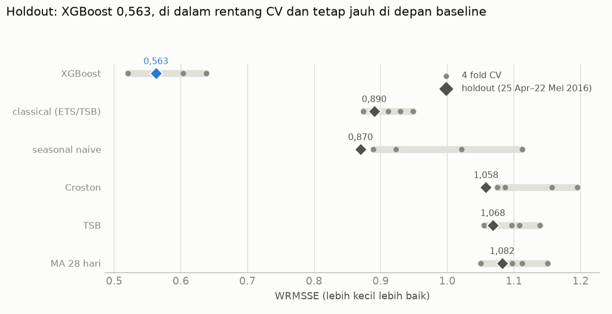
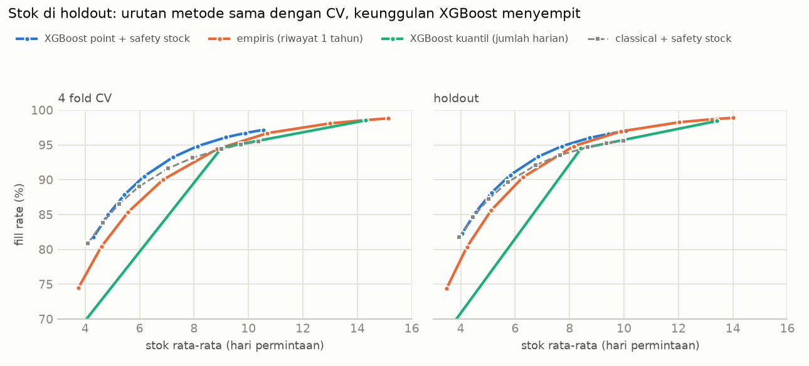

# Fase 9: Evaluasi Holdout M5 (dibuka sekali)

*[← 08c Transfer ke apotek](08c_id_transfer.md) · [Daftar laporan](README.md)*

> **Status (29 Okt 2026):** holdout d_1914–d_1941 (25 Apr–22 Mei 2016) sudah dibuka **satu kali**.
> Kode: `src/retailfc/holdout_eval.py` (run), `src/retailfc/holdout_report.py` (grafik). Angka lengkap:
> `reports/data/holdout_forecast.json`, `reports/data/inventory_sim_holdout.json`. Log run:
> `reports/runs/20261029_012031_holdout/`. Setelah ini, model dan asumsi tidak boleh diubah
> berdasarkan angka di laporan ini.

---

## Ringkasan

- **XGBoost lolos ujian akhir.** WRMSSE holdout **0,563**, di dalam rentang 4 fold CV
  (0,520–0,638; rata-rata 0,582). Baseline terbaik di holdout adalah seasonal naive (0,870),
  jadi error XGBoost **35% lebih kecil**. Di CV selisihnya 36%.
- **Polanya sama dengan CV di semua level.** XGBoost unggul jauh di level gabungan (akurasi total
  96,7% vs 91,3% classical), dan hanya tipis di level produk × toko (RMSSE 0,844 vs 0,851).
  Diukur dengan WAPE, akurasi classical masih sedikit lebih tinggi di tiga level produk
  (selisih 0,2–1,2 poin, misalnya 27,2% vs 26,0% per produk × toko), sama seperti di CV.
- **Model kuantil masih dekat target, tetapi sedikit lebih buruk dari semua fold CV:** P80
  mencakup 79,5% hari (fold CV terendah 80,5%) dan P90 88,7% (fold CV terendah 89,0%), tanpa
  crossing.
- **Simulasi stok mengulang kesimpulan Fase 7.** Metode empiris tetap termurah di semua 12
  asumsi biaya (CV: 10 dari 12). XGBoost point + safety stock masih paling efisien di stok 6–8
  hari, tetapi selisihnya lebih tipis daripada di CV.
- Tidak ada temuan yang berbalik arah. Untuk forecast point, periode holdout sedikit lebih
  "mudah" daripada rata-rata CV: keenam model mendapat WRMSSE di bawah rata-rata CV-nya,
  terutama seasonal naive.

## 1. Apa yang dijalankan (ditetapkan sebelum run)

| Item | Isi |
|---|---|
| Periode | cutoff d_1913, horizon d_1914–d_1941 (28 hari) |
| Model | konfigurasi final apa adanya: `model.xgb_point` dan `model.xgb_quantile`, satu model per toko, early stopping di d_1886–d_1913 |
| Baseline | seasonal naive, MA 28, Croston, TSB, classical (ETS + TSB), dengan cutoff yang sama |
| Metrik | WRMSSE (bobot dari omzet d_1886–d_1913) dan 12 level, akurasi 1 − WAPE per level, bias, pinball, coverage |
| Simulasi stok | kode dan asumsi yang sama dengan Fase 7 (`inventory_sim.simulate_fold` dan `aggregate`) |
| Aturan | tidak ada tuning, seleksi model, atau perubahan konfigurasi berdasarkan hasil ini |

Sebelum run ada dua perubahan kode, keduanya diverifikasi tidak mengubah hasil CV:
- `io.load_wide_matrices` sekarang menolak baris harga tanpa deret penjualan (temuan audit
  Fase 6). Kasusnya 0, baik sampai d_1913 maupun d_1941.
- Isi loop `inventory_sim.py` dipindah ke fungsi `simulate_fold` dan `aggregate` supaya bisa
  dipakai untuk holdout. Simulasi CV yang dijalankan ulang menghasilkan `inventory_sim.json`
  yang identik byte per byte.

## 2. Akurasi forecast

| Model | WRMSSE holdout | CV rata-rata | Rentang CV | Holdout vs CV |
|---|---:|---:|---|---|
| **XGBoost** | **0,5626** | 0,5819 | 0,520–0,638 | di dalam rentang, sedikit lebih baik |
| seasonal naive | 0,8697 | 0,9862 | 0,889–1,112 | **lebih baik dari fold CV terbaiknya** |
| classical (ETS/TSB) | 0,8902 | 0,9158 | 0,874–0,948 | di dalam rentang |
| Croston | 1,0581 | 1,1284 | 1,075–1,195 | sedikit di bawah rentang |
| TSB | 1,0683 | 1,0997 | 1,055–1,139 | di dalam rentang |
| MA 28 hari | 1,0823 | 1,1025 | 1,050–1,150 | di dalam rentang |

- Urutan baseline sedikit berubah: di holdout, seasonal naive lebih baik dari classical. Ini
  wajar, karena seasonal naive paling bervariasi antar periode (rentang CV 0,89–1,11).
- XGBoost tetap jauh lebih baik dari semua baseline. Selisihnya dengan baseline terbaik di
  holdout (−35%) hampir sama dengan di CV (−36% terhadap classical).

### Per level hierarki (RMSSE, lebih kecil lebih baik)

| Level | XGBoost holdout | XGBoost CV | classical holdout | seasonal naive holdout |
|---|---:|---:|---:|---:|
| 1 total | 0,336 | 0,324 | 0,865 | 0,751 |
| 2 negara bagian | 0,382 | 0,410 | 0,867 | 0,754 |
| 3 toko | 0,509 | 0,523 | 0,886 | 0,799 |
| 4 kategori | 0,375 | 0,370 | 0,885 | 0,762 |
| 5 departemen | 0,439 | 0,459 | 0,955 | 0,817 |
| 6 negara bagian × kategori | 0,436 | 0,463 | 0,886 | 0,783 |
| 7 negara bagian × departemen | 0,508 | 0,545 | 0,935 | 0,830 |
| 8 toko × kategori | 0,564 | 0,589 | 0,888 | 0,839 |
| 9 toko × departemen | 0,637 | 0,663 | 0,926 | 0,892 |
| 10 produk | 0,868 | 0,897 | 0,876 | 1,032 |
| 11 produk × negara bagian | 0,855 | 0,881 | 0,863 | 1,075 |
| 12 produk × toko | 0,844 | 0,859 | 0,851 | 1,100 |

XGBoost lebih baik dari classical dan seasonal naive di **12 dari 12 level**. Di level 10–12,
selisihnya dengan classical hanya ±1%, sama seperti di CV.

### Akurasi (1 − WAPE)

| Level | XGBoost holdout | XGBoost CV | classical holdout | classical CV |
|---|---:|---:|---:|---:|
| total 10 toko | **96,7%** | 96,4% | 91,3% | 90,4% |
| per toko | 93,9% | 93,2% | 89,3% | 87,8% |
| per produk (gabungan toko) | 68,9% | 65,9% | 69,1% | 66,0% |
| per produk × toko | 26,0% | 22,3% | **27,2%** | 24,2% |

### Bias total (total ramalan ÷ total aktual − 1)

| Model | Holdout | CV per fold |
|---|---:|---|
| XGBoost | −2,6% | −1,0%, −2,4%, +0,4%, +1,7% |
| classical | −4,1% | −4,3%, −6,2%, −1,7%, +0,3% |
| seasonal naive | −7,4% | – |

Semua model sedikit meramal terlalu rendah di periode ini. XGBoost paling kecil biasnya, dan
nilainya masih dalam kisaran fold CV.

## 3. Model kuantil

| | Holdout | CV rata-rata | Rentang 4 fold CV |
|---|---:|---:|---|
| Coverage P80 | 79,5% | 81,0% | 80,5–81,5% |
| Coverage P90 | 88,7% | 89,4% | 89,0–89,6% |
| Pinball rata-rata | 0,3497 | 0,3413 | 0,3309–0,3495 |
| Crossing | 0% | 0% | 0% |

Coverage P80 dan P90 masih dalam 1,5 poin dari target. Namun ketiganya **sedikit di luar
rentang CV ke arah yang lebih buruk**: coverage 0,3–1,0 poin di bawah fold CV terendah, dan
pinball setara fold CV terburuk. Selisihnya kecil dan tidak mengubah penggunaan model kuantil,
tetapi menunjukkan model kuantil sedikit kurang kokoh di periode baru dibanding model point. Coverage P10 (54,7%) dan P50 (62,6%) jauh di atas target,
seperti di CV, karena ±60% hari bernilai nol (Fase 5b §2). Lima dari 10 model kuantil berhenti
di dekat batas 1.000 iterasi (iterasi terbaik ≥ 900), sesuai keputusan Fase 5c.

## 4. Simulasi stok

**Biaya pada asumsi dasar** (simpan 25%/tahun, kehabisan 30% harga). Biaya absolut holdout (1 fold)
tidak bisa dibandingkan dengan CV (4 fold), jadi yang dibandingkan adalah selisih terhadap
metode termurah:

| Metode (α terbaik) | Holdout | CV |
|---|---:|---:|
| **empiris @ 0,995** | **termurah** | **termurah** |
| XGBoost kuantil @ 0,9 | +16,9% | +8,4% |
| gabungan XGBoost + empiris | +17,9% | +17,4% |
| XGBoost point + safety stock @ 0,995 | +30,0% | +16,6% |
| classical + safety stock @ 0,995 | +53,3% | +44,8% |

- Empiris termurah di **12 dari 12** kombinasi asumsi biaya (CV: 10 dari 12; dua kombinasi
  dengan biaya kehabisan rendah yang dulu dimenangkan XGBoost kini juga dimenangkan empiris).
- Jarak metode lain ke empiris lebih lebar daripada di CV.

**Fill rate pada stok yang sama** (semua deret):

| Stok rata-rata | XGBoost point + SS | empiris | classical + SS | XGBoost kuantil |
|---|---:|---:|---:|---:|
| 6 hari | **91,1%** (CV 89,9%) | 89,2% (CV 86,9%) | 90,3% (CV 89,1%) | 81,5% (CV 79,7%) |
| 8 hari | **95,2%** (CV 94,6%) | 94,5% (CV 92,5%) | 93,9% (CV 93,2%) | 92,2% (CV 89,6%) |
| 10 hari | 97,0% (CV 96,8%) | **97,0%** (CV 95,8%) | – | 95,7% (CV 95,3%) |

- Di stok 6–8 hari, XGBoost point + safety stock masih paling efisien, tetapi keunggulannya atas
  empiris tinggal 0,7–1,9 poin (CV: 2,1–3,0 poin). Di 10 hari keduanya sudah sama.
- Jumlah kuantil harian XGBoost tetap tidak terkalibrasi untuk total periode proteksi: P50
  mencakup 22,3% periode (CV 28,3%) dan P90 96,7% (CV 96,7%).
- Item tumbuh cepat (rasio > 2): classical + safety stock tetap paling efisien (fill rate 93,5% /
  97,0% di 6 / 8 hari, dibanding XGBoost 92,7% / 96,5%), sama seperti di CV.

## 5. Kesimpulan

1. Angka CV untuk forecast point bisa dipercaya: WRMSSE, semua level, dan bias XGBoost berada di
   dalam rentang fold CV. Model kuantil sedikit lebih buruk dari fold CV terburuk (coverage
   0,3–1,0 poin lebih rendah), tetapi masih dekat target.
2. Kesimpulan proyek tetap: XGBoost jauh lebih baik di level gabungan dan hanya tipis di level
   produk. Untuk keputusan stok di layanan tinggi, metode empiris sederhana tetap paling murah.
3. Periode holdout sedikit lebih mudah diramal daripada rata-rata CV untuk hampir semua model,
   jadi WRMSSE 0,563 sebaiknya dibaca bersama rentang CV (0,52–0,64), bukan sebagai angka tunggal.

## 6. Keterbatasan

- Holdout hanya satu periode 28 hari. Satu angka holdout tidak lebih andal daripada rata-rata
  4 fold CV; gunanya adalah memastikan tidak ada kebocoran atau overfit terhadap fold CV.
- Biaya di simulasi stok tetap asumsi, dan penjualan tetap bukan permintaan (censored demand).
