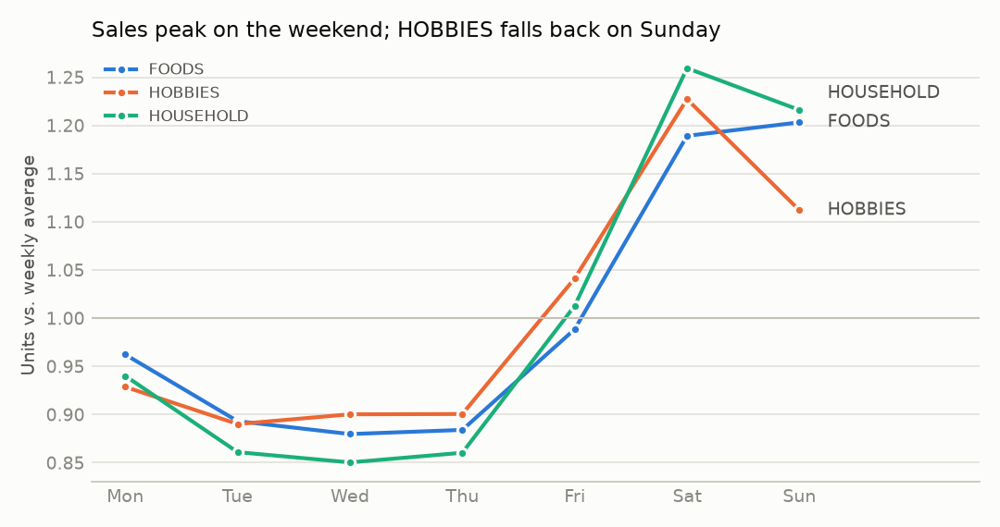
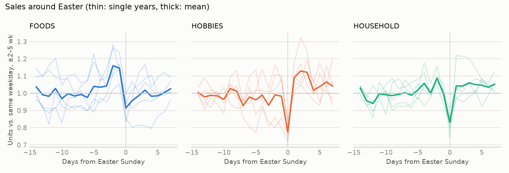

# Phase 2 — Targeted EDA

Source: `python -m retailfc.eda --config config.yaml` (numbers: `reports/eda.json`).
Data: long table from Phase 1 (rows from each item-store's first sale onward),
**d_1 … d_1913 only**. The holdout (d_1914–d_1941) is not used.

Note: the CV fold horizons (d_1802–d_1913) are inside this window. The EDA informs
feature design, not model selection, so this is accepted and stated here.

---

## Q1. Share of zero-sales days per category

| Category | Zero share | Range across 10 stores |
|---|---:|---|
| FOODS | 51.1% | 40.9% (CA_3) – 56.8% (TX_1) |
| HOUSEHOLD | 64.6% | 54.0% (CA_3) – 72.0% (CA_4) |
| HOBBIES | 71.5% | 63.4% (CA_3) – 78.5% (WI_2) |
| **All** | **59.6%** | |

Even after dropping days before first sale, most item-days are zero. HOBBIES is the most
intermittent. CA_3 (the largest store) has the lowest zero share in every category.

**Implication:** a model can look good by predicting near zero. Phase 5/6 must report
metrics per segment and check bias, as the plan requires.

## Q2a. Weekly pattern

Units per weekday relative to the weekly average, after dividing each day by its centred
28-day mean (removes trend and yearly season). Closed days excluded.

| | Mon | Tue | Wed | Thu | Fri | Sat | Sun | max/min |
|---|---:|---:|---:|---:|---:|---:|---:|---:|
| FOODS | 0.96 | 0.89 | 0.88 | 0.88 | 0.99 | 1.19 | 1.20 | 1.37 |
| HOBBIES | 0.93 | 0.89 | 0.90 | 0.90 | 1.04 | 1.23 | 1.11 | 1.38 |
| HOUSEHOLD | 0.94 | 0.86 | 0.85 | 0.86 | 1.01 | 1.26 | 1.22 | 1.48 |

Strong and consistent: weekends sell 37–48% more than the weakest weekday (Tue–Thu).
HOBBIES peaks on Saturday and falls back on Sunday; the other two stay high on Sunday.

**Implication:** day of week is a required feature. Lags at multiples of 7 (28, 35, 42,
49, 56) keep the weekday aligned.

## Q2b. SNAP effect per state

SNAP days from `calendar.csv`:
CA = day 1–10 of the month; TX = 1, 3, 5, 6, 7, 9, 11, 12, 13, 15; WI = 2, 3, 5, 6, 8, 9,
11, 12, 14, 15.

Lift = units on SNAP days vs non-SNAP days, compared **within the same weekday** and
averaged over weekdays (detrended as in Q2a). SNAP benefits can only buy food, so
HOBBIES and HOUSEHOLD act as a **placebo**: their lift measures the general
early-month (e.g. payday) effect that SNAP days are confounded with.

| State | FOODS | HOUSEHOLD (placebo) | HOBBIES (placebo) | FOODS minus placebo |
|---|---:|---:|---:|---:|
| CA | +10.2% | +3.8% | +2.7% | ~+7 pp |
| TX | +14.9% | +2.6% | +1.9% | ~+12 pp |
| WI | +28.1% | +3.0% | +1.3% | ~+25 pp |

The FOODS lift is far above the placebo in every state, so most of it is a real SNAP
effect, strongest in WI. The placebo shows a small early-month effect (~2–4%).

**Implication:** use `snap_<state of the store>` as a feature, mainly useful for FOODS.
This is an association from observational data, not a causal estimate.

## Q3. Days the stores are closed

**25 December is effectively a closed day, but not exactly zero.** Verified from the data:

| Date | Units, whole chain (10 stores) |
|---|---:|
| 2011-12-25 | 13 |
| 2012-12-25 | 11 |
| 2013-12-25 | 20 |
| 2014-12-25 | 20 |
| 2015-12-25 | 14 |

- No day has zero sales in **all** stores, so "total = 0" alone misses Christmas.
- Every Christmas falls below 10% of its centred 28-day mean. **No other day does.**
- Store-level zero days happen only on 25 December (e.g. CA_1 and CA_4 all five years,
  CA_3 only in 2014).

**Decision for later phases:** treat 25 December as closed. Exclude it from training
targets and from rolling-window statistics, and set its forecast to 0. Christmas is not
in any CV fold horizon or in the holdout (latest is d_1792, 2015-12-25), so this affects
training only.

## Q4. Sales around Easter (preparation for P4)

Units per category on each day around Easter Sunday, divided by the mean of the **same
weekday** 2–5 weeks before and after (the event window is excluded from the baseline).
Years 2011–2015. Easter 2016 (d_1885) is left out because its baseline would need days
after d_1913.

| Days from Easter | −3 (Thu) | −2 (Fri) | −1 (Sat) | 0 (Sun) | +1 | +2 | +3 |
|---|---:|---:|---:|---:|---:|---:|---:|
| FOODS | 1.04 | **1.16** | **1.15** | 0.91 | 0.96 | 0.99 | 1.02 |
| HOBBIES | 0.93 | 0.99 | 0.98 | **0.78** | 1.09 | **1.13** | 1.12 |
| HOUSEHOLD | 1.00 | 1.09 | 1.00 | **0.83** | 1.04 | 1.04 | 1.06 |

- **FOODS:** +15–16% on the Friday and Saturday before Easter, −9% on Easter Sunday.
- **HOBBIES and HOUSEHOLD:** a dip on Easter Sunday (−22% / −17%). HOBBIES then sells
  9–13% more on days +1 to +3. The cause is not visible in the data.
- The effect sits in a short window, about **−3 to +3 days**. Single years vary a lot
  (thin lines), with five events per category.
- The calendar flags only Easter Sunday itself. A plain `is_event` flag cannot express
  "two days before". This is the case for `days_to_event` / `days_since_event`.

**Implication for P4 (Phase 4):** clip `days_to_easter` / `days_since_easter` at about
±7 days. The ablation needs folds whose horizon contains the days around Easter: CV 3
ends on Easter 2016 (d_1885) and covers the days before it. An extra fold around
Easter 2015 (d_1528) is needed for the days after.

---

## Summary of decisions passed on

| Topic | Decision | Phase |
|---|---|---|
| Christmas | Treat as closed: drop from targets/rolling stats, forecast 0 | 4–5 |
| Weekday | Required feature; keep lags at multiples of 7 | 4 |
| SNAP | Feature `snap` of the store's state | 4 |
| Easter | `days_to/since_easter`, clipped at ±7; extra fold around d_1528 | 3–4 |
| Zeros | Report metrics per segment and bias; watch for "predict zero" wins | 5–6 |
