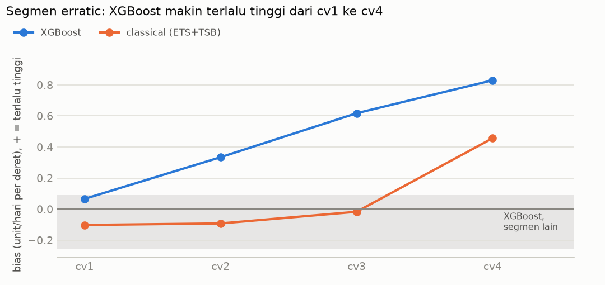
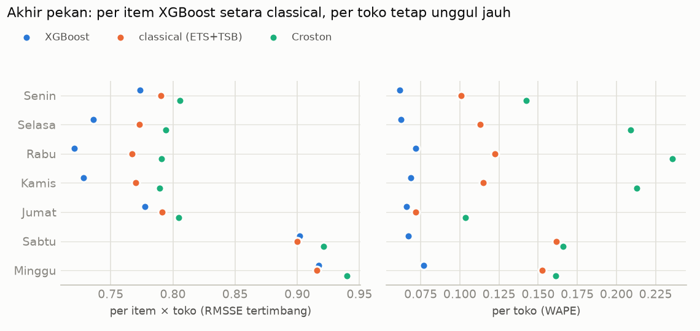
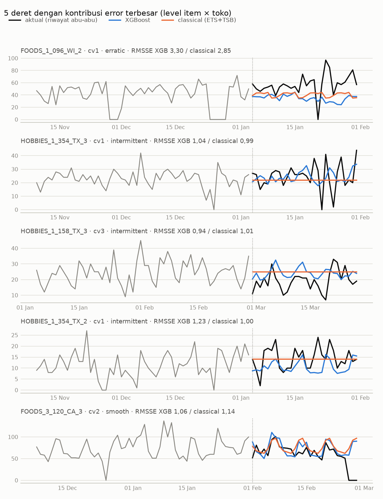
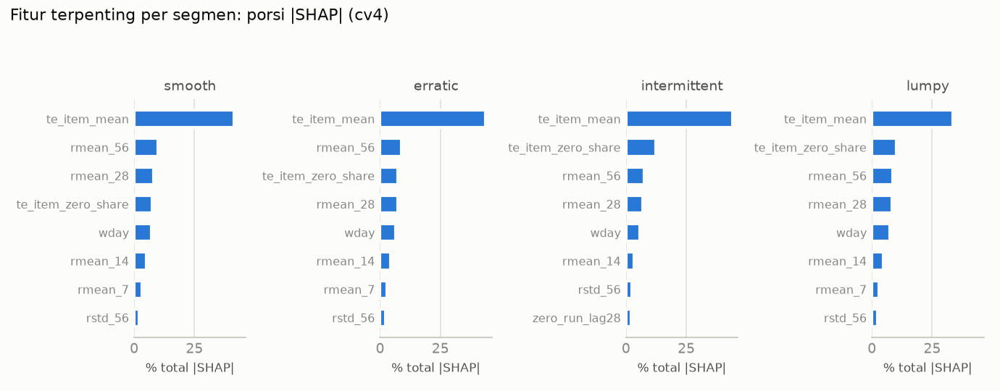

# Fase 6: Analisis Error per Segmen (P2)

> **Status (24 Okt 2026):** analisis segmen, kategori, toko, hari, event, studi kasus, dan
> SHAP **selesai**. Analisis error memakai prediksi Fase 5 yang sudah tersimpan. Untuk SHAP,
> 12 model point dilatih ulang dan prediksinya identik dengan Fase 5 (§8).
> Semua angka dari fold CV (cv1–cv4) dan fold khusus, data ≤ d_1913. Holdout belum disentuh.
> Kode: `src/retailfc/error_analysis.py`, grafik: `src/retailfc/error_report.py`,
> angka lengkap: `reports/error_analysis.json`.

---

## Ringkasan

- **Di level item × toko, XGBoost lebih baik dari semua baseline di keempat segmen**, tetapi
  selisihnya tipis: 1,2–2,8% dibanding baseline terbaik. Berdasarkan bobot omzet, XGBoost
  hanya lebih akurat pada **52–60%** deret dibanding classical (ETS + TSB). Untuk 40–48%
  sisanya, classical lebih baik.
- **Keunggulan besar XGBoost muncul saat deret dijumlahkan.** Untuk total harian segmen
  intermittent dan lumpy, error XGBoost **±54% lebih kecil** daripada baseline terbaik.
- **Jawaban jujur untuk "di mana XGBoost tidak lebih baik":**
  1. **Total segmen erratic:** classical 26% lebih baik (kalah di 3 dari 4 fold), karena
     XGBoost **makin terlalu tinggi** untuk segmen ini dari cv1 ke cv4.
  2. **Akhir pekan, di level item:** XGBoost setara classical (+0,2%), dan kalah di 3 dari 4
     fold untuk hari Sabtu.
  3. **Fold Easter 2015, di level item:** classical lebih baik (+1,6% di hari biasa, +4,4% di
     hari event).
  4. Kombinasi kecil: total erratic FOODS, erratic HOUSEHOLD, dan smooth HOBBIES.
- **XGBoost selalu lebih baik dari Croston dan seasonal naive** di semua segmen.
- **Studi kasus:** deret dengan error terbesar didominasi tiga hal: **stok habis jangka pendek
  sebelum cutoff** (tidak tertangkap aturan "deretan nol ≥ 28 hari"), **permintaan yang
  berubah tanpa sinyal di data** (harga tetap), dan **penjualan harian yang sangat fluktuatif**.
- **SHAP:** model terutama memakai **rata-rata item jangka panjang** (`te_item_mean` 42%,
  kelompok level item 55%), **penjualan terbaru** (31%), dan **hari dalam minggu** (6%).
  Harga hanya 3,3%, dan event serta Easter 0,3%. Karena `te_item_mean` dihitung dari seluruh
  riwayat, model **lambat menyesuaikan diri saat level item berubah**. Ini dugaan terkuat untuk
  bias erratic dan dua studi kasus (item yang tumbuh diramal terlalu rendah).
- **Efek itu sistematis (§8.5):** XGBoost −7% sampai −32% untuk item yang tumbuh dan +5% sampai
  +21% untuk item yang turun. Classical meleset ke arah sebaliknya. Untuk item yang tumbuh cepat
  (±9% unit), P90 kuantil hanya mencakup 79–86% hari. Perbaikan lewat fitur diperkirakan
  menaikkan WRMSSE total < 1% (§8.6), jadi eksperimennya **ditunda** sampai Fase 7.

---

## 1. Cara membaca ukuran di laporan ini

| Ukuran | Arti | Dipakai untuk |
|---|---|---|
| **RMSSE tertimbang** (per item × toko) | Skor level 12 WRMSSE, dibatasi ke deret di satu kelompok. Bobot = porsi omzet di kelompok itu. | Akurasi per produk per toko |
| **RMSSE total kelompok** | Semua deret di kelompok dijumlahkan dulu menjadi satu deret harian, lalu dihitung RMSSE-nya. | Apakah error saling menetralkan saat dijumlahkan |
| **Porsi menang** | Porsi bobot omzet di mana RMSSE XGBoost < RMSSE baseline. | Seberapa merata keunggulannya |
| **WAPE per toko** | Error absolut total per toko per hari ÷ penjualan aktual. | Akurasi di level toko |
| **Bias** | Rata-rata (forecast − aktual), unit per deret per hari. Positif = terlalu tinggi. | Kecenderungan meleset ke satu arah |

Semua skor RMSSE: **lebih kecil lebih baik**. Angka adalah rata-rata 4 fold CV kecuali
disebutkan lain. Segmen Syntetos–Boylan dihitung dari data train tiap fold.

---

## 2. Per segmen pola permintaan

| Segmen | Deret | Porsi omzet | XGBoost | classical | Croston | TSB | seasonal naive | XGB vs terbaik |
|---|---:|---:|---:|---:|---:|---:|---:|---:|
| smooth | 1.912 | 22,5% | **0,798** | 0,821 | 0,863 | 0,848 | 1,043 | −2,8% |
| erratic | 877 | 6,1% | **0,859** | 0,874 | 0,906 | 0,871 | 1,090 | −1,3% |
| intermittent | 22.171 | 55,5% | **0,861** | 0,872 | 0,883 | 0,872 | 1,154 | −1,2% |
| lumpy | 5.523 | 15,8% | **0,936** | 0,956 | 0,985 | 0,956 | 1,237 | −2,2% |

(RMSSE tertimbang per item × toko. 13 deret tanpa riwayat penjualan tidak dinilai.)

**Saat deret di segmen dijumlahkan** (RMSSE total harian segmen):

| Segmen | XGBoost | classical | Croston | seasonal naive | XGB vs terbaik | Fold XGB kalah |
|---|---:|---:|---:|---:|---:|---:|
| smooth | **0,315** | 0,453 | 1,057 | 0,720 | −30,5% | 0/4 |
| erratic | 0,585 | **0,462** | 1,028 | 0,727 | **+26,4%** | **3/4** |
| intermittent | **0,442** | 1,395 | 1,407 | 0,953 | −53,6% | 0/4 |
| lumpy | **0,400** | 1,138 | 1,165 | 0,892 | −55,1% | 0/4 |

**Porsi menang XGBoost** (porsi bobot omzet di mana XGBoost lebih akurat per deret):

| Segmen | vs classical | vs Croston | vs TSB | vs MA28 | vs seasonal naive |
|---|---:|---:|---:|---:|---:|
| smooth | 52,2% | 67,9% | 66,6% | 68,4% | 88,6% |
| erratic | 51,7% | 60,9% | 58,2% | 58,9% | 83,4% |
| intermittent | 59,7% | 59,8% | 59,7% | 59,4% | 91,8% |
| lumpy | 59,0% | 60,6% | 59,0% | 59,5% | 87,7% |

**Cara membacanya:**
- Per produk, XGBoost hanya **sedikit** lebih baik, dan untuk smooth dan erratic menangnya
  hampir 50:50 melawan classical.
- Untuk intermittent dan lumpy, baseline per deret (TSB/Croston) meramal nilai datar setiap
  hari. Error-nya searah dan menumpuk saat dijumlahkan, sehingga RMSSE total-nya > 1.
  XGBoost menangkap pola bersama (hari dalam minggu, SNAP, harga), sehingga error per
  deret saling menetralkan.

---

## 3. Di mana XGBoost tidak lebih baik

### 3.1 Total segmen erratic: XGBoost terlalu tinggi

| Fold | Bias XGBoost | Bias classical | RMSSE total XGBoost | RMSSE total classical |
|---|---:|---:|---:|---:|
| cv1 | +0,07 | −0,10 | **0,247** | 0,411 |
| cv2 | +0,33 | −0,09 | 0,487 | **0,428** |
| cv3 | +0,62 | −0,02 | 0,737 | **0,463** |
| cv4 | +0,83 | +0,46 | 0,867 | **0,547** |

- Bias XGBoost di segmen erratic **naik terus** dari +0,07 ke +0,83 unit per deret per hari.
  Segmen lain berada dalam rentang −0,26 sampai +0,09 (pita abu-abu di grafik).
- Rata-rata 4 fold: bias +0,46 vs +0,06 (classical). WAPE per item 67,1% vs 64,3%.
- Segmen erratic hanya 6,1% omzet, jadi dampaknya ke skor total kecil. Tetapi kalau model
  dipakai untuk stok, produk erratic akan cenderung **kelebihan stok**.
- **Dugaan penyebab (dari SHAP, §8.3):** model menahan forecast di dekat rata-rata jangka
  panjang item (`te_item_mean`), sehingga lambat turun saat penjualan item erratic menurun.
  Bias per deret paling besar pada deret dengan penjualan terbaru rendah tetapi rata-rata
  lama tinggi (korelasi Spearman lag_28 −0,26, te_item_mean +0,25). Ini belum dibuktikan
  langsung; ujiannya adalah eksperimen di §10.

### 3.2 Akhir pekan, di level item

| Hari | RMSSE per item: XGBoost | classical | XGB vs terbaik | Fold XGB kalah | WAPE per toko: XGBoost | classical |
|---|---:|---:|---:|---:|---:|---:|
| Senin | **0,774** | 0,790 | −2,1% | 1/4 | **6,2%** | 10,1% |
| Selasa | **0,736** | 0,773 | −4,8% | 0/4 | **6,3%** | 11,3% |
| Rabu | **0,721** | 0,767 | −6,0% | 0/4 | **7,2%** | 12,3% |
| Kamis | **0,728** | 0,770 | −5,5% | 0/4 | **6,9%** | 11,5% |
| Jumat | **0,777** | 0,791 | −1,5% | 0/4 | **6,6%** | 7,2% |
| Sabtu | 0,902 | **0,900** | +0,2% | **3/4** | **6,7%** | 16,2% |
| Minggu | 0,917 | **0,916** | +0,2% | 2/4 | **7,7%** | 15,3% |

- Per item, keunggulan XGBoost **hanya ada di hari kerja**. Di akhir pekan, ramalan per item
  sama baiknya dengan classical.
- Per toko, XGBoost justru paling unggul di akhir pekan (WAPE 6,7% vs 16,2% di hari Sabtu),
  karena classical (yang sebagian besar TSB datar) tidak menangkap lonjakan akhir pekan
  di total toko.

### 3.3 Fold Easter 2015 dan kombinasi kecil

| Fold khusus | Event di horizon | RMSSE per item, hari event: XGB / classical | hari biasa: XGB / classical | WAPE toko, hari event: XGB / classical |
|---|---|---|---|---|
| easter_2014 | Easter, OrthodoxEaster, Pesach End | **0,721** / 0,775 | **0,824** / 0,832 | **8,7%** / 15,2% |
| easter_2015 | Easter, OrthodoxEaster, Pesach End | 0,900 / **0,862** | 0,833 / **0,820** | **6,5%** / 12,3% |
| year_end_2015 | Chanukah End, Christmas, NewYear | **0,715** / 0,753 | **0,874** / 0,886 | **7,4%** / 10,8% |

- Di fold Easter 2015, classical lebih baik **per item** (+1,6% hari biasa, +4,4% hari event),
  tetapi XGBoost tetap jauh lebih baik **per toko**.
- Hari tutup (25 Des) dikeluarkan dari perhitungan per hari.

Kombinasi segmen × kategori di mana **total harian** XGBoost lebih buruk dari classical:
erratic FOODS (+9,0%, kalah 2/4 fold), erratic HOUSEHOLD (+10,9%, kalah 3/4), dan smooth
HOBBIES (+9,6%, kalah 3/4). Per item, XGBoost tetap sedikit lebih baik di ketiganya.

---

## 4. Per kategori dan toko (RMSSE per item × toko)

| Kategori | Deret | Porsi omzet | XGBoost | classical | XGB vs classical | Fold XGB kalah |
|---|---:|---:|---:|---:|---:|---:|
| FOODS | 14.370 | 56,4% | **0,884** | 0,904 | −2,2% | 0/4 |
| HOBBIES | 5.650 | 13,5% | **0,810** | 0,816 | −0,8% | 1/4 |
| HOUSEHOLD | 10.470 | 30,1% | **0,833** | 0,843 | −1,2% | 1/4 |

| Toko | XGBoost | Baseline terbaik | XGB vs terbaik | Fold XGB kalah |
|---|---:|---|---:|---:|
| CA_1 | 0,810 | classical 0,825 | −1,8% | 1/4 |
| CA_2 | 0,902 | classical 0,906 | −0,5% | 2/4 |
| CA_3 | 0,834 | classical 0,852 | −2,1% | 0/4 |
| CA_4 | 0,803 | classical 0,808 | −0,7% | 1/4 |
| TX_1 | 0,801 | classical 0,813 | −1,4% | 1/4 |
| TX_2 | 0,805 | classical 0,811 | −0,6% | 2/4 |
| TX_3 | 0,852 | classical 0,858 | −0,7% | 1/4 |
| WI_1 | 0,841 | classical 0,872 | −3,7% | 1/4 |
| WI_2 | 1,048 | TSB 1,070 | −2,1% | 1/4 |
| WI_3 | 0,844 | classical 0,867 | −2,7% | 1/4 |

- Keunggulan XGBoost paling tipis di **HOBBIES** (−0,8%) dan di toko **CA_2** dan **TX_2**
  (−0,5% dan −0,6%, kalah di 2 dari 4 fold).
- **WI_2** adalah toko tersulit untuk semua model (RMSSE > 1).

---

## 5. Event dan SNAP (fold CV)

| Kelompok hari | RMSSE per item: XGBoost | classical | XGB vs classical | WAPE toko: XGBoost | classical |
|---|---:|---:|---:|---:|---:|
| Hari event | **0,769** | 0,798 | −3,6% | **8,9%** | 12,3% |
| Hari biasa | **0,857** | 0,871 | −1,7% | **6,6%** | 12,2% |
| Hari SNAP | **0,869** | 0,875 | −0,7% | **6,9%** | 13,0% |
| Hari non-SNAP | **0,827** | 0,848 | −2,5% | **6,8%** | 11,8% |

- Event di horizon CV: MLK Day dan Orthodox Christmas (cv1); Super Bowl, Lent Start, Lent
  Week 2, Valentine, dan Presidents Day (cv2); Easter, Purim End, dan St Patrick's Day
  (cv3). Horizon cv4 tidak berisi event. Jumlah hari event per fold hanya 0–5, jadi angka
  hari event lebih tidak pasti.
- Di **hari SNAP**, keunggulan per item XGBoost paling tipis (−0,7%, kalah di 2 dari 4 fold),
  padahal SNAP sudah menjadi fitur. Di level toko, XGBoost tetap jauh lebih baik.

---

## 6. Konsentrasi error

Porsi skor level 12 (item × toko) XGBoost yang berasal dari deret dengan kontribusi
terbesar (rata-rata 4 fold):

| Deret teratas | Porsi skor level 12 |
|---:|---:|
| 5 | 2,2% |
| 50 | 8,4% |
| 500 | 25,4% |
| 3.000 (±10% deret) | 54,4% |

Error tersebar luas. Tidak ada segelintir deret yang mendominasi, jadi memperbaiki beberapa
produk saja tidak akan banyak mengubah skor total.

---

## 7. Studi kasus: 5 deret dengan kontribusi error terbesar

| Deret | Fold | Segmen | Aktual/hari | XGB/hari | classical/hari | RMSSE XGB / classical | Porsi skor level 12 |
|---|---|---|---:|---:|---:|---|---:|
| FOODS_1_096 WI_2 | cv1 | erratic | 56,9 | 34,8 | 40,5 | 3,30 / 2,85 | 0,79% |
| HOBBIES_1_354 TX_3 | cv1 | intermittent | 24,6 | 24,3 | 22,1 | 1,04 / 0,99 | 0,41% |
| HOBBIES_1_158 TX_3 | cv3 | intermittent | 19,1 | 24,1 | 25,1 | 0,94 / 1,01 | 0,41% |
| HOBBIES_1_354 TX_2 | cv1 | intermittent | 14,4 | 10,7 | 14,2 | 1,23 / 1,00 | 0,30% |
| FOODS_3_120 CA_3 | cv2 | smooth | 60,4 | 73,0 | 76,6 | 1,06 / 1,14 | 0,28% |

Harga semua deret ini **tidak berubah** antara 28 hari sebelum cutoff dan horizon, jadi
error-nya tidak bisa dijelaskan oleh perubahan harga.

1. **FOODS_1_096 di WI_2 (cv1): stok habis jangka pendek sebelum cutoff.** Ada dua deretan
   nol: 28–30 Nov 2015 (3 hari) dan 24–28 Des 2015 (5 hari, termasuk 25 Des yang tutup).
   Rata-rata 28 hari terakhir 40,5/hari, atau 49,3/hari kalau hari nol diabaikan. Fitur lag
   dan rolling ikut tertarik turun oleh hari-hari nol itu, sehingga XGBoost meramal
   34,8/hari, padahal permintaan Januari 56,9/hari (lebih tinggi dari tahun sebelumnya,
   24,1/hari). **Deretan nol < 28 hari tidak dikeluarkan** oleh aturan censored demand
   Fase 5, jadi kasus seperti ini tidak tertangani. SHAP (§8.4) menunjukkan penyebab kedua
   yang lebih besar: rata-rata jangka panjang item ini hanya 13,1/hari, sehingga forecast
   tertahan di bawah level terbarunya (±42/hari).
2. **HOBBIES_1_354 di TX_3 (cv1): penjualan harian sangat fluktuatif.** Rata-rata sudah
   tepat (24,3 vs 24,6 per hari), tetapi penjualan harian berkisar 0 sampai 44 unit. Error
   ini sebagian besar tidak bisa diramal oleh point forecast. Untuk keputusan stok, yang
   lebih relevan adalah forecast kuantil.
3. **HOBBIES_1_158 di TX_3 (cv3): permintaan turun tanpa sinyal.** Turun dari 26,0/hari ke
   19,1/hari tanpa perubahan harga dan tanpa deretan nol. Kedua model terlalu tinggi.
   Penyebabnya tidak terlihat di data M5 (misalnya kompetitor atau perubahan tata letak).
4. **HOBBIES_1_354 di TX_2 (cv1): XGBoost terlalu rendah.** Classical meramal hampir tepat
   (14,2 vs 14,4), sedangkan XGBoost 10,7. SHAP (§8.4) menjelaskannya: rata-rata jangka
   panjang item ini 6,0/hari, sedangkan level terbarunya 11,2/hari dan aktual 14,4/hari.
   Forecast XGBoost tertahan ke arah rata-rata lama, sedangkan classical mengikuti level
   terbaru.
5. **FOODS_3_120 di CA_3 (cv2): stok habis di akhir horizon.** Penjualan 0 pada 26–28 Feb 2016,
   padahal sebelumnya ±60–90/hari. Ini kemungkinan besar stok habis, yang memang tidak bisa
   diramal. Kedua model terlalu tinggi karena meramal permintaan normal.

**Catatan segmen:** HOBBIES_1_354 dan HOBBIES_1_158 tergolong *intermittent* walaupun
sekarang laku ±15–25 unit per hari. Segmen dihitung dari **seluruh riwayat** sejak penjualan
pertama, jadi periode awal yang jarang laku masih memengaruhi klasifikasi. Segmen bisa
tertinggal dari perilaku terbaru produk.

---

## 8. SHAP: fitur apa yang dipakai model

**Cara:** model point dilatih ulang dengan konfigurasi final untuk 10 toko di fold cv4,
ditambah WI_2 dan TX_2 di cv1 untuk studi kasus, lalu disimpan. Prediksi ke-12 model
**identik persis** dengan Fase 5 (selisih 0). SHAP dihitung dengan TreeSHAP bawaan XGBoost
untuk **semua 853.720 baris horizon** cv4 (±85 ribu per toko). Kode:
`src/retailfc/shap_analysis.py`, angka: `reports/shap_summary.json`.

**Cara membaca:** objective tweedie memakai link log, jadi nilai SHAP adalah kontribusi ke
**log** forecast. Kepentingan fitur = rata-rata |SHAP|. Fitur harga dibaca sebagai
**asosiasi, bukan elastisitas kausal**: nilai SHAP harga menunjukkan bagaimana model memakai
harga, bukan efek perubahan harga terhadap permintaan.

**Catatan teknis penting:** SHAP versi GPU di xgboost 3.4.1 memberi hasil **tidak aditif**
untuk model dengan fitur kategorikal. Di CA_4 cv4, jumlah SHAP vs output model berselisih
hingga 0,57, pada 98% baris. Versi CPU tepat (selisih maksimum 6,7e-6 di semua toko).
Semua angka di sini dari CPU, dan setiap toko wajib lolos cek aditivitas (selisih < 0,001).

### 8.1 Kepentingan fitur global

| Kelompok fitur | Porsi total \|SHAP\| | Fitur utama |
|---|---:|---|
| **Level item jangka panjang** | **55,4%** | te_item_mean 42,4%, te_item_zero_share 11,6% |
| **Penjualan terbaru** | **30,6%** | rmean_56 7,8%, rmean_28 7,3%, rmean_14 3,7%, rstd_56 2,4%, zero_run_lag28 2,0% |
| Kalender | 10,7% | wday 6,2%, mday 1,3%, year 1,2%, SNAP 1,0% |
| Harga | 3,3% | price_rel_item 1,4%, price_rel_max 0,8% |

- Model pada dasarnya bekerja sebagai **"rata-rata item jangka panjang + level terbaru +
  pola hari dalam minggu"**. Ini menjelaskan kenapa keunggulannya per produk tipis, tetapi
  besar saat dijumlahkan: pola hari dalam minggu dipelajari bersama oleh semua item.
- **Event dan Easter hampir tidak dipakai:** total 0,28% |SHAP|. Ini konsisten dengan
  ablation Fase 4, yang menunjukkan fitur Easter tidak terbukti membantu di level item.
- **Harga hanya 3,3%.** Model hampir tidak memakai harga untuk meramal.

### 8.2 Per segmen

Urutan fitur hampir sama di semua segmen. te_item_mean memegang 34–44%, dan
te_item_zero_share lebih penting di intermittent (12,3%) dan lumpy (10,2%) daripada di
smooth (7,6%). Tidak ada segmen yang memakai fitur yang sangat berbeda.

### 8.3 Pendorong bias: korelasi bias per deret dengan SHAP per fitur

Untuk setiap deret di cv4: bias = rata-rata (forecast − aktual), lalu dihitung korelasi
Spearman antara bias itu dan rata-rata SHAP tiap fitur.

| Segmen | Deret | Bias rata-rata | Korelasi terkuat |
|---|---:|---:|---|
| smooth | 1.913 | +0,09 | lag_28 −0,25, rmean_7 −0,19, lag_35 −0,15 |
| **erratic** | 876 | **+0,83** | **lag_28 −0,26, te_item_mean +0,25**, month +0,17, rmean_7 −0,17 |
| intermittent | 22.162 | −0,02 | rmean_7 −0,14, lag_28 −0,13, rmean_14 −0,12 |
| lumpy | 5.539 | +0,04 | te_item_zero_share +0,21, te_item_mean +0,17, lag_28 −0,14 |

Cara membacanya untuk segmen erratic: forecast paling terlalu tinggi pada deret yang
**penjualan terbarunya rendah** (kontribusi lag_28 kecil) tetapi **rata-rata jangka
panjangnya tinggi** (kontribusi te_item_mean besar). Artinya, saat penjualan item turun,
model masih menahan forecast di dekat rata-rata lamanya.

### 8.4 Studi kasus: item yang tumbuh

| | FOODS_1_096 WI_2 cv1 | HOBBIES_1_354 TX_2 cv1 |
|---|---:|---:|
| Rata-rata seluruh riwayat (te_item_mean) | 13,1 | 6,0 |
| Rata-rata 56 hari terakhir yang tersedia (rmean_56) | 42,3 | 11,2 |
| Forecast XGBoost | **34,8** | **10,7** |
| Forecast classical | 40,5 | 14,2 |
| Aktual | 56,9 | 14,4 |

Kedua item **tumbuh jauh di atas rata-rata lamanya** (FOODS_1_096 sekarang ±3× lipat).
XGBoost meramal **di bawah** level terbarunya, tertahan ke arah rata-rata jangka panjang.
Classical (ETS/TSB) hanya melihat level terbaru, jadi lebih cepat menyesuaikan.

**Kesimpulan SHAP:** `te_item_mean` dihitung sebagai rata-rata **seluruh** riwayat train
(bisa ±5 tahun). Fitur ini adalah fitur terpenting model, dan membuat model **lambat
menyesuaikan diri** saat level penjualan item berubah. Item yang tumbuh cenderung
diramal terlalu rendah, dan item yang turun cenderung diramal terlalu tinggi. Ini dugaan
terkuat untuk bias erratic (§3.1) dan studi kasus nomor 1 dan 4. Buktinya masih
korelasional (korelasi ±0,25 dan 2 studi kasus). Pembuktian langsungnya adalah eksperimen
di §10.

### 8.5 Seberapa besar efeknya: bias per kelompok pertumbuhan

Untuk menguji dugaan §8.4 di semua produk, setiap deret dikelompokkan menurut **rasio rata-rata
56 hari terakhir sebelum cutoff terhadap rata-rata sejak penjualan pertama** (hanya data ≤
cutoff). Bias = total forecast 28 hari ÷ total aktual − 1, rata-rata 4 fold CV.

| Rasio terbaru / jangka panjang | Porsi unit | Bias XGBoost | Bias classical | Coverage kuantil P80 | P90 |
|---|---:|---:|---:|---:|---:|
| < 0,5 (turun tajam) | 7,5% | **+21,3%** | −35,5% | 85,0% | 90,7% |
| 0,5–0,8 (turun) | 17,1% | +5,4% | −11,0% | 82,0% | 90,2% |
| 0,8–1,25 (stabil) | 38,0% | −1,6% | −0,1% | 80,1% | 89,3% |
| 1,25–2 (tumbuh) | 26,9% | **−7,2%** | +8,2% | 78,4% | 88,2% |
| 2–4 (tumbuh cepat) | 7,6% | **−16,1%** | +13,6% | 75,6% | **85,9%** |
| > 4 (tumbuh sangat cepat) | 1,2% | **−32,3%** | +2,7% | 67,0% | **78,6%** |

- Dugaan SHAP **terbukti sistematis di seluruh produk**: XGBoost meramal terlalu rendah untuk
  item yang tumbuh dan terlalu tinggi untuk item yang turun.
- **Classical meleset ke arah sebaliknya, sering lebih jauh.** Item yang turun tajam ternyata
  cenderung naik kembali (classical −35,5%). Jadi kebiasaan XGBoost menarik forecast ke rata-rata
  lama **sebagian memang benar** (regresi ke rata-rata). Kebenarannya ada di antara keduanya.
- **Dampak ke stok:** untuk item yang tumbuh cepat (rasio > 2, ±9% unit), P90 hanya mencakup
  79–86% hari (target 90%), jadi risiko kehabisan stok lebih tinggi. Untuk segmen erratic,
  model kuantil **tidak** bias (P80 81,3%, P90 90,1%), jadi bias erratic di §3.1 hanya
  menyangkut point forecast.
- **Bias erratic dalam skala total:** +8,9% dari unit segmen erratic (cv1 +1,3% → cv4 +17,0%),
  tetapi hanya ±1,0% dari total unit semua produk.

### 8.6 Diagnosis: apakah informasi level terbaru belum dimanfaatkan?

Forecast XGBoost dicampur dengan classical (yang mengikuti level terbaru). Ini **bukan usulan
model**, hanya diagnosis.

| Bobot XGBoost | WRMSSE | Perubahan | Level item × toko | Bias tumbuh 2–4× | Bias turun < 0,5× |
|---:|---:|---:|---:|---:|---:|
| **100% (sekarang)** | **0,5819** | – | 0,8585 | −16,1% | +21,3% |
| 90% | 0,5871 | +0,9% | 0,8516 | −13,1% | +15,6% |
| 80% | 0,6015 | +3,4% | 0,8466 | −10,2% | +9,9% |
| 70% | 0,6240 | +7,2% | 0,8435 | −7,2% | +4,2% |
| 50% | 0,6881 | +18,3% | 0,8429 | −1,3% | −7,1% |

- Informasi level terbaru **membantu di level produk** (level 12 membaik hingga −1,8%) dan
  **mengurangi bias per kelompok**, tetapi WRMSSE total memburuk karena classical merusak pola
  mingguan di level agregat.
- **Batas atas manfaat di WRMSSE total kecil.** Kalau level 10–12 masing-masing membaik 1,8%
  dan level lain tetap: (0,897 + 0,881 + 0,858) × 1,8% ÷ 12 ≈ 0,0040, atau ±0,7% dari
  WRMSSE 0,582. Ini di bawah ambang 1% yang dipakai di Fase 5.

**Keputusan (24 Okt 2026): eksperimen `te_item_mean` jendela terbaru tidak dijalankan
sekarang.** Perbaikan WRMSSE total kemungkinan < 1%, dan item yang turun bisa memburuk.
Temuannya dicatat. Kelompok item yang tumbuh cepat ditandai sebagai **kelompok berisiko** di
simulasi stok Fase 7. Kalau biaya kehabisan stok di kelompok itu ternyata besar, eksperimen
ini punya alasan bisnis untuk dijalankan.

---

## 9. Keterbatasan

- **Error per item kecil selisihnya.** Perbedaan 1–3% antara XGBoost dan classical per segmen
  belum diuji terhadap noise seed. Arah yang konsisten antar fold ("fold XGB kalah") dipakai
  sebagai bukti utama.
- **Segmen dihitung dari seluruh riwayat** (§7), bukan perilaku terbaru.
- **Hari event sedikit** (0–5 hari per fold), jadi hasil per event tidak pasti.
- **Penyebab bias erratic baru didukung bukti korelasional** (§8.3), belum eksperimen.
- **SHAP hanya untuk fold cv4** (plus 2 model cv1 untuk studi kasus). Kepentingan fitur
  di fold lain bisa sedikit berbeda.
- SHAP menjelaskan **bagaimana model memakai fitur**, bukan sebab-akibat di dunia nyata.
- Stok habis hanya terlihat sebagai penjualan nol. Data M5 tidak memuat data persediaan,
  jadi "stok habis" adalah dugaan, bukan fakta.

---

## 10. Langkah berikutnya

1. **Fase 7:** simulasi stok memakai forecast kuantil. Laporkan hasil terpisah untuk
   **kelompok item yang tumbuh cepat** (rasio > 2, §8.5), karena P90-nya kurang.
2. **Eksperimen yang ditunda** (§8.6): `te_item_mean` dari jendela terbaru (misalnya 365 hari).
   Dijalankan hanya kalau Fase 7 menunjukkan biaya kehabisan stok yang besar di item yang
   tumbuh. Ukuran keberhasilannya: bias per kelompok pertumbuhan dan coverage kuantil, bukan
   hanya WRMSSE.
3. Perlakuan untuk deretan nol pendek pada item laris (studi kasus nomor 1), sebagai
   eksperimen terpisah.
