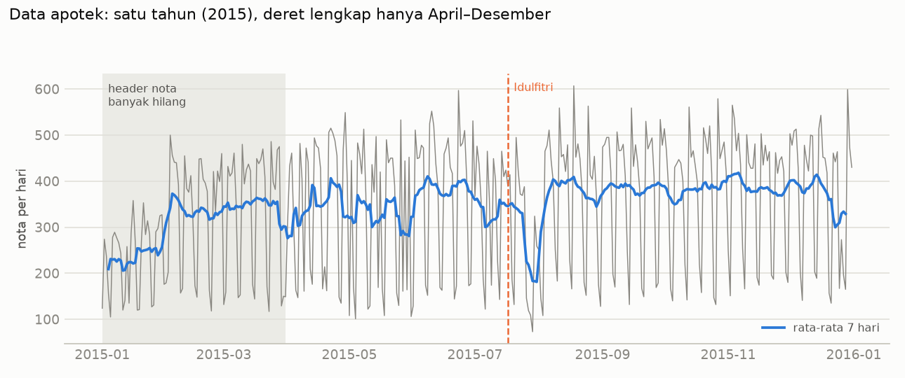

# Fase 8 Langkah 1: Audit Kelayakan Data Apotek Indonesia

> **Status (28 Okt 2026):** audit selesai, belum ada modeling. Kode: `src/retailfc/id_pharmacy.py`
> (dump SQL → Parquet), `src/retailfc/id_audit.py` (angka audit dan grafik). Angka lengkap:
> `reports/id_data_audit.json`. Tes parser: `tests/test_id_pharmacy.py`.

---

## Ringkasan

- **Data tidak memenuhi syarat transfer penuh** di `PROJECT_PLAN.md` §5 Fase 8:
  - periodenya hanya **satu tahun (1 Jan–31 Des 2015)**, padahal syaratnya ≥ 2 tahun;
  - hanya ada **satu Idulfitri (17 Jul 2015)**, padahal syaratnya ≥ 2 kali Ramadan/Idulfitri;
  - header nota bulan **Jan–Mar 2015 sebagian besar hilang** (42–68% nota tidak bertanggal),
    jadi deret harian yang lengkap hanya **1 Apr–31 Des 2015 (275 hari)**.
- Sesuai rencana, langkah berikutnya adalah **jalur "tidak cukup"**: studi efek
  Ramadan/Idulfitri dan forecasting di level agregat, bukan forecasting per produk dengan
  fitur Ramadan.
- **Pola Idulfitri di data ini janggal.** Nota rawat jalan (kode `RJ`) tetap normal pada
  16–18 Jul (cuti bersama dan Idulfitri), lalu turun tajam pada **28 Jul–1 Agu**. Sebaliknya,
  libur 1 Mei dan 25 Des terlihat tepat pada harinya. Penyebabnya tidak bisa dipastikan dari
  data, sehingga hasil studi efek Idulfitri nantinya harus dibaca dengan hati-hati.
- **Ini kemungkinan bukan apotek ritel biasa.** Data memuat nomor resep, kode dokter,
  penjamin Askes, racikan, dan hanya 0,07% nota yang pembelinya "UMUM". Kemungkinan besar
  ini apotek rumah sakit atau klinik, tetapi belum terverifikasi. Permintaannya digerakkan oleh
  kunjungan pasien, bukan belanja, jadi pola Ramadan ala ritel belum tentu berlaku.

---

## 1. Sumber dan cara unduh

| Kolom | Nilai |
|---|---|
| Dataset | Gustriansyah, R. (2022). *Retail sales dataset of a pharmacy in Indonesia*. Mendeley Data, V1 |
| DOI | `10.17632/2ym7v78wtd.1` |
| Lisensi | CC BY 4.0 |
| Cara unduh | API publik Mendeley (`/public-api/datasets/2ym7v78wtd/files?version=1`), tanggal akses 28 Okt 2026 |
| File | `sales.zip` (8.560.326 byte), SHA-256 cocok dengan nilai di metadata Mendeley |
| Isi | `sales.sql` (70.610.765 byte), dump MariaDB 10.4.6 dari HeidiSQL 11.3 |

Detail checksum ada di `data/SOURCES.md` §2.

## 2. Tabel

Jumlah baris di bawah adalah hitungan parser. Angka di komentar dump hanya perkiraan InnoDB.

| Tabel | Baris | Perkiraan di dump | Isi |
|---|---:|---:|---|
| `ms_sales` | 127.064 | 127.025 | header nota: `NO_RESEP`, `TGL`, `JAM_JUAL`, `KD_CUST`, `KD_DOKTER`, `REG_AS`, `RACIK` |
| `det_sales` | 514.620 | 511.559 | baris nota: `NO_RESEP`, `KD_OBAT`, `QTY`, `HNA` (harga beli), `HJ` (harga jual), `PPN_JUAL` |
| `ms_product` | 6.878 | 7.057 | master produk: `KD_OBAT`, `NAMA`, `SAT_JUAL`, `KD_PABRIK`, `HJ_RP` |
| `transaction` | 399.738 | 403.111 | gabungan versi penulis: `TGL`, `KD_CUST`, `KD_OBAT`, `QTY`, `HNA`, `HJ` |

Catatan: nama tabel di dump adalah `ms_product`, bukan `ms_products` seperti di deskripsi
Mendeley. Tidak ada kolom kategori atau golongan obat. Yang tersedia hanya nama, satuan,
dan kode pabrik.

## 3. Periode dan kelengkapan

- Tanggal nota: **1 Jan–31 Des 2015**, 365 tanggal berbeda, tanpa hari kosong.
- **102.605 baris `det_sales` (19,9%) tidak punya header** di `ms_sales`, sehingga tidak
  bertanggal. Semuanya berasal dari nota bulan Jan–Mar menurut nomor notanya:

| Bulan (dari nomor nota) | Nota dengan header | Nota tanpa header | Hilang |
|---|---:|---:|---:|
| Jan 2015 | 6.192 | 12.969 | 68% |
| Feb 2015 | 8.311 | 11.264 | 58% |
| Mar 2015 | 9.034 | 6.517 | 42% |
| Apr–Des 2015 | 99.830 | 0 | 0% |

- Karena itu, **deret harian yang dipakai dimulai 1 Apr 2015 (275 hari)**. Pada Jan–Mar,
  volume yang terlihat lebih rendah karena data hilang, bukan karena permintaan turun.
- Tidak ada lag 364 hari yang bisa dihitung, dan tidak ada pola tahunan yang bisa dipelajari.

## 4. Tabel `transaction` vs gabungan sendiri

`transaction` adalah subset dari `det_sales ⋈ ms_sales`: tidak ada baris yang hanya ada di
`transaction`, tetapi **12.277 baris (3,0%) dibuang** penulis. Aturan pembuangannya tidak
didokumentasikan dan tidak terlihat dari data. Hanya 5 baris yang ber-QTY ≤ 0, dan
99,98% baris yang dibuang ber-PPN 0% (vs 85,8% pada baris yang disimpan). Selain itu,
**83 nota punya tanggal berbeda** antara `transaction` dan `ms_sales` (median selisih 3 hari).

**Keputusan:** saya memakai `det_sales ⋈ ms_sales` dengan tanggal dari header nota.
Gabungan ini lebih lengkap, dan setiap pembersihannya bisa saya catat sendiri.

## 5. Kualitas data

| Cek | Jumlah |
|---|---:|
| Baris `det_sales` yang sama persis | 1.948 |
| QTY negatif (kemungkinan retur) | 278 |
| QTY nol | 6 |
| QTY bukan bilangan bulat | 2.512 |
| Harga jual nol | 51 |
| Produk di `det_sales` yang tidak ada di master | 122 baris |
| Nota ganda di `ms_sales` | 0 |
| Nota tanpa tag bulan di nomornya | 3.587 |
| Nota yang bulan di nomornya ≠ bulan `TGL` | 2 |
| Produk master yang tidak pernah terjual | 4.651 dari 6.878 |
| Produk master dengan harga 0 | 859 |

Baris yang sama persis belum tentu salah, karena obat yang sama bisa muncul dua kali dalam
satu nota. Keputusan untuk baris ini, retur, dan QTY pecahan diambil saat membangun deret,
lalu dicatat.

## 6. Volume harian (1 Apr–31 Des 2015)

| Ukuran per hari | Min | Median | Maks |
|---|---:|---:|---:|
| Nota | 73 | 428 | 607 |
| Baris nota | 243 | 1.374 | 1.963 |
| Unit | 912 | 14.139 | 72.667 |
| Omzet (QTY × HJ, sebelum PPN) | Rp 4,4 jt | Rp 42,7 jt | Rp 211,0 jt |

Tidak ada hari tanpa nota. Hanya 3,4% nota yang tercatat di luar jam 07.00–21.00.

### Jenis nota dan pola mingguan

Huruf awal nomor nota: `RJ` 72.005, `RI` 44.880, `RL` 7.735, `KC` 2.349, `B` 87, `PR` 8.
Artinya tidak didokumentasikan. `REG_AS` berisi `R` 102.858, `I` 24.116, `A` 90, padahal
komentar skema hanya menyebut R (reguler) dan A (Askes).

Rata-rata nota per hari:

| | Sen | Sel | Rab | Kam | Jum | Sab | Min |
|---|---:|---:|---:|---:|---:|---:|---:|
| RJ | 31,5 | 310,5 | 264,0 | 270,4 | 256,8 | 235,1 | 41,1 |
| RI | 111,2 | 123,3 | 133,0 | 128,6 | 127,4 | 122,6 | 123,5 |
| RL | 5,5 | 53,7 | 29,0 | 32,0 | 27,8 | 31,9 | 16,8 |

Nota `RJ` hampir hilang **setiap Minggu dan Senin**, konsisten di semua bulan, sedangkan `RI`
stabil sepanjang minggu. Pola Senin sepi ini tidak lazim. Pola itu nyata di data, tetapi
penyebabnya tidak diketahui, entah jadwal layanan atau cara pencatatan tanggal.

## 7. Produk (1 Apr–31 Des 2015)

- **1.826 produk** terjual minimal sekali.
- Terjual di ≥ 10% hari: 695 produk; ≥ 25%: 410; ≥ 50%: **200**; ≥ 80%: **75**.
- Hari tanpa penjualan: 83,6% dari seluruh sel produk × hari. Median per produk 95,3%.
- 196 produk menyumbang 80% omzet.
- Segmen Syntetos–Boylan (ADI/CV², ambang yang sama dengan Fase 6): smooth 26, erratic 73,
  intermittent 1.243, lumpy 484.

Sebagai pembanding, M5 punya 30.490 deret dengan riwayat sampai 5,3 tahun. Di sini hanya
±200 produk yang cukup sering terjual, dengan riwayat 9 bulan.

## 8. Kalender dan Idulfitri

Libur di bawah berasal dari paket `holidays` 0.107 (ID, kategori `public` dan `government`)
dan **belum diverifikasi terhadap SKB**. Verifikasi dilakukan saat membuat
`data/external/id_calendar.csv`.

- Idulfitri: **17–18 Jul 2015**. Cuti bersama: 16, 20, dan 21 Jul 2015.
- Awal Ramadan tidak ada di paket `holidays` dan belum diambil dari sumber resmi (sidang
  isbat). Karena Ramadan berlangsung 29–30 hari sebelum Idulfitri, seluruh Ramadan 2015
  pasti berada di periode lengkap (sejak 1 Apr). Ada ±2,5 bulan data sebelum Ramadan
  sebagai pembanding.

Nota per jenis di sekitar Idulfitri:

| Tanggal | Hari | Keterangan | RJ | RI | RL |
|---|---|---|---:|---:|---:|
| 14 Jul | Sel | | 249 | 124 | 74 |
| 15 Jul | Rab | | 236 | 142 | 25 |
| 16 Jul | Kam | cuti bersama | 253 | 127 | 30 |
| 17 Jul | Jum | Idulfitri | 225 | 129 | 26 |
| 18 Jul | Sab | Idulfitri hari ke-2 | 210 | 159 | 35 |
| 19 Jul | Min | | 41 | 136 | 6 |
| 20 Jul | Sen | cuti bersama | 29 | 103 | 0 |
| 21 Jul | Sel | cuti bersama | 311 | 105 | 65 |
| 22–25 Jul | Rab–Sab | | 209–244 | 100–130 | 19–48 |
| 26 Jul | Min | | 18 | 95 | 29 |
| 27 Jul | Sen | | 37 | 81 | 1 |
| 28 Jul | Sel | | 54 | 55 | 1 |
| 29 Jul | Rab | | 9 | 62 | 2 |
| 30 Jul | Kam | | 47 | 111 | 150 |
| 31 Jul | Jum | | 72 | 127 | 46 |
| 1 Agu | Sab | | 82 | 120 | 36 |

Sebagai pembanding: pada 1 Mei (Jumat) nota RJ hanya 9, dan pada 25 Des (Jumat) hanya 36,
tepat di hari liburnya. Pada Idulfitri, hari kerja dengan nota RJ serendah itu justru muncul
pada 28 Jul–1 Agu, 11–15 hari kemudian.

Yang sudah dicek:
- Nomor urut nota umumnya naik searah tanggal (median korelasi Spearman 0,98 di 183
  kelompok jenis × bulan × unit), jadi **tidak ada pergeseran tanggal yang sistematis**.
  Namun 27% kelompok punya korelasi < 0,95, dan rentang nomor antar hari banyak yang
  tumpang tindih. Artinya sebagian nota diberi tanggal mundur.

Kemungkinan penyebab yang **belum bisa dibedakan** dari data: layanan rawat jalan tetap buka
saat Lebaran lalu libur seminggu sesudahnya, atau tanggal di sistem adalah tanggal input
dan bukan tanggal layanan. Cara memastikannya: bertanya ke penulis dataset.

## 9. Keputusan kelayakan

| Syarat (`PROJECT_PLAN.md`) | Hasil | Lolos |
|---|---|---|
| Periode ≥ 2 tahun | 1 tahun, lengkap 275 hari | ✗ |
| ≥ 2 kali Ramadan/Idulfitri | 1 kali (2015) | ✗ |
| Cukup banyak produk aktif | ±200 produk terjual di ≥ 50% hari | terbatas |

**Kesimpulan: jalur "tidak cukup".** Alasannya:
1. Dengan satu Ramadan, fitur `is_ramadan`, `ramadan_day`, dan `days_to_idulfitri` hanya
   muncul di train atau di test, tidak di keduanya. Ablation dengan vs tanpa fitur Ramadan
   tidak bisa diuji secara jujur.
2. Riwayat 9 bulan tidak cukup untuk lag 364 dan musiman tahunan, yang di M5 termasuk fitur
   yang dipakai.

Usulan Langkah 2 (menunggu persetujuan):
- **Studi efek Ramadan/Idulfitri**: nota dan unit per hari relatif terhadap baseline per
  hari dalam minggu, di jendela sebelum Ramadan, selama Ramadan, sekitar Lebaran, dan sesudah
  Lebaran. Dipecah per jenis nota (RJ/RI). Anomali di §8 ditulis sebagai keterbatasan.
- **Forecasting agregat** (total harian, atau ±200 produk paling sering terjual) dengan
  rolling origin di Agu–Des, dibandingkan dengan baseline yang sama seperti di M5.
- Sebelum itu, `data/external/id_calendar.csv` dibuat dengan tanggal yang diverifikasi
  dari SKB dan pengumuman isbat.

## 10. Privasi

Kolom `KD_CUST` (nomor registrasi pasien) dan `KD_DOKTER` hanya dipakai untuk menghitung
agregat. Nilai individunya tidak ditampilkan di laporan, grafik, atau repo.
