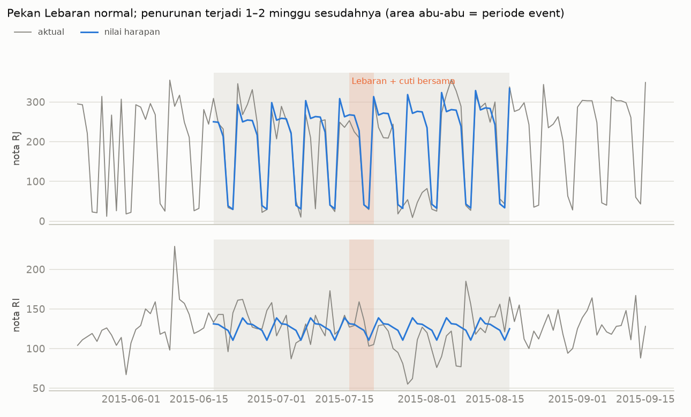

# Fase 8: Transfer ke Data Apotek Indonesia (P5)

> **Status (28 Okt 2026):** selesai, mengikuti jalur "tidak cukup" dari
> `reports/id_data_audit.md`. Desain ditetapkan sebelum hasil dihitung:
> `reports/id_phase8_design.md`.
>
> - Kode: `src/retailfc/id_calendar.py`, `id_event_study.py`, `id_forecast.py`, `id_report.py`.
> - Angka lengkap: `reports/id_event_study.json`, `id_event_study_daily.csv`,
>   `id_event_calibration.json`, `id_forecast.json`.
> - Tes: `tests/test_id_calendar.py`, `test_id_event_study.py`, `test_id_forecast.py`.

---

## Ringkasan

- **Pekan Lebaran itu sendiri tidak berbeda dari minggu biasa.** Nota pada 16–21 Jul
  (cuti bersama + Idulfitri) hanya −3% dari nilai harapan, masih di dalam fluktuasi biasa.
- **Efek terbesar justru muncul 1–2 minggu sesudahnya** (22 Jul–4 Agu): total nota −25% dan
  −37%, RJ −30% dan −63%, RI −20% dan −23%. Angka ini jauh di luar pita plasebo dan konsisten
  di kelima cara baseline. Setelah itu ada rebound +8–9% di minggu ke-3 dan ke-4.
- **Minggu terakhir Ramadan** juga turun (total −11%, RJ −22%). Kenaikan di awal Ramadan
  tidak kokoh, karena besarnya bergantung pada pilihan baseline.
- **Untuk forecast 14 hari, XGBoost tidak mengalahkan baseline sederhana.** Di deret agregat,
  XGBoost tidak pernah menjadi yang terbaik di 24 perbandingan (8 fold × 3 deret). Pemenangnya
  rata-rata hari yang sama dari 4 minggu terakhir dan ETS. Untuk ±200 produk, XGBoost
  (WRMSSE 0,98) sedikit kalah dari rata-rata hari yang sama (0,94).
- **Fitur hari libur umum tidak membantu**, termasuk di fold yang horizon-nya memuat Lebaran.
- **Pelajaran untuk P4:** desain fitur ala Easter (`days_to/since_event`, dipotong ±7 hari)
  akan **melewatkan** sebagian besar efek di data ini, karena efeknya terjadi 5–18 hari setelah
  Idulfitri, dengan penurunan terdalam di hari ke-11 s.d. ke-15.

---

## 1. Data dan kalender

- Data: baris `det_sales` yang punya header nota, 1 Apr–31 Des 2015 (275 hari). Detail
  di audit.
- Kalender: `data/external/id_calendar.csv`, berisi 24 baris dengan sumber per tanggal
  (SKB 3 Menteri lewat Setkab, SKB perubahan 310/2014, Keppres 25/2015, dan pengumuman
  isbat). 1 Ramadan 1436 H = 18 Jun 2015, Idulfitri = 17 Jul 2015, cuti bersama = 16, 20,
  dan 21 Jul 2015. Paket `holidays` cocok di semua tanggal libur, tetapi tidak memuat
  status cuti bersama Natal 24 Des.

## 2. Studi efek Ramadan/Lebaran

Metode (detail di desain §2): nilai harapan = faktor hari dalam minggu × level lokal, dengan
level diinterpolasi dari 28 hari biasa sebelum dan sesudah periode event (18 Jun–18 Agu).
Baseline dan panjang jendela dipilih lewat kalibrasi plasebo, **hanya dari data non-event**.
Libur non-Lebaran di dalam periode event (17 Agu) dikeluarkan dari jumlah, sama seperti di
jendela plasebo.

Efek (% terhadap nilai harapan), dengan pita plasebo 5–95% dalam kurung. Tanda * berarti di
luar pita.

| Jendela | Tanggal | Nota total | Nota RJ | Nota RI | Unit total |
|---|---|---:|---:|---:|---:|
| Ramadan mg 1 | 18–24 Jun | +9,7* [−8,6; +3,7] | +10,7* [−14,6; +2,0] | +11,1* [−4,7; +10,3] | +17,4 [−21,5; +52,8] |
| Ramadan mg 2 | 25 Jun–1 Jul | +5,7* [−7,0; +4,7] | +4,8* [−15,3; +1,7] | +6,5 [−2,9; +10,8] | +6,8 [−19,8; +58,0] |
| Ramadan mg 3 | 2–8 Jul | −4,6 [−6,2; +5,2] | −4,6 [−15,7; +2,2] | −8,3* [−3,2; +11,1] | +10,8 [−19,7; +53,3] |
| Ramadan mg 4 | 9–15 Jul | **−10,6*** [−6,6; +9,4] | **−21,8*** [−15,2; +2,1] | +6,4 [−2,8; +11,5] | +1,9 [−19,0; +44,5] |
| Lebaran + cuti | 16–21 Jul | −3,1 [−9,3; +7,7] | −6,8 [−17,3; +0,4] | +1,6 [−5,8; +12,9] | +12,7 [−24,1; +73,2] |
| pasca mg 1 | 22–28 Jul | **−24,8*** [−8,6; +7,7] | **−29,7*** [−15,8; −2,0] | **−19,6*** [−4,2; +11,4] | −23,3 [−24,3; +66,0] |
| pasca mg 2 | 29 Jul–4 Agu | **−37,0*** [−8,7; +6,6] | **−63,0*** [−15,3; −2,6] | **−22,8*** [−5,8; +11,7] | **−55,6*** [−25,6; +28,7] |
| pasca mg 3 | 5–11 Agu | +9,0* [−3,1; +7,3] | +13,2* [−12,5; +3,2] | −3,8* [−1,5; +10,9] | +40,2* [−30,2; +26,3] |
| pasca mg 4 | 12–18 Agu | +7,8* [−4,0; +7,3] | +3,9* [−12,4; +0,6] | +9,2 [−4,9; +10,8] | +33,3* [−34,1; +25,8] |

### 2.1 Seberapa kokoh?

Efek dihitung ulang dengan 4 cara baseline lain: median per hari dalam minggu, log-linear
dengan tren, serta level lokal dengan margin 14 dan 42 hari (`id_event_study.json →
sensitivity`).

| Temuan | Rentang di 5 baseline | Di luar pita di semua baseline? |
|---|---|---|
| Pasca Lebaran mg 1, nota total | −23,6% s.d. −26,2% | ya |
| Pasca Lebaran mg 2, nota total | −36,1% s.d. −37,8% | ya |
| Pasca Lebaran mg 2, nota RJ | −61,4% s.d. −64,6% | ya |
| Pasca Lebaran mg 1–2, nota RI | −18,0% s.d. −24,0% | ya |
| Ramadan mg 4, nota total | −8,9% s.d. −13,3% | ya |
| Lebaran + cuti, nota total | −1,4% s.d. −5,4% | tidak, di dalam pita di semua baseline |
| Ramadan mg 1, nota total | +2,6% s.d. +12,3% | **tidak**: hanya di 3 dari 5 baseline |
| Pasca Lebaran mg 3–4, nota total | +7,6% s.d. +10,6% | 4 dari 5 baseline (kecuali median per hari dalam minggu) |

**Kesimpulan yang bisa dipegang:** permintaan turun tajam selama dua minggu, mulai 1 hari
setelah cuti bersama terakhir, lalu sebagian kembali (rebound). Penurunan juga terjadi di
minggu terakhir Ramadan, terutama di RJ. Kenaikan di awal Ramadan bergantung pada pilihan
baseline, jadi **tidak disimpulkan**.

### 2.2 Keterbatasan

- **Satu kejadian.** Ini deskripsi satu Lebaran di satu apotek, bukan perkiraan efek yang
  berlaku umum.
- **Pita plasebo kasar.** 60 posisi plasebo saling tumpang tindih, dan data Agu–Des hanya
  memuat ±2 periode 62 hari yang benar-benar terpisah. Dengan 9 jendela, ±1 jendela bisa
  keluar pita karena kebetulan. Karena itu, kesimpulan hanya diambil dari efek yang besar
  **dan** konsisten antar baseline.
- **Penyebab tidak diketahui.** Pola "normal saat Lebaran, turun seminggu sesudahnya" bisa
  berarti layanan rawat jalan libur setelah Lebaran (dokter cuti), atau tanggal di sistem
  adalah tanggal input, bukan tanggal layanan. Audit §8 menunjukkan sebagian nota diberi
  tanggal mundur. Data ini tidak bisa membedakan keduanya.
- **Unit lebih berisik daripada nota** (pita plasebo ±20–70%), sehingga hanya efek paling
  besar yang terdeteksi di unit.

## 3. Forecast 14 hari

Desain di §3 dokumen desain: 8 fold CV (horizon 11 Sep–31 Des) dan 2 fold khusus. Train
selalu mulai 1 Apr, dengan early stopping di 14 hari terakhir train. Parameter XGBoost
ditetapkan di awal dan **tidak di-tuning**. Metrik: RMSSE, dengan skala MSE naive 7 hari
di train.

### 3.1 Deret agregat (CV, rata-rata 8 fold; simpangan baku dalam kurung)

| Metode | Nota RJ | Nota RI | Unit total | Terbaik (dari 24) |
|---|---:|---:|---:|---:|
| naive 7 hari | 0,43 (0,33) | 0,78 (0,20) | 1,49 (0,70) | 3 |
| rata-rata hari sama 4 mg | **0,36** (0,30) | **0,63** (0,14) | 1,15 (0,65) | 6 |
| MA 28 | 1,31 (0,17) | 0,64 (0,09) | 1,31 (0,62) | 4 |
| ETS (musiman 7) | 0,37 (0,29) | 0,67 (0,14) | **1,09** (0,69) | **9** |
| XGBoost | 0,69 (0,34) | 0,76 (0,18) | 1,19 (0,81) | 0 |
| XGBoost tanpa fitur libur | 0,65 (0,33) | 0,76 (0,18) | 1,18 (0,84) | 2 |

WAPE nota RJ: rata-rata hari sama 10%, ETS 10%, XGBoost 22%.

### 3.2 Produk (±200 produk yang terjual di ≥ 50% hari train)

| Metode | WRMSSE (std) | WAPE per produk | WAPE total produk |
|---|---:|---:|---:|
| naive 7 hari | 1,180 (0,301) | 80% | 40% |
| rata-rata hari sama 4 mg | **0,941** (0,260) | **66%** | **32%** |
| MA 28 | 0,991 (0,257) | 83% | 50% |
| Croston | 1,001 (0,257) | 84% | 49% |
| TSB | 0,997 (0,255) | 83% | 49% |
| XGBoost | 0,984 (0,346) | 69% | 36% |
| XGBoost tanpa fitur libur | 0,968 (0,324) | 68% | 35% |

XGBoost lebih baik dari baseline terbaik di fold itu pada 4 dari 8 fold (cv1, cv3, cv5,
cv6), tetapi jauh lebih buruk di cv8 (1,43 vs 1,03). Akibatnya rata-ratanya kalah. Sebarannya
juga lebih besar (std 0,35 vs 0,26).

### 3.3 Fold khusus Lebaran

RMSSE, dengan bias (% total) di belakangnya:

| Fold (horizon) | Deret | Rata-rata hari sama 4 mg | ETS | XGBoost | XGBoost tanpa libur |
|---|---|---:|---:|---:|---:|
| `lebaran` (10–23 Jul) | nota RJ | 0,21 / +2% | 0,21 / −1% | 0,37 / −4% | 0,37 / −2% |
| | nota RI | 0,78 / +2% | 0,56 / −2% | 0,90 / −15% | 0,89 / −13% |
| | unit total | 0,38 / −10% | 0,41 / −10% | 0,61 / −18% | 0,54 / −14% |
| | produk (WRMSSE) | 0,703 | – | 0,731 | 0,724 |
| `post_lebaran` (24 Jul–6 Agu) | nota RJ | 1,25 / +42% | 1,23 / +43% | 1,31 / +51% | 1,21 / +46% |
| | nota RI | 1,13 / +30% | 1,16 / +30% | 0,93 / +21% | 0,89 / +19% |
| | unit total | 1,28 / +50% | 1,21 / +49% | 1,09 / +31% | 1,05 / +28% |
| | produk (WRMSSE) | 0,870 | – | 0,801 | 0,765 |

- **Fitur libur umum tidak membantu memprediksi Lebaran.** Varian dengan dan tanpa fitur
  libur hampir sama, dan yang tanpa fitur libur sedikit lebih baik. Ini konsisten dengan §2:
  hari Lebaran sendiri tidak berbeda dari hari biasa.
- **Penurunan pasca Lebaran tidak terprediksi oleh metode mana pun** (bias +19% s.d. +51%).
  Tidak ada informasi di data train yang menandakan penurunan itu akan terjadi. XGBoost
  sedikit kurang bias untuk RI dan unit, tetapi tetap meleset jauh.

### 3.4 Kenapa XGBoost kalah di sini, padahal menang di M5?

- **Datanya kecil.** Setelah dikurangi 41 hari pemanasan lag, satu fold hanya punya ±60
  (fold `lebaran`) sampai ±220 (cv8) hari baris train per deret. Di M5, satu toko punya ±4,5 juta baris.
- **Polanya sederhana dan stabil.** Pola mingguan RJ sangat kuat (Minggu dan Senin hampir
  nol), dan rata-rata hari yang sama dari 4 minggu terakhir sudah menangkapnya hampir
  sempurna. XGBoost harus mempelajari pola itu dari lag ≥ 14 hari, dengan data sedikit.
- **Early stopping tidak stabil.** Jendela validasi hanya 14 hari. Iterasi terbaik
  berkisar 3 sampai 519 antar fold (cv7 produk: 3 iterasi).
- Parameter sengaja tidak di-tuning (lihat desain). Tuning mungkin memperbaiki XGBoost,
  tetapi dengan data sekecil ini tidak ada data tersisa untuk menilai hasil tuning secara jujur.

## 4. Perbandingan dengan Easter di M5 (Langkah 3)

| | Easter (M5, Fase 2 & 4) | Idulfitri (apotek, Fase 8) |
|---|---|---|
| Jumlah kejadian | 5 (2011–2015), 10 toko | 1 (2015), 1 apotek |
| Jenis permintaan | belanja ritel | resep obat (kemungkinan rumah sakit/klinik) |
| Kapan efeknya | sekitar hari-H, ±3 hari | **bukan** di hari-H; 1–14 hari setelah cuti bersama terakhir (5–18 hari setelah Idulfitri) |
| Arah dan besar | FOODS +15–16% Jum–Sab sebelum; HOBBIES/HOUSEHOLD −17% s.d. −22% di hari-H | nota −25% s.d. −37% selama dua minggu, lalu rebound +8–9%; Ramadan minggu terakhir −11% |
| Kelompok terdampak | berbeda per kategori | RJ paling dalam (−63% di minggu ke-2), RI juga turun (−20% s.d. −23%) |
| Fitur hari libur dalam forecast | `days_to/since_easter` tidak terbukti di level item; membantu total harian FOODS | fitur Ramadan tidak bisa diuji (1 kejadian); fitur libur umum tidak membantu, termasuk di fold Lebaran |

**Pelajaran:**
1. Fitur `days_to/since_event` yang dipotong ±7 hari, seperti yang dipakai untuk Easter,
   **tidak akan menangkap** sebagian besar efek Idulfitri di data ini, karena efeknya terjadi
   5–18 hari setelah hari-H (terdalam di hari ke-11 s.d. ke-15), dengan rebound sampai sekitar
   4 minggu sesudahnya. Untuk Lebaran, jendela fitur harus jauh lebih panjang, setidaknya
   sampai 4 minggu setelah hari-H. Batas ini sebaiknya ditentukan dari data dengan lebih dari
   satu Lebaran.
2. Efek hari libur bergantung pada **jenis permintaan**. Ritel naik sebelum hari libur,
   sedangkan layanan resep turun ketika layanannya sendiri berkurang. Pola dari satu jenis
   bisnis tidak bisa dipindahkan begitu saja ke jenis lain. Yang bisa dipindahkan adalah
   **metodenya**: kalender bersumber resmi, baseline per hari dalam minggu, dan uji plasebo.

## 5. Yang tidak berhasil

- **Run pertama XGBoost salah skala** (`reports/id_forecast_unscaled.json`). Satu model
  gabungan melatih nota (±100–300/hari) bersama unit (±14.000/hari) tanpa penyamaan skala.
  Loss tweedie didominasi deret yang besar, sehingga di fold `post_lebaran` XGBoost menebak
  nota RJ +302% dan RI +356% di atas aktual. Perbaikannya: target dan fitur tiap deret dibagi
  rata-rata train deret itu, lalu level deret dimasukkan sebagai fitur. Ini menyimpang dari
  desain awal (dicatat di desain §6). Rata-rata CV sebelum → sesudah perbaikan: nota RJ
  0,59 → 0,69, nota RI 1,22 → 0,76, unit 1,23 → 1,19, dan produk 1,026 → 0,984. Nota RJ
  sedikit memburuk, tetapi hasil absurd di fold pasca Lebaran hilang. Kesimpulan bahwa
  XGBoost kalah dari baseline sederhana tetap sama di kedua versi.
- **Fitur Ramadan tidak bisa diuji**, sesuai perkiraan audit.

## 6. Apa artinya untuk proyek

- P5 terpenuhi **sebagian**. Metodenya berhasil dipindahkan: kalender resmi, rolling origin,
  baseline yang sama, dan uji plasebo. Namun fitur Ramadan tidak bisa diuji, dan XGBoost
  tidak unggul di data sekecil ini.
- Temuan terkuat bersifat **deskriptif**: Lebaran berdampak ke permintaan apotek ini
  **sesudah** liburnya, bukan saat libur. Ini relevan untuk perencanaan stok, karena
  baseline dan XGBoost sama-sama meleset +19% s.d. +51% di periode itu.
- Untuk menguji fitur Ramadan dengan jujur, dibutuhkan data dengan minimal 2–3 Lebaran.
