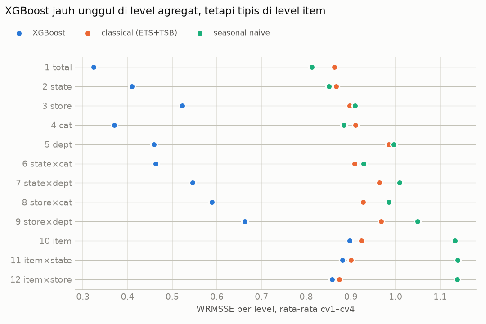
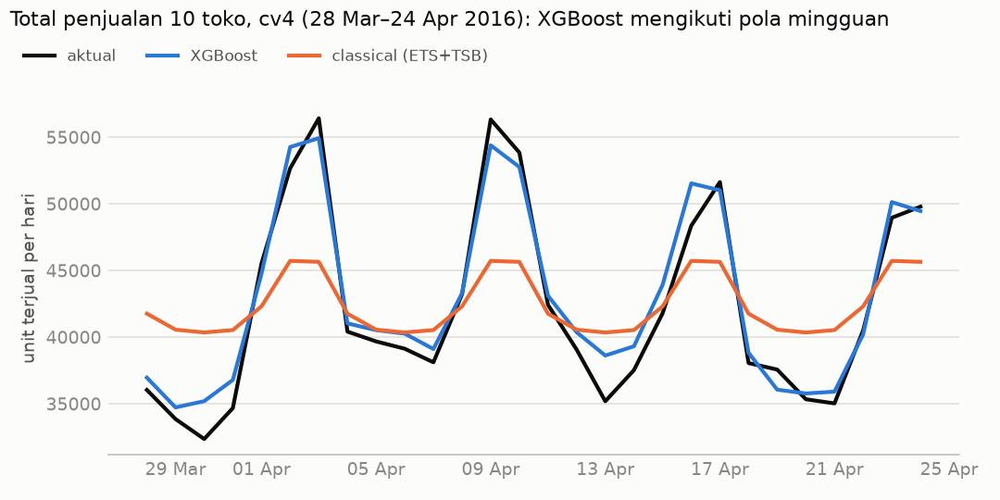
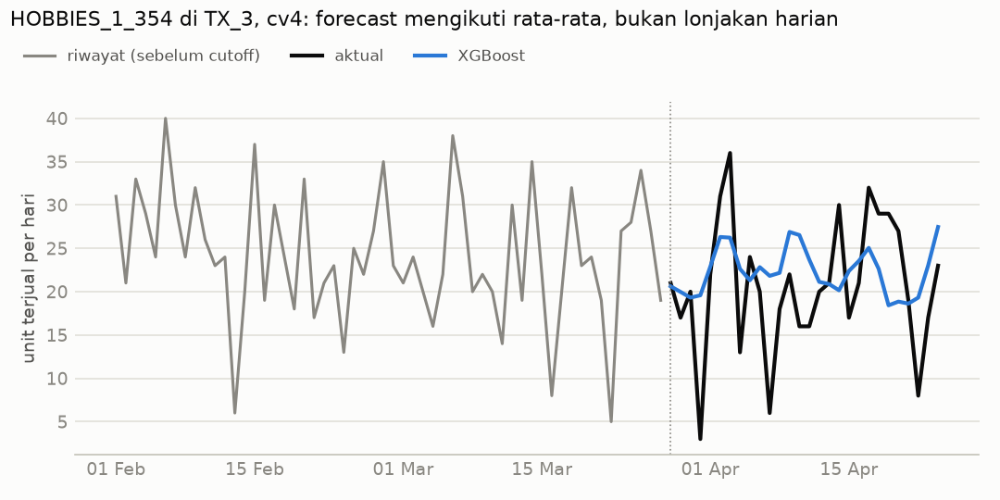

# Fase 5: Hasil Sementara Baseline dan XGBoost

> **Status (24 Okt 2026):** point forecast **selesai** (10 toko × 7 fold).
> Eksperimen kuantil **selesai** (eta 0,2 terpilih, §8). Model kuantil final 10 toko
> belum dilatih.
> Semua angka di sini berasal dari fold CV dan fold khusus (data ≤ d_1913).
> Holdout d_1914–d_1941 **belum disentuh**.

---

## Ringkasan singkat

- **XGBoost jauh lebih akurat daripada semua baseline.** WRMSSE rata-rata 4 fold CV
  **0,582 ± 0,051**. Baseline terbaik (classical = ETS + TSB) mendapat **0,916 ± 0,032**,
  jadi error XGBoost **±36% lebih kecil**. XGBoost menang di **ketujuh fold**.
- **Dalam bahasa sehari-hari** (akurasi = 100% − WAPE, rata-rata 4 fold CV):
  - total penjualan harian 10 toko: **96,4%** (classical 90,4%),
  - penjualan harian per toko: **93,2%** (classical 87,8%),
  - penjualan harian per **item per toko**: hanya **22,3%** (classical 24,2%).
- **Keunggulan XGBoost ada di level agregat** (total, toko, kategori, departemen).
  Di level item, keunggulannya **tipis atau tidak ada**: WRMSSE hanya 2–3% lebih baik,
  dan menurut WAPE classical malah sedikit lebih baik di level item-toko.
  Fase 6 akan menelusuri penyebabnya.
- **Tiga keputusan model** diambil lewat eksperimen di 2 toko: objective `reg:tweedie`
  dengan power 1,1, `item_id` di-*label encode*, dan baris di dalam deretan nol panjang
  item laris (indikasi stok habis) dikeluarkan dari training.

---

## 1. Cara kerja WRMSSE dan cara membacanya

### 1.1 Kenapa tidak pakai "akurasi %" atau MAPE saja?

Data M5 punya tiga sifat yang menyulitkan metrik biasa:

1. **Banyak nol.** 59,6% hari item-toko bernilai nol (`reports/eda.md`). MAPE membagi
   dengan nilai aktual, jadi hari bernilai nol membuat MAPE tak terhingga.
2. **Skala sangat berbeda.** Total 10 toko terjual ±42.000 unit per hari, sedangkan satu
   item bisa terjual 0–2 unit per hari. Error "10 unit" kecil untuk total, tetapi besar
   untuk satu item. Error mentah (MAE/RMSE) tidak adil dipakai lintas deret.
3. **Tidak semua deret sama penting.** Item yang omzetnya besar lebih penting bagi
   bisnis daripada item yang hampir tidak laku.

WRMSSE (*Weighted Root Mean Squared Scaled Error*) adalah metrik resmi kompetisi M5.
Metrik ini dirancang untuk mengatasi ketiga masalah tersebut.

### 1.2 Langkah demi langkah

Nama WRMSSE dibaca dari belakang:

| Langkah | Bagian nama | Apa yang dihitung |
|---|---|---|
| 1 | **MSE** (*Mean Squared Error*) | Untuk satu deret, hitung selisih forecast dan aktual tiap hari selama 28 hari, kuadratkan, lalu rata-ratakan. |
| 2 | **S** (*Scaled*) | Bagi dengan **skala deret**: rata-rata kuadrat perubahan harian di **riwayat** deret itu, yaitu (hari ini − kemarin)², dihitung dari penjualan pertama sampai cutoff. Skala ini adalah error yang didapat seandainya kita meramal "besok = hari ini". |
| 3 | **R** (*Root*) | Ambil akarnya. Hasilnya **RMSSE** per deret, dan angka ini tidak bersatuan (bukan unit, bukan dolar). |
| 4 | **W** (*Weighted*) | Kalikan RMSSE tiap deret dengan **bobotnya**, yaitu porsi omzet (unit × harga) deret itu dalam 28 hari terakhir sebelum cutoff. Bobot dihitung per level, dan jumlah bobot di setiap level = 1. |
| 5 | 12 level | Langkah 1–4 dilakukan untuk **42.840 deret** di 12 level hierarki (tabel di bawah). Skor tiap level dirata-rata **sama rata**, dan hasilnya adalah WRMSSE. |

Dalam rumus:

```
RMSSE_deret = √( MSE forecast / MSE naive "besok = hari ini" di riwayat )
            = RMSE forecast / RMSE naive di riwayat

skor_level  = Σ (bobot_deret × RMSSE_deret)     ← jumlah bobot per level = 1
WRMSSE      = rata-rata skor_level dari 12 level
```

Ke-12 level hierarki M5:

| Level | Deret yang dinilai | Jumlah deret |
|---|---|---:|
| 1 | total semua toko | 1 |
| 2 | per negara bagian (CA, TX, WI) | 3 |
| 3 | per toko | 10 |
| 4 | per kategori | 3 |
| 5 | per departemen | 7 |
| 6 | negara bagian × kategori | 9 |
| 7 | negara bagian × departemen | 21 |
| 8 | toko × kategori | 30 |
| 9 | toko × departemen | 70 |
| 10 | per item (semua toko) | 3.049 |
| 11 | item × negara bagian | 9.147 |
| 12 | item × toko | 30.490 |
| | **total** | **42.840** |

**Konsekuensi penting:** level 1 (satu deret total) dan level 12 (30.490 deret)
masing-masing menyumbang 1/12 skor. WRMSSE menilai apakah forecast tetap konsisten
ketika dijumlahkan ke atas (toko, kategori, total), bukan hanya akurat per item.

### 1.3 Contoh hitungan dari data asli (fold cv4, 28 Mar–24 Apr 2016)

**Contoh A: total penjualan 10 toko (level 1, bobot = 1)**

| | Nilai |
|---|---:|
| Rata-rata aktual per hari | 42.272 unit |
| Skala: RMSE naive "besok = hari ini" di riwayat | 5.912 unit |
| RMSE XGBoost | 1.529 unit → **RMSSE = 1.529 / 5.912 = 0,26** |
| RMSE classical (ETS+TSB) | 5.112 unit → RMSSE = 0,86 |
| RMSE seasonal naive | 3.947 unit → RMSSE = 0,67 |

Artinya, error harian XGBoost hanya sekitar **seperempat** dari besarnya perubahan
penjualan dari hari ke hari. Classical hampir sama buruknya dengan menebak
"besok = hari ini".

**Contoh B: satu item-toko (level 12), `HOBBIES_1_354` di `TX_3`**

Deret ini dipilih secara otomatis karena bobotnya paling besar di level 12 pada cv4
(0,40% omzet level item-toko).

| | Nilai |
|---|---:|
| Rata-rata aktual per hari | 20,6 unit |
| Skala: RMSE naive di riwayat | 10,28 unit |
| RMSE XGBoost | 7,46 unit → **RMSSE = 0,73** |
| RMSE classical | 8,02 unit → RMSSE = 0,78 |
| RMSE seasonal naive | 13,10 unit → RMSSE = 1,27 (lebih buruk dari naive) |

Kontribusi deret ini ke skor level 12 = 0,0040 × 0,73 ≈ 0,003.

### 1.4 Cara membaca angka WRMSSE

| WRMSSE | Arti |
|---|---|
| **0** | forecast sempurna |
| **< 1** | error lebih kecil daripada perubahan harian yang biasa terjadi (lebih baik dari naive "besok = hari ini") |
| **≈ 1** | setara dengan naive "besok = hari ini" |
| **> 1** | lebih buruk daripada naive tersebut |

- **Lebih kecil lebih baik.** WRMSSE **bukan persen**, jadi 0,58 **tidak** berarti
  "akurasi 42%" atau "error 58%".
- Cara paling aman membacanya adalah **membandingkan model di fold yang sama**:
  0,582 vs 0,916 berarti error tertimbang XGBoost ±36% lebih kecil.
- Skor antar fold tidak bisa dibandingkan langsung, karena setiap periode punya
  tingkat kesulitan berbeda (misalnya akhir tahun lebih sulit).

### 1.5 Kegunaan WRMSSE di proyek ini

- **Adil lintas skala:** item yang laku 1 unit/hari dan total yang laku 42.000 unit/hari
  dinilai dengan ukuran yang sebanding.
- **Aman untuk data bernilai nol:** pembaginya adalah skala riwayat, bukan nilai aktual.
- **Fokus pada yang penting bagi bisnis:** deret dengan omzet besar berbobot besar.
- **Menilai konsistensi hierarki:** forecast yang bagus per item tetapi meleset saat
  dijumlahkan per toko akan dihukum.
- **Standar M5:** memudahkan pembaca yang mengenal kompetisi M5.

Keterbatasan WRMSSE: angkanya sulit dijelaskan ke orang non-teknis, dan WRMSSE tidak
menilai ketidakpastian forecast. Karena itu laporan ini juga menyajikan akurasi
berbasis WAPE (§2), dan nanti pinball loss untuk forecast kuantil.

### 1.6 Verifikasi implementasi

Implementasi WRMSSE di `src/retailfc/metrics.py` diuji di `tests/test_metrics.py`:

- **Bobot** di cutoff d_1913 cocok dengan file resmi M5 `weights_validation.csv`
  untuk ke-42.840 deret (selisih bobot maksimum 2,3e-9).
- **Skor** cocok dengan implementasi kedua yang ditulis terpisah (logika `groupby` pandas)
  di fold cv4, dengan toleransi relatif 1e-9.
- Forecast sempurna menghasilkan skor tepat 0.

Catatan: di fold `easter_2014` dan `easter_2015` ada 17 dan 3 deret agregat yang baru
mulai laku menjelang cutoff. Deret ini punya bobot, tetapi skalanya tidak terdefinisi,
jadi dikeluarkan dari bobot. Di fold CV tidak ada deret yang dikeluarkan.

---

## 2. Seberapa akurat? (akurasi = 100% − WAPE)

Supaya lebih mudah dipahami, akurasi juga dihitung dengan **WAPE**
(*Weighted Absolute Percentage Error*):

```
WAPE    = Σ |aktual − forecast|  /  Σ aktual       (atas semua deret dan 28 hari di level itu)
akurasi = 100% − WAPE
```

Contoh: akurasi 96% di level total berarti total selisih harian (tanpa melihat tanda)
hanya 4% dari total penjualan sebenarnya. WAPE aman untuk hari bernilai nol karena
pembaginya adalah **total**, bukan nilai per hari.


**Akurasi per level, rata-rata cv1–cv4** (lebih besar lebih baik):

| Level | XGBoost | classical | seasonal naive |
|---|---:|---:|---:|
| 1 total | **96,4%** | 90,4% | 90,3% |
| 2 negara bagian | **95,0%** | 89,1% | 89,1% |
| 3 toko | **93,2%** | 87,8% | 87,9% |
| 4 kategori | **95,7%** | 89,4% | 89,0% |
| 5 departemen | **94,5%** | 88,5% | 87,7% |
| 6 negara bagian × kategori | **94,1%** | 88,0% | 87,4% |
| 7 negara bagian × departemen | **92,7%** | 87,1% | 85,9% |
| 8 toko × kategori | **91,6%** | 86,2% | 85,4% |
| 9 toko × departemen | **89,8%** | 84,8% | 83,4% |
| 10 item | 65,9% | **66,0%** | 59,3% |
| 11 item × negara bagian | 50,4% | **50,9%** | 40,3% |
| 12 item × toko | 22,3% | **24,2%** | 10,5% |

**Cara membacanya:**

- Untuk **perencanaan agregat** (total toko, kategori, departemen), XGBoost meleset rata-rata
  hanya 4–10% per hari, dan ±5–6 poin lebih akurat daripada classical di semua level 1–9.
- Untuk **satu item di satu toko per hari**, akurasinya rendah untuk semua model
  (10–24%). Penyebabnya adalah sifat datanya: sebagian besar item-toko terjual 0, 1,
  atau 2 unit per hari secara acak (22.162 dari 30.490 deret tergolong *intermittent*).
  Penjualan harian setingkat itu memang hampir tidak bisa ditebak tepat.
  Untuk keputusan stok, yang dipakai adalah **total selama lead time** dan
  **forecast kuantil** (Fase 7), bukan angka satu hari.
- **Temuan jujur:** di level 10–12, WRMSSE menyebut XGBoost 2–3% lebih baik, sedangkan
  WAPE menyebut classical 0,1–1,9 poin lebih baik. Perbedaan ini wajar, karena WRMSSE
  memakai error kuadrat, diskala per deret, dan ditimbang omzet, sedangkan WAPE memakai
  error absolut dan ditimbang volume unit. Kesimpulannya, **di level item, XGBoost
  belum jelas lebih unggul daripada classical.**

**Selisih total 28 hari** (seluruh 10 toko, forecast dibanding aktual):

| Fold | Aktual (unit) | XGBoost | classical | seasonal naive |
|---|---:|---:|---:|---:|
| cv1 | 1.093.558 | −1,0% | −4,3% | −4,6% |
| cv2 | 1.175.668 | −2,4% | −6,2% | −9,4% |
| cv3 | 1.176.067 | +0,4% | −1,7% | −6,0% |
| cv4 | 1.183.626 | +1,7% | **+0,3%** | −2,9% |

Di cv4, total 28 hari classical justru lebih dekat ke aktual. Meski begitu, akurasi
**harian** classical jauh lebih buruk karena pola mingguannya rata (lihat §5). Inilah alasan
WRMSSE menilai error **per hari**, bukan total periode.

---

## 3. WRMSSE per fold


| Fold | Periode horizon | XGBoost | classical | seasonal naive |
|---|---|---:|---:|---:|
| cv1 | 4–31 Jan 2016 | **0,566** | 0,948 | 1,112 |
| cv2 | 1–28 Feb 2016 | **0,638** | 0,930 | 1,021 |
| cv3 | 29 Feb–27 Mar 2016 | **0,604** | 0,874 | 0,889 |
| cv4 | 28 Mar–24 Apr 2016 | **0,520** | 0,911 | 0,923 |
| **rata-rata CV ± sd** | | **0,582 ± 0,051** | 0,916 ± 0,032 | 0,986 ± 0,101 |
| easter_2014 | 7 Apr–4 Mei 2014 | **0,592** | 0,783 | 0,872 |
| easter_2015 | 23 Mar–19 Apr 2015 | **0,628** | 0,785 | 0,831 |
| year_end_2015 | 7 Des 2015–3 Jan 2016 | **0,727** | 0,779 | 0,981 |

- XGBoost menang di semua fold. Sebaran antar fold CV (sd 0,05) jauh lebih kecil daripada
  selisih ke baseline (±0,33), jadi keunggulannya bukan kebetulan satu periode.
- Selisih paling tipis ada di **akhir tahun** (0,727 vs 0,779). Periode Natal dan
  Tahun Baru paling sulit untuk semua model.
- Fold khusus dilaporkan terpisah dan tidak dimasukkan ke rata-rata CV.

**Error dasar per item-toko per hari** (rata-rata 4 fold CV):

| Model | MAE (unit) | RMSE (unit) | Bias (unit) |
|---|---:|---:|---:|
| XGBoost | 1,05 | 2,23 | −0,004 |
| classical | 1,03 | 2,32 | −0,040 |
| seasonal naive | 1,21 | 2,86 | −0,078 |

Bias = rata-rata (forecast − aktual). XGBoost hampir tidak bias. Baseline sedikit
*under-forecast*. Perhatikan bahwa **MAE per item-toko XGBoost sedikit lebih besar
daripada classical** (1,05 vs 1,03), meski RMSE-nya lebih kecil. Ini sejalan dengan
temuan WAPE di §2: di level item, kedua model hampir setara.

---

## 4. WRMSSE per level



| Level | XGBoost | classical | seasonal naive | XGBoost vs classical |
|---|---:|---:|---:|---:|
| 1 total | 0,324 | 0,863 | 0,812 | −62% |
| 2 negara bagian | 0,410 | 0,867 | 0,850 | −53% |
| 3 toko | 0,523 | 0,898 | 0,909 | −42% |
| 4 kategori | 0,370 | 0,911 | 0,884 | −59% |
| 5 departemen | 0,459 | 0,985 | 0,996 | −53% |
| 6 negara bagian × kategori | 0,463 | 0,908 | 0,929 | −49% |
| 7 negara bagian × departemen | 0,545 | 0,964 | 1,009 | −43% |
| 8 toko × kategori | 0,589 | 0,928 | 0,985 | −36% |
| 9 toko × departemen | 0,663 | 0,968 | 1,050 | −31% |
| 10 item | 0,897 | 0,924 | 1,133 | −3% |
| 11 item × negara bagian | 0,881 | 0,901 | 1,139 | −2% |
| 12 item × toko | 0,858 | 0,874 | 1,138 | −2% |

(Rata-rata cv1–cv4. Angka negatif = error XGBoost lebih kecil.)

**Arti temuan ini:**

- Error item-toko XGBoost tidak jauh lebih kecil, tetapi errornya **saling menetralkan**
  saat dijumlahkan, karena model menangkap pola bersama (hari dalam minggu, SNAP, harga,
  event). Hasilnya, total dan agregat jauh lebih akurat.
- Classical (ETS/TSB per deret) tidak melihat kalender dan harga, sehingga error tiap
  item cenderung searah dan menumpuk saat dijumlahkan.
- Ini pertanyaan utama untuk **Fase 6**: di segmen mana (smooth / erratic / intermittent /
  lumpy) XGBoost kalah dari classical atau Croston di level item?

---

## 5. Contoh visual

### 5.1 Total penjualan harian 10 toko (cv4)



XGBoost mengikuti naik-turun mingguan (puncak Sabtu–Minggu, lembah pertengahan minggu).
Total classical hanya menunjukkan pola mingguan yang lemah. Kemungkinan besar penyebabnya
adalah komposisi model: ETS dengan musiman 7 hari hanya dipakai untuk ±2.800 deret
*smooth/erratic*, sedangkan ±27 ribu deret lainnya diramal TSB dengan nilai **datar**
setiap hari. Akibatnya, puncak akhir pekan hilang saat semua deret dijumlahkan.

### 5.2 Satu item-toko (cv4)



Di level item, penjualan harian naik-turun tajam (3 sampai 36 unit). Forecast XGBoost
mengikuti **rata-rata dan pola mingguan**, tetapi tidak bisa menebak lonjakan atau
penurunan tajam satu hari. Ini wajar untuk point forecast. Rentang kemungkinan akan
diwakili oleh forecast kuantil (P50/P80/P90).

---

## 6. Bagaimana konfigurasi XGBoost dipilih

Eksperimen dijalankan di **2 toko (CA_3, WI_2) × 4 fold CV**. Rancangan dan aturan
memilih ditetapkan **sebelum** melihat hasil (`src/retailfc/xgb_experiments.py`).
Ukuran *noise*: konfigurasi yang sama dengan seed berbeda (42 vs 43) berselisih rata-rata
±0,004, dan per fold hingga ±0,03.

**Tahap 1: objective**

| Objective | WRMSSE rata-rata ± sd |
|---|---:|
| **tweedie, power 1,1** | **0,756 ± 0,101** |
| squarederror | 0,781 ± 0,090 |
| poisson | 0,784 ± 0,104 |
| tweedie 1,2 (seed 42 / seed 43) | 0,791 / 0,795 |
| tweedie 1,3 | 0,795 ± 0,118 |
| tweedie 1,5 | 0,830 ± 0,098 |

**Tahap 2 dan 3: opsi tambahan (dengan tweedie 1,1)**

| Varian | WRMSSE | Keputusan |
|---|---:|---|
| dasar (label encoding) | 0,756 | |
| **keluarkan deretan nol panjang (censored)** | **0,690** | **dipakai**: lebih baik di keempat fold, bias −0,10 → −0,03 |
| latih ulang setelah early stopping (*refit*) | 0,744 | tidak dipakai (cv1 memburuk) |
| `item_id` kategorikal | 0,808 | tidak dipakai: lebih buruk, model 18× lebih besar (±87 MB vs 4,9 MB) |
| censored + refit | 0,693 | tidak dipakai: tidak lebih baik dari censored saja |

**Apa itu "keluarkan deretan nol panjang"?** Di EDA ditemukan 62% item laris pernah tidak
terjual ≥ 28 hari berturut-turut. Penyebab paling mungkin adalah stok habis, bukan tidak
ada pembeli. Hari-hari seperti itu dikeluarkan dari **data training** (rata-rata 2,6% baris,
1,6–3,4% per toko-fold di run final) supaya model belajar **permintaan**, bukan kekosongan stok.
**Evaluasi tetap memakai penjualan aktual**, termasuk hari-hari nol tersebut.

**Konfigurasi final** (`config.yaml → model.xgb_point`): `reg:tweedie` power 1,1, eta 0,05,
max_depth 8, min_child_weight 10, subsample 0,8, colsample_bytree 0,8, max_bin 256,
seed 42, early stopping 100 iterasi pada 28 hari terakhir sebelum cutoff, maksimum 3.000
iterasi. Satu model per toko, GPU (`device="cuda"`), xgboost 3.4.1.

**Biaya komputasi run final** (`reports/runs/20261024_011412_xgb_point/`):
70 model (10 toko × 7 fold), total waktu training ±28 menit, 13–36 detik per model
(rata-rata per fold), iterasi terbaik rata-rata 120–499, model 2,4–20 MB, puncak RAM 5,5 GB.

---

## 7. Baseline

Semua baseline dihitung untuk **30.490 deret** di setiap fold (`src/retailfc/baselines.py`).

| Baseline | Cara kerja | WRMSSE CV ± sd |
|---|---|---:|
| **classical** | ETS (`AutoETS`) untuk deret *smooth/erratic* dengan riwayat ≥ 56 hari, TSB untuk lainnya | **0,916 ± 0,032** |
| seasonal naive | nilai 7 hari lalu, diulang | 0,986 ± 0,101 |
| TSB | Croston dengan probabilitas permintaan yang ikut diperbarui | 1,100 ± 0,035 |
| moving average 28 | rata-rata 28 hari terakhir | 1,103 ± 0,041 |
| Croston | ukuran dan interval permintaan dihaluskan terpisah | 1,128 ± 0,057 |

Segmentasi ADI/CV² (ambang 1,32 / 0,49) dihitung dari data train tiap fold.
Contoh cv4: smooth 1.913, erratic 876, intermittent 22.162, lumpy 5.539 deret.
Hari tutup (25 Des) di riwayat diganti nilai 7 hari sebelumnya, dan forecast baseline
untuk hari tutup di horizon diisi 0.

Di 2 toko eksperimen (CA_3, WI_2), baseline terbaik juga classical (1,024), sedangkan
XGBoost final di toko yang sama mendapat 0,690.

---

## 8. Forecast kuantil: pemilihan eta

Model: satu model multi-kuantil `reg:quantileerror` per toko, α = 0,1/0,5/0,8/0,9, dilatih
tanpa deretan nol panjang item laris (Fase 7 mensimulasikan permintaan). Rincian:
`reports/quantile_experiments.json`, kode: `src/retailfc/quantile_experiments.py`.

### 8.1 Riwayat rancangan

Rancangan awal (eta 0,1 dan 0,2 di 2 toko × 4 fold, eta 0,05 di cv4, maksimal 3.000
iterasi) **dihentikan sistem karena RAM laptop menipis** setelah 3 run eta 0,1
(293–524 detik per model). Rancangan direvisi karena **waktu dan RAM**, bukan karena nilai
pinball: eta 0,2 dan 0,3, maksimal 1.000 iterasi, 2 toko × 4 fold. Aturan memilih
**tidak diubah**: pinball rata-rata terendah; kalau selisihnya < 1%, pilih yang tercepat.
Acuan eta 0,05 tidak dijalankan.

Sebelum dijalankan ulang, pemakaian RAM training dikurangi tanpa mengubah hasil: tabel
fold dilepas sebelum data dikonversi ke `QuantileDMatrix`, dan matriks fitur dilepas
sebelum training. Puncak RAM satu model (CA_3 cv3) turun dari **4,87 ke 4,43 GB**, dan
prediksi model point maupun kuantil **identik persis** dengan kode lama.

### 8.2 Hasil (2 toko × 4 fold CV, pinball: lebih kecil lebih baik)

| Varian | Pinball rata-rata | Waktu rata-rata | Iterasi terbaik | Berhenti karena batas 1.000 | Kuantil bersilangan |
|---|---:|---:|---:|---:|---:|
| eta 0,2 | **0,4384** | 156 s | 431–999 | 3 dari 8 | 0% |
| eta 0,3 | 0,4393 (+0,20%) | **138 s** | 359–996 | 3 dari 8 | 0% |

**Pembanding dengan eta 0,1** (hanya CA_3 cv1–cv3, satu-satunya run eta 0,1 yang selesai):

| Varian | Pinball rata-rata | Waktu rata-rata |
|---|---:|---:|
| eta 0,1 (maks 3.000) | 0,4675 | 410 s |
| eta 0,2 | 0,4671 (−0,07%) | 162 s |
| eta 0,3 | 0,4686 (+0,25%) | 156 s |

**Keputusan: eta 0,2, maksimal 1.000 iterasi. Ini menyimpang dari aturan yang ditetapkan
sebelumnya.** Menurut aturan, eta 0,3 yang terpilih: selisih pinball dengan eta 0,2 hanya
0,20% (< 1%), dan eta 0,3 rata-rata 11% lebih cepat. Eta 0,2 tetap dipilih karena:

- eta 0,2 lebih teliti di **7 dari 8 run**, dan satu-satunya kekalahannya (WI_2 cv1)
  berselisih 0,00002, jadi selisihnya konsisten, bukan kebetulan satu fold;
- penghematan waktu eta 0,3 hanya ±18 detik per model (±15 menit untuk 50 model final),
  sedangkan ambang 1% dirancang untuk penghematan besar seperti eta 0,1 → 0,2 (±2,5×);
- yang dipilih adalah varian dengan pinball CV terendah, dan holdout tidak dipakai.

Dibanding acuan eta 0,1 (CA_3 cv1–cv3), eta 0,2 sama teliti (−0,07%) dan ±2,5× lebih cepat.

### 8.3 Kalibrasi (eta 0,2, rata-rata 8 run)

| Kuantil | Pinball | Coverage (porsi aktual ≤ forecast) | Target |
|---|---:|---:|---:|
| P10 | 0,182 | 53,6% | 10% |
| P50 | 0,622 | 63,2% | 50% |
| P80 | 0,555 | **80,6%** | 80% |
| P90 | 0,394 | **89,1%** | 90% |

- **P80 dan P90 terkalibrasi baik.** Keduanya yang paling penting untuk simulasi stok.
- **P10 dan P50 terlihat "terlalu tinggi"**, tetapi ini efek data bernilai nol: kalau
  aktual 0 dan forecast kuantil juga 0, keduanya dihitung tercakup. Dengan ±60% hari
  bernilai nol, coverage kuantil rendah pasti jauh di atas targetnya.

### 8.4 Catatan

- **3 dari 8 run eta 0,2 berhenti karena batas 1.000 iterasi**, bukan karena early
  stopping (CA_3 cv1, CA_3 cv4, WI_2 cv1; iterasi terbaik 996–999). Model ini mungkin
  masih bisa sedikit membaik dengan batas lebih tinggi. Hal yang sama terjadi pada
  eta 0,3 (3 dari 8 run).
- Model final 10 toko × 4 fold CV dengan batas 1.000: 21 dari 40 berhenti di batas. Uji
  batas hingga 3.000 menunjukkan pohon tambahan tidak membantu (pinball +0,07%), jadi batas
  1.000 tetap dipakai. Rincian: `reports/quantile_cap1000.md` dan
  `reports/quantile_cap3000_comparison.md`.
- Puncak RAM proses selama eksperimen 4,59 GB. RAM tersedia terendah di laptop 2,92 GB.
  Seluruh 16 model selesai dalam 39 menit.
- Ukuran model 19,4–31,8 MB (eta 0,2).
- Perkiraan waktu model kuantil final: 10 toko × ±156 s ≈ **±26 menit per fold**.
  4 fold CV + holdout ≈ ±2,2 jam.

---

## 9. Keterbatasan dan catatan

- **Holdout belum dipakai.** Semua angka berasal dari backtest. Skor holdout baru akan
  dihitung sekali di akhir proyek.
- **Hyperparameter pohon** (depth, min_child_weight, subsample, dll.) belum di-tuning,
  hanya objective dan opsi data. Masih ada ruang perbaikan, tetapi tuning harus tetap
  memakai CV, bukan holdout.
- **Eksperimen hanya di 2 toko.** Pilihan konfigurasi mungkin tidak optimal untuk toko
  lain, meski hasil final 10 toko konsisten unggul.
- **Keunggulan di level item kecil** (WRMSSE −2–3%, WAPE sedikit kalah). Jangan
  menyimpulkan "XGBoost lebih baik untuk setiap produk".
- **Censored demand** hanya diperkirakan dari deretan nol ≥ 28 hari pada item laris.
  Stok habis yang lebih singkat tidak terdeteksi.
- WRMSSE di fold `easter_2014`/`easter_2015` mengeluarkan 17/3 deret agregat tanpa skala
  yang valid (lihat §1.6), jadi skornya tidak persis sebanding dengan fold lain.

---

## 10. Langkah berikutnya

1. Latih model kuantil final 10 toko (eta 0,2, maksimal 1.000 iterasi) untuk Fase 7
   (simulasi stok).
3. **Fase 6:** error per segmen ADI/CV², kategori, toko, hari dalam minggu, event vs
   non-event, SHAP, dan studi kasus deret dengan error terbesar. Fokus utamanya adalah
   lemahnya keunggulan di level item.

---

## Lampiran: file dan cara mereproduksi

| File | Isi |
|---|---|
| `reports/baselines.json` | skor semua baseline per fold, per level, jumlah deret per segmen |
| `reports/xgb_experiments.json` | eksperimen konfigurasi (tahap 1–3) dan baseline di toko yang sama |
| `reports/model_comparison.json` | XGBoost final vs baseline, per fold dan per level |
| `reports/phase5_level_table.json` | WRMSSE per level, rata-rata CV |
| `reports/phase5_explain.json` | WAPE per level, selisih total 28 hari, contoh hitungan RMSSE |
| `reports/quantile_experiments.json` | eksperimen eta model kuantil: pinball, coverage, waktu per run |
| `reports/runs/20261024_011412_xgb_point/` | config, versi, iterasi terbaik, metrik run final |

```powershell
python -m retailfc.baselines        --config config.yaml
python -m retailfc.xgb_experiments  --config config.yaml --stage 1   # lalu --stage 2, --stage 3
python -m retailfc.xgb_final        --config config.yaml
python -m retailfc.phase5_report    --config config.yaml
python -m retailfc.phase5_explain   --config config.yaml
python -m retailfc.quantile_experiments --config config.yaml
pytest -q tests/test_metrics.py tests/test_baselines.py tests/test_train.py
```
