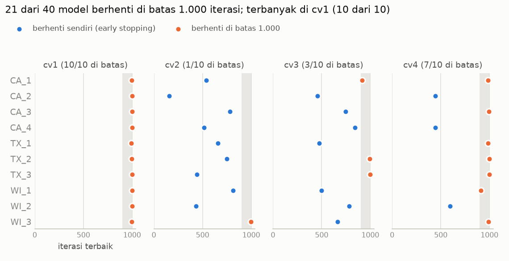

# Rekap Model Kuantil Final: Batas 1.000 Iterasi

> **Tanggal:** 24 Okt 2026. **Run:** `reports/runs/20261024_075605_xgb_quantile/`.
> Hanya fold CV (cv1–cv4, data ≤ d_1913). Holdout belum disentuh.
> Lanjutan: uji batas hingga 3.000 iterasi (§6). **Hasil:** batas 1.000 tetap dipakai;
> pohon tambahan sedikit memperburuk horizon. Lihat `reports/quantile_cap3000_comparison.md`.

---

## Ringkasan

- **40 model selesai** (10 toko × 4 fold CV), tanpa error. Training sempat terhenti
  karena listrik padam setelah 16 model, lalu dilanjutkan tanpa mengulang model yang sudah
  tersimpan.
- **P80 dan P90 terkalibrasi baik:** aktual ≤ P80 pada **81,0%** kasus dan ≤ P90 pada
  **89,4%** kasus, konsisten di semua toko dan fold.
- **Kuantil tidak pernah bersilangan** di 40 model.
- **Hasil identik dengan eksperimen:** 8 model CA_3/WI_2 memberi pinball yang sama persis
  (selisih 0,0), jadi training deterministik dan run final konsisten dengan eksperimen.
- **21 dari 40 model (53%) berhenti karena batas 1.000 iterasi**, bukan karena early
  stopping. Semua toko di cv1 (10/10) dan 7/10 di cv4. Ini alasan uji batas hingga
  3.000 (§6).

---

## 1. Konfigurasi

| | Nilai |
|---|---|
| Objective | `reg:quantileerror`, α = 0,1 / 0,5 / 0,8 / 0,9 dalam satu model per toko |
| eta | 0,2 (dipilih di `reports/phase5_models.md` §8) |
| Batas iterasi | **1.000**, early stopping 100 iterasi |
| Validasi early stopping | 28 hari terakhir sebelum cutoff (bukan horizon) |
| Pohon | max_depth 8, min_child_weight 10, subsample 0,8, colsample_bytree 0,8, max_bin 256, seed 42 |
| Data training | tanpa deretan nol ≥ 28 hari item laris (permintaan, bukan penjualan) |
| Perangkat | GPU (`device="cuda"`), xgboost 3.4.1 |

---

## 2. Hasil per fold (semua 30.490 deret)

Pinball: lebih kecil lebih baik. Satuannya **unit penjualan**, jadi hanya bisa
dibandingkan antar model di data yang sama, bukan antar toko.

| Fold | Horizon | Pinball P10 | P50 | P80 | P90 | **Rata-rata** |
|---|---|---:|---:|---:|---:|---:|
| cv1 | 4–31 Jan 2016 | 0,127 | 0,464 | 0,427 | 0,306 | **0,331** |
| cv2 | 1–28 Feb 2016 | 0,134 | 0,491 | 0,451 | 0,322 | **0,349** |
| cv3 | 29 Feb–27 Mar 2016 | 0,134 | 0,482 | 0,442 | 0,315 | **0,344** |
| cv4 | 28 Mar–24 Apr 2016 | 0,134 | 0,482 | 0,438 | 0,311 | **0,341** |
| **rata-rata ± sd** | | | | | | **0,341 ± 0,008** |

**Coverage** (porsi hari ketika aktual ≤ forecast kuantil):

| Fold | P10 (target 10%) | P50 (target 50%) | P80 (target 80%) | P90 (target 90%) |
|---|---:|---:|---:|---:|
| cv1 | 60,0% | 66,9% | 81,5% | 89,5% |
| cv2 | 58,3% | 65,0% | 80,5% | 89,0% |
| cv3 | 57,7% | 65,2% | 81,0% | 89,5% |
| cv4 | 56,6% | 64,5% | 81,0% | 89,6% |
| **rata-rata** | 58,1% | 65,4% | **81,0%** | **89,4%** |

**Cara membaca coverage P10 dan P50 yang jauh di atas target:** sekitar 60% hari
item-toko bernilai nol (`reports/eda.md`). Pada hari itu, forecast kuantil rendah juga
sering 0, dan "aktual 0 ≤ forecast 0" dihitung tercakup. Untuk data hitungan yang
didominasi nol, coverage kuantil rendah pasti jauh di atas targetnya. P80 dan P90 tidak
terdampak, dan keduanya yang dipakai simulasi stok (Fase 7).

---

## 3. Hasil per toko (rata-rata 4 fold)

| Toko | Pinball | Coverage P80 | Coverage P90 | Model di batas |
|---|---:|---:|---:|---:|
| CA_1 | 0,364 | 81,3% | 89,8% | 3/4 |
| CA_2 | 0,361 | 78,7% | 88,1% | 1/4 |
| CA_3 | 0,463 | 80,4% | 89,4% | 2/4 |
| CA_4 | 0,247 | 82,2% | 89,7% | 1/4 |
| TX_1 | 0,285 | 82,1% | 90,0% | 2/4 |
| TX_2 | 0,328 | 80,9% | 89,6% | 3/4 |
| TX_3 | 0,317 | 81,3% | 89,7% | 3/4 |
| WI_1 | 0,318 | 81,0% | 89,7% | 2/4 |
| WI_2 | 0,414 | 80,7% | 88,8% | 1/4 |
| WI_3 | 0,317 | 81,3% | 89,1% | 3/4 |

- Pinball tertinggi ada di toko yang paling ramai (CA_3, WI_2), karena satuannya unit.
  Ini **bukan** berarti modelnya paling buruk di toko itu.
- Coverage paling meleset ada di **CA_2** (P80 78,7%, P90 88,1%, sedikit di bawah target).
  Yang lain dalam ±2 poin dari target.

---

## 4. Model yang berhenti di batas 1.000 iterasi



Area abu-abu = iterasi 900–1.000. Model dengan iterasi terbaik di area ini tidak sempat
menjalankan 100 iterasi tunggu early stopping, jadi training berhenti karena **batas**,
bukan karena skor validasi berhenti membaik.

| Fold | Validasi early stopping (28 hari sebelum cutoff) | Event di jendela validasi | Model di batas |
|---|---|---|---:|
| cv1 | 7 Des 2015–3 Jan 2016 | Natal, Tahun Baru | **10/10** |
| cv2 | 4–31 Jan 2016 | Orthodox Christmas, MLK Day | 1/10 |
| cv3 | 1–28 Feb 2016 | Super Bowl, Valentine, Presidents Day | 3/10 |
| cv4 | 29 Feb–27 Mar 2016 | St Patrick's Day, Easter | 7/10 |

Fakta dari 21 model yang mentok:

- **16 dari 21** punya iterasi terbaik ≥ 990, dan **14 dari 21** ≥ 995. Skor validasinya
  masih membaik di iterasi-iterasi terakhir.
- Model yang tidak mentok berhenti di iterasi terbaik 160–844.
- Waktu rata-rata: 181 detik (mentok) vs 129 detik (tidak mentok).

### 4.1 Apakah ini overfitting?

**Kemungkinan besar bukan.** Justru sebaliknya:

- **Overfitting** = model terlalu menyesuaikan diri dengan data training sehingga skor
  di data validasi **memburuk**. Kalau itu terjadi, early stopping akan berhenti **lebih
  awal**, karena skor validasi tidak membaik selama 100 iterasi.
- **Mentok di batas** = skor validasi **masih membaik** sampai iterasi ke-1.000. Ini tanda
  model **belum selesai belajar** (*underfitting* ringan), bukan overfitting.

Tetapi ada satu kemungkinan yang mirip overfitting dan perlu dicek: skor di **jendela
validasi** terus membaik, sementara skor di **horizon** (28 hari yang diramal) tidak ikut
membaik atau malah memburuk. Ini bisa terjadi kalau jendela validasinya tidak mewakili
horizon. **Dugaan** (belum dibuktikan): jendela validasi cv1 berisi Natal–Tahun Baru dan
cv4 berisi Easter, dua periode yang polanya tidak biasa. Model mungkin terus "mengejar"
pola liburan itu. Fold yang jendela validasinya tanpa event besar (cv2) hampir tidak ada
yang mentok.

Uji batas hingga 3.000 (§6) menjawab dua hal ini sekaligus.

---

## 5. Biaya komputasi

| | Nilai |
|---|---|
| Total waktu training | 6.240 detik (104 menit), rata-rata 156 detik per model |
| Ukuran model | 13,1–39,3 MB |
| Puncak RAM proses | 4,54 GB (sesi kedua) |
| RAM tersedia terendah di laptop | 2,71 GB |

---

## 6. Rencana uji batas hingga 3.000 iterasi

Ditetapkan **sebelum** hasilnya terlihat. Kode sudah disiapkan, tetapi run belum dijalankan.

### 6.1 Riwayat rancangan

Rancangan pertama menaikkan batas ke 1.500. Run itu dihentikan setelah 1 model (CA_1 cv1),
karena rencananya masih didiskusikan. Satu-satunya hasil itu menunjukkan model **masih**
mentok di 1.500 (iterasi terbaik 1.492), dan pinball horizonnya 0,3598 vs 0,3591 di batas
1.000. Hasil itu tidak dipakai. Rancangan diganti menjadi batas 3.000 dengan titik baca,
supaya beberapa batas bisa dinilai sekaligus dalam satu run.

### 6.2 Rancangan

- **Satu run berbatas 3.000 iterasi**, parameter lain sama persis dengan run 1.000.
- **Titik baca 1.000 / 1.500 / 2.000 / 2.500 / 3.000.** Training deterministik, jadi pohon
  1..C model berbatas 3.000 identik dengan model berbatas C. Untuk tiap C, iterasi terbaik =
  skor validasi terbaik di antara iterasi 1..C (sama dengan pilihan early stopping kalau
  batasnya C), lalu horizon diprediksi dengan pohon sampai iterasi itu
  (`train.emulate_cap`). Hasilnya setara dengan 5 run terpisah, tanpa melatih ulang 5 kali.
- **21 model yang mentok** dilatih dengan batas 3.000.
- **17 model yang tidak mentok tidak dilatih ulang.** Model ini berhenti sendiri di iterasi
  terbaik 160–844, artinya training berhenti di iterasi 260–944, sebelum batas 1.000. Dengan
  batas berapa pun ≥ 1.000, hasilnya identik. Prediksinya disalin dan ditandai
  `reused_from_run`.
- **2 model tidak mentok tetap dilatih ulang sebagai bukti** (CA_2 cv2 dan WI_2 cv2).
- Kurva skor validasi **lengkap** disimpan per model (`es_curve`).

### 6.3 Pemeriksaan otomatis (harus lolos sebelum hasil dipakai)

1. **Titik 1.000 = run 1.000.** Untuk ke-23 model yang dilatih, iterasi terbaik dan pinball
   di titik 1.000 harus **sama persis** dengan run 1.000 (`check_vs_reference`). Kalau ada
   yang berbeda, cara meniru batas dianggap salah dan hasil tidak dipakai.
2. **Cara meniru batas = early stopping XGBoost.** Di titik 3.000, iterasi terbaik hasil
   peniruan harus sama dengan `booster.best_iteration`. Kalau berbeda, training berhenti
   dengan error.

### 6.4 Pengaman terhadap underfitting dan overfitting

| Risiko | Pengaman |
|---|---|
| **Underfitting** (model belum selesai belajar) | Batas dinaikkan ke 3.000. Jumlah model yang masih mentok di tiap batas dicatat. |
| **Overfitting ke data training** | Early stopping tetap aktif (berhenti jika skor validasi tidak membaik 100 iterasi), dengan validasi di luar data fitting. |
| **"Mengejar" jendela validasi** (validasi membaik, horizon tidak) | Pinball horizon dinilai di setiap titik batas. Per model, perubahan skor validasi dibandingkan dengan perubahan pinball horizon. |
| **Memilih batas yang kebetulan bagus di CV** | Titik baca dan aturan keputusan ditetapkan di sini sebelum hasil keluar. Holdout tetap tidak disentuh. |

**Parameter lain sengaja tidak diubah** (depth, min_child_weight, eta, regularisasi).
Mengubahnya bersamaan dengan batas iterasi membuat perbandingan tidak lagi setara, dan
setiap perubahan parameter butuh eksperimen sendiri. Kalau hasil uji ini menunjukkan
model "mengejar" jendela validasi, perubahan parameter (misalnya regularisasi lebih kuat)
akan diusulkan sebagai eksperimen terpisah.

### 6.5 Aturan keputusan

Dari 5 titik batas (1.000, 1.500, 2.000, 2.500, 3.000), pilih **batas terkecil** yang:

- pinball rata-rata 4 fold (semua 30.490 deret) **dalam 1%** dari pinball terbaik di semua
  batas, dan
- coverage P80 dan P90 tidak menjauh dari target lebih dari 1 poin persen dibanding batas
  1.000.

Aturan ini sejalan dengan pemilihan eta: kalau selisih ketelitian < 1%, pilih yang lebih
cepat. Hasilnya dihitung otomatis oleh `quantile_cap_report.choose_cap`. Hasil cek
"mengejar jendela validasi" dilaporkan apa adanya, apa pun keputusannya.

### 6.6 Perkiraan waktu

Terukur dari CA_1 cv1: 0,162 detik per pohon, ditambah ±11 detik biaya tetap per model.

| Skenario | Total |
|---|---:|
| Semua model berhenti sendiri tak lama setelah 1.000 | ±1,3 jam |
| Rata-rata berhenti di sekitar 2.000 | ±2,3 jam |
| Semua model jalan sampai 3.000 | ±3,1 jam |

Prediksi di 5 titik baca menambah waktu per model. Besarnya belum diukur, dan akan
tercatat di `checkpoint_predict_seconds`.

### 6.7 Perintah

```powershell
python -m retailfc.quantile_final --config config.yaml --max-rounds 3000 `
    --checkpoints 1000 1500 2000 2500 3000 `
    --reuse-uncapped-from reports/runs/20261024_075605_xgb_quantile --retrain CA_2:cv2 WI_2:cv2
python -m retailfc.quantile_cap_report --runs reports/runs/20261024_075605_xgb_quantile `
    reports/runs/<stamp>_xgb_quantile_r3000
```

---

## 7. Keterbatasan

- **Belum ada baseline kuantil.** Model terbukti terkalibrasi di P80/P90, tetapi belum
  dibandingkan dengan cara sederhana (misalnya kuantil empiris 28 hari terakhir). Pembanding
  ini perlu ada, paling lambat di simulasi stok Fase 7.
- **Pinball bergantung skala.** Angka antar toko tidak bisa dibandingkan langsung, dan
  angka di laporan ini (semua 30.490 deret) tidak bisa dibandingkan dengan eksperimen di
  `reports/data/quantile_experiments.json` (hanya item yang sudah pernah laku, 2 toko).
- **Coverage P10/P50 tidak informatif** untuk data yang didominasi nol (§2).
- Hanya fold CV. Fold khusus (Easter, akhir tahun) dan holdout belum dijalankan untuk
  model kuantil.

---

## Lampiran: file

| File | Isi |
|---|---|
| `reports/runs/20261024_075605_xgb_quantile/metrics.json` | pinball dan coverage per fold, per toko × fold, cek vs eksperimen |
| `reports/runs/20261024_075605_xgb_quantile/infos.json` | iterasi terbaik, waktu, crossing, `hit_cap` per model |
| `reports/data/quantile_cap_r1000.json` | ringkasan model di batas per fold dan per toko |
| `data/processed/preds/<fold>/xgb_quantile.npy` | prediksi P10/P50/P80/P90 (30.490 × 28 × 4) |
| `src/retailfc/quantile_final.py` | training final (tahan terhenti) |
| `src/retailfc/quantile_cap_report.py` | grafik dan perbandingan antar batas iterasi |
