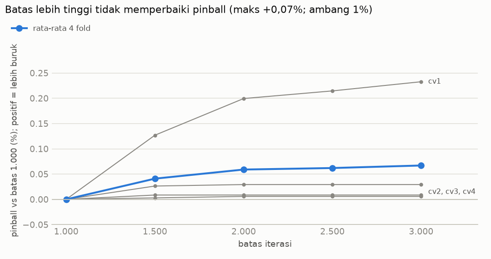
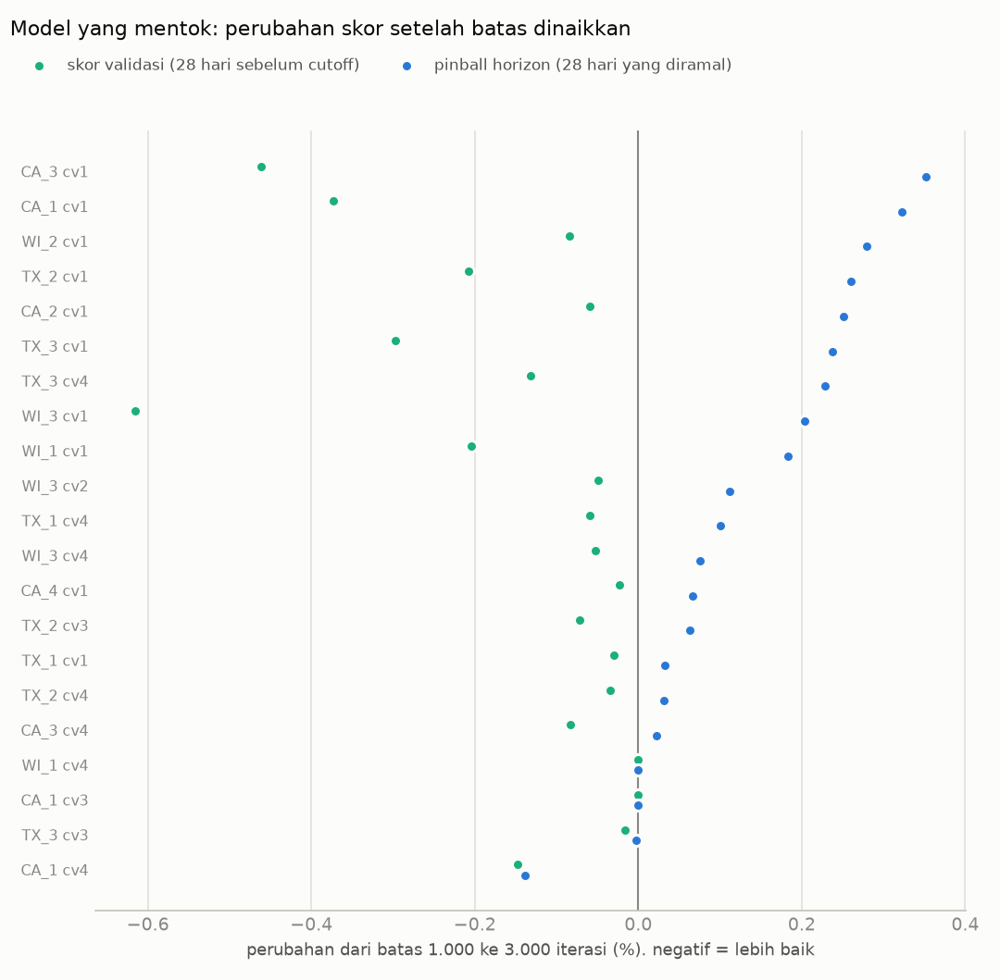
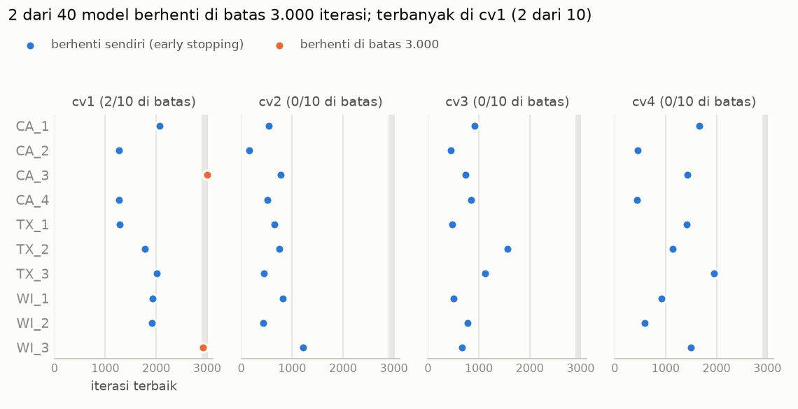

# Uji Batas Iterasi Model Kuantil: 1.000 vs hingga 3.000

> **Tanggal:** 24 Okt 2026. **Run acuan (batas 1.000):** `reports/runs/20261024_075605_xgb_quantile/`.
> **Run uji (batas 3.000, titik baca 1.000/1.500/2.000/2.500/3.000):**
> `reports/runs/20261024_120716_xgb_quantile_r3000/`. Rancangan dan aturan keputusan
> ditetapkan sebelumnya di `reports/quantile_cap1000.md` §6. Hanya fold CV; holdout belum disentuh.

---

## Ringkasan

- **Keputusan sesuai aturan: tetap batas 1.000.** Pinball terbaik justru ada di batas 1.000
  (0,34133). Batas yang lebih tinggi sedikit **lebih buruk**, paling jauh +0,07% di 3.000.
- **Model yang mentok di 1.000 bukan underfitting yang merugikan.** Dengan pohon tambahan,
  skor validasi membaik di 19 dari 21 model, tetapi pinball horizon **memburuk di 17 model**,
  membaik di 2, dan tetap di 2.
- **Pohon tambahan membuat model sedikit overfitting ke jendela validasi**, paling jelas di
  cv1. Kesepuluh model cv1 memburuk (+0,03% sampai +0,35%). Jendela validasi cv1 adalah
  7 Des 2015–3 Jan 2016, periode Natal–Tahun Baru.
- **Pemeriksaan lolos semua:** titik 1.000 identik dengan run acuan di 23 dari 23 model
  (selisih pinball 0,0, iterasi terbaik sama), dan 2 model pembukti identik.
- Besarnya efek sangat kecil. Secara praktis, 1.000 dan 3.000 setara ketelitiannya, tetapi
  batas 1.000 rata-rata **±1,7× lebih cepat** untuk model yang terdampak (181 s vs 308 s).

---

## 1. Hasil per batas (40 model, semua 30.490 deret, rata-rata 4 fold CV)



| Batas | Pinball | vs 1.000 | Coverage P80 | Coverage P90 | Model masih di batas |
|---:|---:|---:|---:|---:|---:|
| **1.000** | **0,34133** | – | 81,0% | 89,4% | 21 |
| 1.500 | 0,34147 | +0,04% | 81,0% | 89,3% | 13 |
| 2.000 | 0,34153 | +0,06% | 81,0% | 89,3% | 7 |
| 2.500 | 0,34154 | +0,06% | 81,0% | 89,3% | 2 |
| 3.000 | 0,34156 | +0,07% | 81,0% | 89,3% | 2 |

**Per fold** (perubahan pinball dari batas 1.000 ke 3.000):

| Fold | Jendela validasi | Batas 1.000 | Batas 3.000 | Perubahan |
|---|---|---:|---:|---:|
| cv1 | 7 Des 2015–3 Jan 2016 (Natal, Tahun Baru) | 0,33088 | 0,33165 | **+0,23%** |
| cv2 | 4–31 Jan 2016 | 0,34949 | 0,34952 | +0,01% |
| cv3 | 1–28 Feb 2016 | 0,34364 | 0,34366 | +0,01% |
| cv4 | 29 Feb–27 Mar 2016 (Easter) | 0,34130 | 0,34140 | +0,03% |

**Aturan keputusan** (`quantile_cap1000.md` §6.5): batas terkecil yang pinball-nya dalam 1%
dari pinball terbaik, dengan coverage P80/P90 tidak menjauh dari target > 1 poin. Pinball
terbaik ada di batas 1.000 sendiri, jadi **batas 1.000 terpilih**. Coverage P80/P90 praktis
tidak berubah di semua batas (selisih ≤ 0,1 poin).

---

## 2. Apa yang terjadi pada 21 model yang mentok



Hijau = perubahan skor **validasi** (28 hari sebelum cutoff, yang dipakai early stopping).
Biru = perubahan pinball **horizon** (28 hari yang diramal). Negatif = lebih baik.

| | Jumlah model |
|---|---:|
| Skor validasi membaik dengan pohon tambahan | 19 dari 21 |
| Pinball horizon **memburuk** | **17** |
| Pinball horizon membaik | 2 (CA_1 cv4 −0,14%, TX_3 cv3 −0,003%) |
| Tidak berubah (iterasi terbaik sama) | 2 (CA_1 cv3, WI_1 cv4) |

**Rata-rata per fold** untuk model yang mentok:

| Fold | Model | Skor validasi | Pinball horizon |
|---|---:|---:|---:|
| cv1 | 10 | −0,24% | **+0,22%** |
| cv2 | 1 | −0,05% | +0,11% |
| cv3 | 3 | −0,03% | +0,02% |
| cv4 | 7 | −0,07% | +0,05% |

**Uji tanda (kasar):** 17 memburuk vs 2 membaik, jadi peluang pola ini muncul kalau arahnya
sebenarnya acak (50:50) adalah p ≈ 0,0007. Ini uji kasar, karena model antar fold dan toko
tidak sepenuhnya independen. Tetapi arah "memburuk" jelas konsisten, bukan kebetulan satu
model.

**Iterasi terbaik di batas 3.000:**



- 19 dari 21 model berhenti sendiri di antara 917 dan 2.070 iterasi.
- 2 model masih mentok di 3.000 (CA_3 cv1 dan WI_3 cv1), keduanya di cv1, dan keduanya terus
  memburuk di setiap titik. Contoh WI_3 cv1: 0,3043 → 0,3044 → 0,3045 → 0,3046 → 0,3049.
- 3 model (CA_1 cv3, WI_1 cv4, TX_3 cv3) ternyata hampir tidak butuh pohon tambahan. Di run
  1.000, mereka tercatat "mentok" hanya karena tidak sempat menjalankan 100 iterasi tunggu
  setelah iterasi terbaiknya.

---

## 3. Interpretasi

**Mentok di batas 1.000 bukan tanda underfitting yang merugikan.** Model memang belum
"selesai" menurut skor validasi, tetapi pohon-pohon tambahan itu mempelajari detail yang
**hanya ada di jendela validasi** dan tidak terulang di horizon. Dari sisi horizon, itu
overfitting ringan. Dugaan awal soal overfitting jadi terbukti sebagian: bukan di batas
1.000, tetapi **saat batas dinaikkan melewati 1.000**.

**Efeknya terbesar di cv1**, yang jendela validasinya Natal–Tahun Baru. Data total 10 toko
menunjukkan periode itu berbeda dari Januari:

| | Jendela validasi cv1 (Des) | Horizon cv1 (Jan) |
|---|---:|---:|
| Sabtu vs rata-rata minggu | 1,16× | 1,29× |
| Rabu vs rata-rata minggu | 0,95× | 0,83× |
| Porsi HOBBIES | 10,9% | 9,7% |
| 25 Des | 14 unit (praktis tutup) | – |
| Senin 28 Des vs Senin 21 Des | −16% (lesu setelah Natal) | – |

Pola mingguan di Desember lebih rata dan HOBBIES lebih tinggi. Pohon tambahan "mengejar"
pola ini di validasi, lalu meleset di Januari. **Catatan:** hubungan sebab-akibat ini masih
dugaan yang konsisten dengan data, belum diuji langsung (misalnya dengan melatih ulang cv1
memakai jendela validasi non-Desember).

**Batas 1.000 berfungsi sebagai pengaman.** Dengan eta 0,2, batas 1.000 mencegah model
terlalu lama mengejar jendela validasi, terutama di periode liburan.

---

## 4. Implikasi

1. **Konfigurasi final tidak berubah:** eta 0,2, batas 1.000, early stopping 100
   (`config.yaml → model.xgb_quantile`). Prediksi kuantil final yang dipakai untuk Fase 6–7
   tetap dari run acuan: `data/processed/preds/<fold>/xgb_quantile.npy`.
2. **Fase 8 (Indonesia):** jendela validasi yang berisi event besar (Ramadan/Lebaran) bisa
   memberi masalah yang sama, bahkan lebih besar. Pertimbangkan mengeluarkan hari event
   besar dari jendela validasi, atau memakai jendela yang mirip horizon.
3. **Holdout** (cutoff d_1913): jendela validasinya 28 Mar–24 Apr 2016. Easter 2016
   (27 Mar) jatuh sehari sebelumnya, jadi tidak ada event besar di jendela itu.
4. **Eksperimen lanjutan (opsional, belum dijalankan):** uji langsung dugaan Natal dengan
   jendela validasi alternatif untuk cv1.

---

## 5. Biaya komputasi

| | Nilai |
|---|---|
| Model yang dilatih | 23 (21 mentok + 2 pembukti); 17 disalin dari run acuan |
| Total waktu training | 6.627 detik (±110 menit) |
| Waktu per model mentok | 181 s (batas 1.000) vs 308 s (batas 3.000), rata-rata |
| Waktu membaca 5 titik batas | total 96 detik untuk 23 model |
| Ukuran model terbesar | 90,8 MB |
| Puncak RAM proses | 4,71 GB |
| RAM tersedia terendah di laptop | 2,85 GB |

---

## 6. Keterbatasan

- Efek yang diukur sangat kecil (< 0,4% per model, 0,07% total). Kesimpulannya adalah
  "batas lebih tinggi tidak membantu", bukan "batas lebih tinggi jauh lebih buruk".
- Belum ada ukuran noise seed untuk model kuantil, jadi perubahan < 0,1% per model belum
  bisa dibedakan dari noise. Arah yang konsisten (17 dari 19) adalah bukti utamanya.
- Penjelasan pola Natal belum diuji langsung (§3).
- Hanya fold CV. Fold khusus dan holdout belum dijalankan untuk model kuantil.

---

## Lampiran: file dan perintah

| File | Isi |
|---|---|
| `reports/data/quantile_cap_comparison.json` | tabel per batas, keputusan aturan, rincian 21 model yang mentok |
| `reports/runs/20261024_120716_xgb_quantile_r3000/metrics.json` | pinball/coverage per batas, per fold, per toko; cek vs run acuan |
| `reports/runs/20261024_120716_xgb_quantile_r3000/infos.json` | kurva validasi lengkap dan hasil per titik batas per model |
| `data/processed/preds/<fold>/xgb_quantile_r3000_c<C>.npy` | prediksi kuantil untuk tiap batas C (tidak ikut git) |

```powershell
python -m retailfc.quantile_final --config config.yaml --max-rounds 3000 `
    --checkpoints 1000 1500 2000 2500 3000 `
    --reuse-uncapped-from reports/runs/20261024_075605_xgb_quantile --retrain CA_2:cv2 WI_2:cv2
python -m retailfc.quantile_cap_report --runs reports/runs/20261024_075605_xgb_quantile `
    reports/runs/20261024_120716_xgb_quantile_r3000
```
